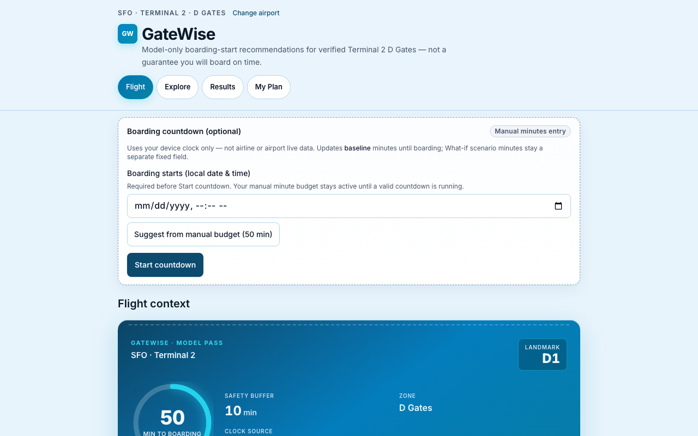
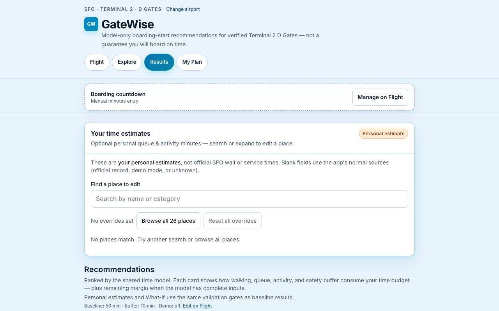

# Mivvu

Airport facility discovery for travelers — start at an airport, search and filter what’s nearby, open details, and keep a short list on this device.

- **Live site:** [https://mivvu.vercel.app](https://mivvu.vercel.app)
- **Source:** [github.com/cucu071212/Mivvu](https://github.com/cucu071212/Mivvu)
- **Documentation revision:** `GW-PLAN-REV-2026-10-29` — see [`docs/plan-revisions.md`](docs/plan-revisions.md)

| Airport | Live experience (verified against production UI + `main`) |
| --- | --- |
| **ICN (Incheon)** | Full directory browse: search, terminal and category filters, facility details, device-local saved list |
| **SFO (San Francisco)** | Browse shell is live; **facility information is currently unavailable** |

Same product also answers at the historical Vercel alias [https://gate-wise-iota.vercel.app](https://gate-wise-iota.vercel.app) (still serves Mivvu). Prefer **mivvu.vercel.app** as the current-facing link.

## What it does today

Mivvu is a **mobile-first** web app. Choose ICN or SFO from the entry screen, then browse facilities without setting up a flight.

### ICN — live directory

On [`/icn`](https://mivvu.vercel.app/icn):

- **Search** facilities by name, location text, or category (KO/EN UI; search follows the active locale).
- **Terminal filters** (all / T1 / concourse / T2) and **category** type filters.
- **Facility details** with snapshot-backed fields (hours text, location labels, optional goods/services enrichment where adopted).
- **Saved facilities** on [`/icn/saved`](https://mivvu.vercel.app/icn/saved) — stored in **this browser only** (`localStorage`); not synced across devices or accounts.

Listings come from **saved ICN snapshots** shipped with the app — not a live open/closed feed, live queues, GPS coordinates, or measured walking times. The product labels snapshot limits in-product.

### SFO — browse shell only

On [`/sfo`](https://mivvu.vercel.app/sfo):

- The **same browse layout** as ICN is available (language toggle, chrome, disabled search/filters).
- Status copy: **facility information is not available** (KO: 시설 정보를 이용할 수 없습니다).
- Legacy GateWise demo URLs (`/flight`, `/explore`, `/recommendations`, `/plan`) **redirect to `/sfo`** on the public site. Demo code remains in the repository for history and harnessed tests; it is not the public SFO experience today.

## Honest limits (current product)

- No claim of **live queues**, occupancy, or boarding feeds.
- No claim of **official indoor walking routes** or measured gate-to-facility times.
- No claim of an **airport partnership** or exclusive official dataset access beyond what release notes and provenance docs record.
- Published hours text is **informational snapshot text**, not a guarantee the place is open now.
- ICN coverage is large but not promised complete for the whole airport.

Product rules: [`PLAN.md`](./PLAN.md). Agent collaboration rules: [`AGENTS.md`](./AGENTS.md).

## Stack

- **Next.js 16** App Router, **React 19**, **TypeScript**, **Tailwind CSS v4**
- Tests: Vitest (unit/component) and Playwright (E2E; SFO demo harness flagged in `package.json`)
- Hosting: Vercel

No auth, database, payments, or production indoor navigation in the current product.

## Local development

Requires Node.js 20+ and npm 10+.

```bash
npm install
npm run dev
```

Open [http://localhost:3000](http://localhost:3000). No environment variables are required for the local browse demo. Do not commit secrets.

| Command | Purpose |
| --- | --- |
| `npm run dev` | Dev server |
| `npm run build` | Production build |
| `npm run start` | Serve the production build |
| `npm run lint` | ESLint |
| `npm test` | Vitest |
| `npx tsc --noEmit` | Typecheck |
| `npm run test:e2e:run` | Playwright (after `npx playwright install chromium`) |
| `npm run quality:icn-snapshots` | ICN snapshot quality check |

Canonical routes: `/` (entry), `/icn`, `/icn/f/...` (detail), `/icn/saved`, `/sfo`. Legacy preview paths `/preview/mivvu-entry` and `/preview/mivvu-entry/icn` redirect to `/` and `/icn`.

## Historical context — GateWise hackathon (SFO)

Mivvu grew out of **GateWise**, a HackPSU-era **boarding-time planner** demo for **SFO Terminal 2 D Gates**:

- Time-budget recommendations, What-if, and a two-stop **demo** planner.
- Model-only math: outbound + return + queue + activity + one safety buffer; unknowns never zero-filled.
- D→D walks and queue/activity minutes were **labeled demo estimates**, not official SFO measurements.

Those demo features belong to **hackathon history**. They are preserved in source, submission docs, and QA archives; they are **not** what the public `/sfo` shell shows today.

| Historical record | Purpose |
| --- | --- |
| [`docs/submission/RELEASE_FACTS.md`](docs/submission/RELEASE_FACTS.md) | SFO hackathon production SHA `c9c163c` and deployment facts |
| [`docs/submission/MIVVU_RELEASE_2026-10-28.md`](docs/submission/MIVVU_RELEASE_2026-10-28.md) | First Mivvu entry + ICN browse production record |
| [`docs/submission/MIVVU_RELEASE_2026-10-28-icn-search.md`](docs/submission/MIVVU_RELEASE_2026-10-28-icn-search.md) | ICN search / snapshot integration follow-on |
| [`docs/submission/DEVPOST_TECHNICAL_BRIEF.md`](docs/submission/DEVPOST_TECHNICAL_BRIEF.md) | Hackathon technical brief |
| [`docs/submission/FEATURE_VERIFICATION_MATRIX.md`](docs/submission/FEATURE_VERIFICATION_MATRIX.md) | Feature verification matrix |
| [`docs/submission/KNOWN_LIMITATIONS.md`](docs/submission/KNOWN_LIMITATIONS.md) | Known limitations (hackathon-era) |
| [`docs/submission/DEMO_RUNBOOK.md`](docs/submission/DEMO_RUNBOOK.md) | Demo runbook |
| [`docs/archive/hackathon-sfo-through-phase-c/`](docs/archive/hackathon-sfo-through-phase-c/) | Archived SFO roadmap |

Handoffs under [`docs/handoffs/`](docs/handoffs/) and QA under [`docs/qa/`](docs/qa/) remain the evidence trail for ICN slices and older SFO work — **not** live authorization to re-enable demo claims on the public site.

Representative **historical** GateWise UI screenshots (hackathon polish set; not a claim about current `/sfo`):

| Flight | Results | Two-stop (demo) |
| --- | --- | --- |
|  |  |  |

## Production notes

| Item | Value |
| --- | --- |
| Current-facing alias | https://mivvu.vercel.app |
| Historical / alternate alias | https://gate-wise-iota.vercel.app (serves the same Mivvu entry) |
| `main` tip used for this README pass | `7b7fead` — `Merge pull request #23` (verify before treating as forever-current) |
| SFO hackathon product SHA (record) | `c9c163cd7ee51d270e1a079daf84ffaf37b5952a` — [`RELEASE_FACTS.md`](docs/submission/RELEASE_FACTS.md) |
| Early Mivvu/ICN release SHA (record) | `556943b020749405f34f4b21622fbd1f5993bce0` — [`MIVVU_RELEASE_2026-10-28.md`](docs/submission/MIVVU_RELEASE_2026-10-28.md) |

**Deployment caution:** Merging or pushing to `main` may trigger an automatic Vercel **production** deployment. Recorded SHAs are not fresh proof of what is serving until re-checked against the live alias.

## Attribution

- ICN facility content: saved snapshots derived from the public 공항서비스 API reference documented in project data notes — documentation of an API is **not** proof of partnership, completeness, or live accuracy.
- Historical SFO facility names, hours text, and listing URLs: [SFO Shop, Dine & Relax](https://www.flysfo.com/passengers/shop-dine-relax) and related official SFO pages (research dates on rows; typically 2026-10-25). See [`docs/data-provenance.md`](docs/data-provenance.md).
- Approved images (hackathon-era): Wikimedia CC0 and Unsplash stills listed in [`docs/FACILITY-IMAGE-RIGHTS-AUDIT.md`](docs/FACILITY-IMAGE-RIGHTS-AUDIT.md). Official SFO listing photos are **not** reused.

## License

This repository does not currently include a license file.
