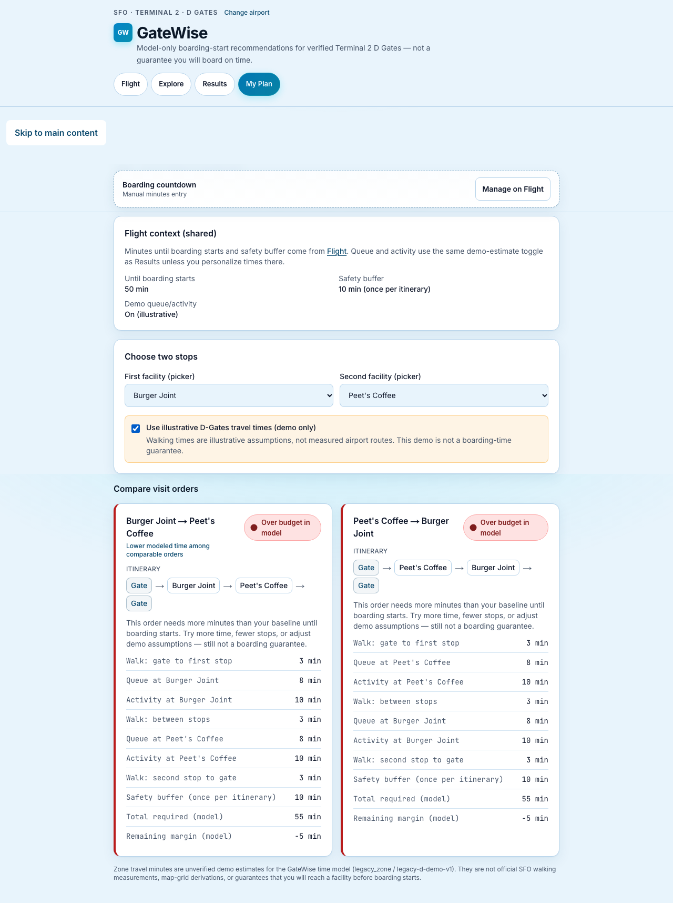

# GateWise

*Your airport. Your gate. Your time.*

Airport maps show where a café or shop is. GateWise helps a traveler see whether a visit still fits **before boarding starts** — with every modeled minute labeled, and missing data left unknown.

**Live demo:** [https://gate-wise-iota.vercel.app](https://gate-wise-iota.vercel.app)  
**Source:** [github.com/cucu071212/GateWise](https://github.com/cucu071212/GateWise)  
**Approved release:** `c9c163cd7ee51d270e1a079daf84ffaf37b5952a`

## The problem

Knowing that Peet’s is near Gate D7 does not answer the only question that matters in a terminal: *do I have time to go, wait, stay, and get back?* Most airport tools hide that budget. GateWise makes the arithmetic visible and refuses to invent the minutes it does not have.

## What it does

GateWise is a **model-only** boarding-start planner for **San Francisco International Airport (SFO)**.

| Surface | What you can do |
| --- | --- |
| **Welcome** | Choose SFO. Other listed airports are coming soon. |
| **Flight** | Enter minutes until boarding starts, a safety buffer, optional boarding countdown, and an optional demo wait/activity toggle. |
| **Explore** | Browse **26** sourced facilities across SFO terminals. Open facility details, published hours, official listing links, and Location Guidance. |
| **Results** | Time-model **12** Terminal 2 D Gates facilities. Rank feasible / tight / over budget / unknown / ineligible. |
| **What-if** | Change remaining minutes or a queue adjustment. Same engine as the baseline. Baseline stays on screen. |
| **My Plan** | Optional **demo** two-stop planner. Travel stays Unknown until you opt in to illustrative D-Gates walks. |
| **Location Guidance** | GW-B sourced area evidence for 12 listings (`verified_area` or `unknown`). No measured indoor coordinates or drawn routes. |

**26 browse / 12 recommend.** Time-based recommendations use the `legacy-d-v1` manifest only. Browse-only rows (other terminals, or T2 D listings outside that manifest) stay ineligible for the model.

## Screenshots

Representative UI from the in-repo QA set (not a claim that every pixel matches a later polish pass):

| Flight | Results | Two-stop (demo) |
| --- | --- | --- |
|  |  |  |

More: `docs/qa/gw-ux-polish/`, `docs/qa/facility-imagery/`, `docs/gw-e2-preview/`.

## Stack and architecture

- **Next.js 16** App Router, **React 19**, **TypeScript**, **Tailwind CSS v4**
- Local data: `src/data/facilities.json`, `src/data/travel-times.ts`, `src/data/sfo-t2-location-evidence.ts`
- Pure calculation: `src/lib/recommend.ts` (single-stop + What-if), `src/lib/plan-two-stop-legacy.ts` (two-stop demo)
- Tests: Vitest (unit/component) and Playwright (E2E)
- Hosting: Vercel

No auth, database, payments, live flight feed, boarding-pass scanner, or production indoor navigation.

```text
required = outbound + return + queue + activity + safety buffer
margin   = minutes until boarding starts − required
```

| Margin | Classification |
| --- | --- |
| ≥ 10 | Feasible in model |
| 0–9 | Tight in model |
| < 0 | Over budget |
| Missing essential minutes | Unknown (never zero-filled) |

Directed outbound and return are evaluated separately. `minutesUntilBoarding` means **minutes until boarding starts**, not gate closure.

## Demo mode and Unknown

Official facility records keep **queue and activity as unknown**. GateWise does not invent them.

- **Flight → Demo estimates:** labeled in-memory **8 min queue** and **10 min activity**. Off by default.
- **D→D walking:** unverified **3 min** demo estimate per directed leg (`legacy_zone` / `legacy-d-demo-v1`). Not a measured SFO walk.
- **My Plan travel:** stays Unknown until **Use illustrative D-Gates travel times** is checked.
- Personal overrides on Results are user-supplied estimates, not official waits.

A “feasible” result is a **model outcome**, not a promise you will board on time.

## Local development

Requires Node.js 20+ and npm 10+.

```bash
npm install
npm run dev
```

Open [http://localhost:3000](http://localhost:3000). No environment variables are required for the local demo. Do not commit secrets.

| Command | Purpose |
| --- | --- |
| `npm run dev` | Dev server |
| `npm run build` | Production build |
| `npm run start` | Serve the production build |
| `npm run lint` | ESLint |
| `npm test` | Vitest |
| `npx tsc --noEmit` | Typecheck |
| `npm run test:e2e:run` | Playwright (after `npx playwright install chromium`) |

## Production

| Item | Value |
| --- | --- |
| Alias | https://gate-wise-iota.vercel.app |
| Git SHA (this repo) | `c9c163cd7ee51d270e1a079daf84ffaf37b5952a` |
| Vercel deployment | `dpl_AVbZEGA48z5evM1GRRssLPfAgQLF` (READY, production) |

Vercel inspect metadata does **not** currently expose a Git SHA. Treat the repo SHA plus the lead-recorded deployment ID as the release pair. Preview deployments may require Vercel Authentication.

## Limitations

- SFO only. One recommend zone: Terminal 2 D Gates.
- Walking, queue, and activity times are demo estimates or unknown — not live airport data.
- Published hours are informational, not live open/closed status.
- Location Guidance is listing-backed area evidence, not a floor plan or route.
- Two-stop planner is an in-app demo, not a certified itinerary tool.
- Most facility photos are category illustrations. See [`docs/FACILITY-IMAGE-RIGHTS-AUDIT.md`](docs/FACILITY-IMAGE-RIGHTS-AUDIT.md).

## What’s next (not in this freeze)

Verified indoor walking times (**G-Data HOLD**), additional airports, and live operations are out of scope until separately authorized. Product rules: [`PLAN.md`](./PLAN.md). Agent rules: [`AGENTS.md`](./AGENTS.md).

## Attribution

- Facility names, hours text, and listing URLs: [SFO Shop, Dine & Relax](https://www.flysfo.com/passengers/shop-dine-relax) and related official SFO pages. Research date recorded on each row (typically 2026-10-25).
- Provenance: [`docs/data-provenance.md`](docs/data-provenance.md).
- Approved images: Wikimedia CC0 (Compass Books / Books Inc.) and Unsplash illustrative stills listed in the rights audit. Official SFO listing photos are **not** reused.

## License

This repository does not currently include a license file.

## Submission package

Hackathon technical drafts (not presentation slides):

- [`docs/submission/RELEASE_FACTS.md`](docs/submission/RELEASE_FACTS.md)
- [`docs/submission/DEVPOST_TECHNICAL_BRIEF.md`](docs/submission/DEVPOST_TECHNICAL_BRIEF.md)
- [`docs/submission/FEATURE_VERIFICATION_MATRIX.md`](docs/submission/FEATURE_VERIFICATION_MATRIX.md)
- [`docs/submission/KNOWN_LIMITATIONS.md`](docs/submission/KNOWN_LIMITATIONS.md)
- [`docs/submission/DEMO_RUNBOOK.md`](docs/submission/DEMO_RUNBOOK.md)
