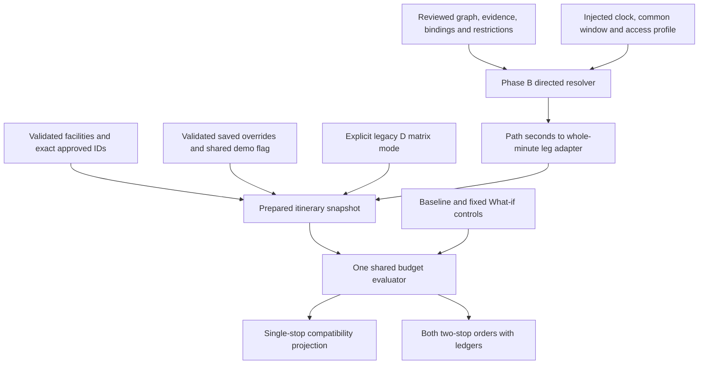

# Phase B × GW-E — Unified routing and itinerary architecture

**Assignment:** Architecture integration and independent verification only. No runtime implementation, production-data edits, merge, deployment, or gate approval.

**Reviewer:** Engineering Support Codex. **Date:** 2026-10-25 (America/New_York).

**Verdict:** The designs are compatible in purpose, but **not directly API-compatible**. Adopt Phase B's evidence, endpoint, access, seconds-envelope, and validity model; retain GW-E's explicit stop ledger and both-order evaluation. Replace the earlier GW-E routing port with the contracts below. All proposed changes await the human lead's approval. **G-B0, G-B1, G-Data, and G-E remain unapproved by this study; implementation readiness is HOLD.**

## 1. Actual sources and baseline reviewed

Both requested remote branches were fetched successfully. Their tips exactly matched the supplied SHAs. The source documents were read from Git objects at those commits, not from completion summaries. This integration branch starts at the current fetched main baseline; it does not merge either research branch or duplicate their documents.

| Source | Exact commit / content identity | Material reviewed |
| --- | --- | --- |
| [Phase B routing research](https://github.com/cucu071212/GateWise/blob/452686683cb84ff2fa156fc3ea13d8a3b159aa9d/docs/walking-time-policy.md) | `452686683cb84ff2fa156fc3ea13d8a3b159aa9d`; branch `codex/gw-b-r001-routing-research` | 574 lines; §2 evidence/licensing, §3 current contracts, §4–§7 graph and budget architecture, T01–T53, gates. |
| [GW-E design](https://github.com/cucu071212/GateWise/blob/d32cdd969f443a967f4d7a376138f37f5b31a5bd/docs/GW-E-two-stop-planner-design.md) | `d32cdd969f443a967f4d7a376138f37f5b31a5bd`; branch `codex/gw-e-two-stop-design` | 656 lines; equations, routing port, ledger, ranking, countdown, E01–E55, gates. |
| Current implementation and planning | `47c07028e1eccb3515f8bd8bfddd80f1c90fccdd` | Fetched `origin/main`; both studies share this application baseline. |

Source Markdown SHA-256: B=`ec1b3808c14ab2adfa69e01d39809ed2be91a048be28ec16a7b6798cf3ec29de`; E=`f8a82497ca6e408e9ca81142943061b1fbc59e4980e613baff0271994687dabd`.

Repository sources read: [AGENTS.md](../AGENTS.md), [PLAN.md](../PLAN.md), [IMPLEMENTATION_PLAN.md](IMPLEMENTATION_PLAN.md), [REMAINING_ROADMAP.md](REMAINING_ROADMAP.md), and [GW-F-CONTRACT.md](GW-F-CONTRACT.md). Runtime audit covered [airport.ts](../src/types/airport.ts), [travel-times.ts](../src/data/travel-times.ts), [recommend.ts](../src/lib/recommend.ts), [strict-integer.ts](../src/lib/strict-integer.ts), [facility-location.ts](../src/lib/facility-location.ts), context/facility validators, the [personalization wrapper](../src/lib/recommend-facilities-with-personalization.ts), [duration resolver](../src/lib/resolve-facility-durations.ts), [override validator](../src/lib/validate-duration-overrides.ts), [WhatIfSimulator](../src/components/WhatIfSimulator.tsx), [comparison module](../src/lib/what-if-compare.ts), [session](../src/context/gatewise-session.tsx), and countdown/recovery helpers.

The executable baseline confirms:

- 26 source-linked directory records: **18 in D**, of which only the **12 legacy normalized IDs** are recommendation-eligible; six D records and eight non-D records are explicitly browse-only. “D-only” alone is insufficient eligibility protection.
- Every record queue/activity is null. `D→D=3` is the existing demo movement estimate, not graph identity or measured SFO travel.
- Primitive minutes are safe integers in 0–1,440; queue adjustment is −1,440 through +1,440; checked totals may exceed 1,440.
- GW-F per-field precedence is user override → enabled demo → record → Unknown. The session suppresses results for invalid drafts/rejected override commits and countdown recovery failures.
- Current single-stop signatures, result unions, unknown-reason priority, sorting, and numeric validation are compatibility requirements. Some old document headers/owner entries predate Phase X; the latest Phase D table and current AGENTS govern proposed ownership. No source-of-truth document is silently revised here.

## 2. Conflict-resolution decisions

“Adopt” below is a **recommendation for GW-B-001**, not a recorded human approval. Corrections apply to this unified proposal; the two original studies remain immutable review inputs.

| ID | Difference / gap | Resolution and rationale |
| --- | --- | --- |
| C01 | B queries physical NodeIds, injected time/window/profile, and returns seconds/path evidence. E queries gate/facility IDs and returns scalar minutes. | Bind business/gate identity to one reviewed access node first. B resolves node paths; a shared adapter converts a complete path to minute legs for E. Both preserve source IDs. |
| C02 | E's optional gate ID and common `getLeg` can hide representative-area versus precise-location mode. | Explicit `legacy_zone` and `location_graph` modes; no optional precise gate that silently falls back to D=3. Original UserContext remains unchanged. |
| C03 | B requires planning envelopes and minimizes upper seconds. E accepts a known minute with little uncertainty structure. | Graph mode requires the B envelope/evidence policy. Return the selected path's envelope and seconds; ceil once per complete leg. Legacy D mode retains its existing scalar assumption without fabricating an envelope. |
| C04 | Both discuss “best order,” but minimizing summed seconds and summed rounded leg minutes can disagree. | B minimizes upper seconds **per leg**; itinerary ranking minimizes required whole minutes after the approved per-leg conversion. Explicit counterexample in §6.4. Do not rank by raw seconds while displaying a different minute objective. |
| C05 | E maps a prohibited required segment to an ineligible order; B filters blocked edges and may find an alternative. | An inaccessible **edge** stays explicitly inaccessible in evidence/diagnostics, but does not prove the entire query inaccessible. Route-level inaccessible requires a closed exact endpoint or evidence applying to the whole requested movement. Initial schema supports the former; other whole-query prohibitions need an explicit later policy contract. |
| C06 | E includes `route_unreachable` for a certified complete graph. B's graph is explicitly partial. | Remove physical-unreachability claims from the initial route contract. Failed partial search is Unknown; retain specific blocked-edge facts. A future completeness certificate needs a separate schema/policy decision. |
| C07 | E06–E09 and B T46 can be read as “delete a direct edge and the leg is Unknown.” | Those are complete-leg-result fixtures, not general shortest-path tests. In a real graph, search alternatives. A valid closed tour implies reverse-order reachability under the static model (§6.2). Both studies need this qualification. |
| C08 | E mentions entrance continuity, but its port lets each leg resolve a facility independently; B allows multiple entrances. | Initial graph pilot selects one reviewed entrance node per facility, fixed across incoming/outgoing legs and both scenarios. Multiple unresolved choices → Unknown, not independent minimum-in/minimum-out. |
| C09 | E allows evidenced co-location zero; B exact-node identity requires checks first. | Adopt exact-node identity after scope, access, freshness and binding validation. Sharing a coarse anchor never proves co-location. Graph edges between distinct physical nodes require positive seconds. Legacy numeric behavior, including explicit zero test inputs, remains untouched. |
| C10 | E snapshot revision lacks B's explicit horizon, as-of, restrictions and recheck coverage. | Prepared graph frame includes all of them. Validate **the full R, including buffer**, against a common window independent of T/d. Reject an insufficient window; never return numeric feasibility from partially checked time. |
| C11 | B's half-open evidence validity leaves exact final-arrival boundary implicit. | Evidence is valid on `[from,until)`. Query `through` is inclusive, so `through < until` and `through < recheckBy`. A gate arrival exactly at a closure is not admitted. This conservative boundary is a proposed policy decision. |
| C12 | E says fixed scenario output stays unchanged as baseline ticks; B requires evidence refresh even while paused. | Scenario **minutes input** stays fixed. Numeric output is unchanged only within the same admitted frame. If clock/evidence changes require a new frame, recompute both and label a model/access change; do not promise an indefinitely frozen scenario result. |
| C13 | B differentiates known observations versus estimates; E has one per-leg confidence. | Keep field-level confidence, provenance, method, envelope, access, and reuse separately. Known observation ≠ verified prediction. `official_record` is a resolver source, not an official time guarantee. |
| C14 | Both say preserve 12 eligible D records; loose D filtering could admit six more D records. | Require normalized `recommendEligible`, current product scope, and the exact versioned approved ID set. Graph reachability cannot promote a browse-only row. Existing legacy normalization remains intact. |
| C15 | B T42/T49 use −7 margin for queue+7; E uses −14. | Arity explains it: one visited queue → −7; two known unclamped visited queues → −14. Shared core applies d once per explicit stop, not once per itinerary or path node. |
| C16 | B proposes broader graph infrastructure; GW-B-002 currently names matrix/metadata and tests. | First GW-B-002 can be metadata-only after scoped G-B0. Graph validation/search, new location input and shared-core extraction require explicit tasks/files/ownership; do not bundle them into metadata work. |
| C17 | E can compare supplied arbitrary directed costs; graph distances satisfy additional reachability/triangle properties. | Preserve adapter-level tests without imposing graph properties on legacy matrices. Add independent graph tests; do not invent a disconnected reverse tour from a strongly connected three-node cycle. |
| C18 | Both need shared arithmetic, but legacy code has presentation-specific error clearing/reason order. | Extract only authorized primitives/core, keep a legacy projection that preserves every old return shape/order/exception. New richer route statuses do not silently extend old public unions. |

**Compatibility verdict:** conditional compatibility after C01–C18 are accepted and contracts finalized. My earlier E port is insufficient for B's freshness/uncertainty guarantees; B's broader graph proposal also must not expand approved task scope. Neither study supplies an accepted physical SFO routing dataset or reuse permission.

## 3. Unified layers and state semantics



The graph resolver never adds queues, activities, safety buffer or the feasibility threshold. The budget core never infers routes, permissions, endpoints, units or missing times. Both run on explicit immutable inputs without network, storage, timers, or hidden clock reads.

| State | Meaning | Budget behavior |
| --- | --- | --- |
| Resolved | All required graph evidence admitted for this profile/window, selected path fully costed; or explicit legacy model leg | Arithmetic may proceed if every service field is known. “Resolved” is not “verified safe.” |
| Unknown | Evidence, endpoint, duration, units, freshness, envelope, graph validity or full temporal coverage insufficient | Null required time and margin; retain known components and diagnostics. |
| Inaccessible | Affirmative current access denial for this edge, or for the exact requested endpoint | Never a numeric penalty or a generic missing value. Edge denial is filtered; endpoint denial prevents any query through that endpoint. |
| Ineligible | Product scope, recommendation eligibility, or passenger/security policy rejects evaluation | Explicit reason; no numeric totals. This is distinct from physical access evidence. |

Initial route scope is a partial, static, post-security walking model. Screening, immigration, staff-only passages and AirTrain are excluded, not assigned a small delay. A business tagged `both` is not a pre/post bridge. Step-free requests require evidence on every edge and entrance; no automatic downgrade to standard walking. Unknown access is never admitted to numeric search.

Data corruption invalidates the graph frame rather than silently removing malformed data. With a valid frame, a usable alternate path may bypass an unknown-duration or closed edge. An unused unknown edge does not poison a fully supported path. All source facts retain their diagnostic state even when unused.

## 4. Proposed unified TypeScript contracts

These declaration-only blocks form one type-checkable module against current GateWise types. They are review material, not added application exports. Brands express unit/identity intent; only future validated constructors may produce them. Runtime validators must still reject casts, malformed JSON, unsafe numbers and mismatched IDs.

### 4.1 Identities, evidence, physical nodes and graph

```ts
import type {
  BoardingAreaCode, DataConfidence, Facility, FacilityDurationOverrideMap,
  IneligibilityReason, ProductionTravelMatrix, RecommendationStatus,
  ResolvedFacilityDurations, TerminalCode,
} from "@/types/airport";

declare const brand: unique symbol;
type Branded<T, K extends string> = T & { readonly [brand]: K };
type NodeId = Branded<string, "NodeId">;
type EdgeId = Branded<string, "EdgeId">;
type EvidenceId = Branded<string, "EvidenceId">;
type FacilityId = Facility["id"]; // Existing IDs, unchanged; never cast to NodeId.
type EpochMs = Branded<number, "EpochMs">;
type Seconds = Branded<number, "Seconds">;
type NonEmpty<T> = readonly [T, ...T[]];

interface EvidenceRecord {
  readonly id: EvidenceId;
  readonly sourceUrl: string;
  readonly publisher: string;
  readonly locator: string;
  readonly claim: string; // Field-scoped; not a copied map or vendor payload.
  readonly retrievedAtMs: EpochMs;
  readonly observedAtMs: EpochMs | null;
  readonly sourceEffectiveAtMs: EpochMs | null;
  readonly sourceDateText: string | null; // Preserve month-only dates verbatim.
  readonly revision: string | null;
  readonly contentSha256: string | null;
  readonly retrieval: "direct" | "indexed" | "field_observation";
  readonly confidence: DataConfidence;
  readonly reuse: "approved_for_this_use" | "restricted" | "unreviewed";
  readonly reuseDecisionRef: string | null;
}

interface ReviewedValidity {
  readonly checkedAtMs: EpochMs;
  readonly sourceFromMs: EpochMs | null;
  readonly sourceUntilMs: EpochMs | null;
  readonly approvedFromMs: EpochMs;
  readonly approvedUntilMs: EpochMs; // Exclusive, bounded reviewer coverage.
  readonly recheckByMs: EpochMs; // Exclusive; no default forever.
  readonly reviewDecisionRef: string;
}

type Fact<T> =
  | { readonly kind: "supported"; readonly value: T;
      readonly evidenceIds: NonEmpty<EvidenceId>; readonly validity: ReviewedValidity }
  | { readonly kind: "unknown"; readonly reason: string;
      readonly evidenceIds: readonly EvidenceId[] };

type SecurityLocation = {
  readonly side: "pre" | "post" | "sterile_arrivals" | "staff_only";
  readonly regionId: string;
};

interface AirportLocationNode {
  readonly id: NodeId;
  readonly airportIata: "SFO";
  readonly kind: "gate" | "facility_entrance" | "junction" | "transfer";
  readonly terminalCode: TerminalCode | null;
  readonly boardingAreaCode: BoardingAreaCode | null;
  readonly placement: Fact<string>;
  readonly level: Fact<string>;
  readonly security: Fact<SecurityLocation>;
  readonly access: AccessFact;
  readonly stepFree: Fact<boolean>; // Includes the selected gate/entrance itself.
}

type AccessFact =
  | { readonly kind: "allowed"; readonly evidenceIds: NonEmpty<EvidenceId>;
      readonly validity: ReviewedValidity }
  | { readonly kind: "inaccessible";
      readonly reason: "closed" | "staff_only" | "prohibited_direction";
      readonly evidenceIds: NonEmpty<EvidenceId>; readonly validity: ReviewedValidity }
  | { readonly kind: "unknown"; readonly reason: string };

interface SecondsEnvelope {
  readonly lower: Seconds;
  readonly nominal: Seconds;
  readonly upper: Seconds;
  readonly interpretation: "model_envelope_not_guarantee";
  readonly rationale: string;
}

type DurationFact =
  | { readonly kind: "observed_or_published"; readonly seconds: Seconds;
      readonly confidence: Exclude<DataConfidence, "unknown" | "demo_estimate">;
      readonly evidenceIds: NonEmpty<EvidenceId>; readonly validity: ReviewedValidity;
      readonly planningEnvelope: SecondsEnvelope | null }
  | { readonly kind: "estimated"; readonly confidence: "demo_estimate";
      readonly method: "map_grid" | "distance_speed" | "calibrated_walk";
      readonly evidenceIds: NonEmpty<EvidenceId>; readonly validity: ReviewedValidity;
      readonly assumptions: NonEmpty<string>; readonly planningEnvelope: SecondsEnvelope }
  | { readonly kind: "unknown"; readonly reason: string };

interface DirectedEdge {
  readonly id: EdgeId;
  readonly from: NodeId;
  readonly to: NodeId;
  readonly mode: "walk" | "stairs" | "escalator" | "elevator" | "airtrain";
  readonly connectivity: Fact<true>;
  readonly transition: Fact<"same_post_region" | "post_connector"
    | "exit_security" | "screening" | "immigration" | "staff_access">;
  readonly stepFree: Fact<boolean>;
  readonly access: AccessFact;
  readonly duration: DurationFact;
  readonly restrictionIds: readonly string[];
}

type EntityBinding =
  | { readonly kind: "resolved"; readonly entity: "gate" | "facility";
      readonly entityId: string; readonly nodeId: NodeId;
      readonly evidenceIds: NonEmpty<EvidenceId>; readonly validity: ReviewedValidity }
  | { readonly kind: "unknown"; readonly entity: "gate" | "facility";
      readonly entityId: string; readonly reason: "unmapped" | "coarse_landmark"
        | "ambiguous_entrances" | "conflicting_location" };

interface Restriction {
  readonly id: string;
  readonly nodeIds: readonly NodeId[];
  readonly edgeIds: readonly EdgeId[];
  readonly effect: "closed" | "access_unknown" | "revalidation_required";
  readonly evidenceIds: NonEmpty<EvidenceId>;
  readonly validity: ReviewedValidity;
  readonly supersedes: readonly string[];
  readonly expectedReopenText: string | null; // Never enables an edge.
}

interface GraphSnapshot {
  readonly schemaVersion: 1;
  readonly revision: string; // Includes nodes, edges, bindings, evidence, restrictions.
  readonly coverage: "partial";
  readonly nodes: readonly AirportLocationNode[];
  readonly edges: readonly DirectedEdge[];
  readonly bindings: readonly EntityBinding[];
  readonly evidence: readonly EvidenceRecord[];
  readonly restrictions: readonly Restriction[];
}
```

No geometry is required by this initial numeric interface. If later added, geometry carries its coordinate reference system and units as a separate fact and never generates connectivity by proximity. Multiple physical entrances may exist in the evidence catalog; a pilot binding must select one coherent entrance with evidence or remain Unknown. Entry and exit use that same node. An internal transfer or alternate entrance is future explicitly modeled movement, not hidden in queue/activity duration.

The first version retains only partial graph coverage. A physical identity between two business bindings requires reviewed exact co-location; merely mapping both to a broad corridor label fails binding validation. IDs are case-sensitive; Map-based lookup avoids prototype keys. Duplicate/dangling IDs, mismatched terminal/area fields, malformed restrictions, or unsafe graph numbers invalidate the snapshot.

### 4.2 Directed queries, explicit time frame and result states

```ts
interface RoutingPolicy {
  readonly id: string; // Versioned objective, numeric and access rules.
  readonly approvedScopeId: string;
  readonly approvedNodeIds: readonly NodeId[];
  readonly approvedEdgeIds: readonly EdgeId[];
  readonly allowedModes: readonly ("walk" | "stairs" | "escalator" | "elevator")[];
  readonly allowEstimatedDurations: boolean;
  readonly objective: "minimum_upper_seconds";
  readonly requirePlanningEnvelope: true;
  readonly security: "remain_post_security";
}

interface GraphFrame {
  readonly key: string; // Content identity of every field and graph revision.
  readonly graphRevision: string;
  readonly policy: RoutingPolicy;
  readonly asOfMs: EpochMs;
  readonly throughMs: EpochMs; // Inclusive endpoint; independent of available T.
  readonly passenger: "confirmed_post" | "unknown";
  readonly mobility: "standard_walk" | "step_free_required";
}

interface DirectedTravelQuery {
  readonly from: NodeId;
  readonly to: NodeId;
  readonly frame: GraphFrame;
}

type UnknownCode = "unresolved_endpoint" | "no_evidenced_path" | "unknown_duration"
  | "access_unknown" | "stale_evidence" | "conflicting_evidence" | "reuse_unapproved"
  | "missing_planning_envelope" | "invalid_graph" | "invalid_clock"
  | "numeric_out_of_range" | "contract_mismatch" | "horizon_insufficient";

interface Diagnostic {
  readonly at: string; // Stable field/leg/node/edge identifier.
  readonly code: string;
  readonly evidenceIds: readonly EvidenceId[];
}

interface RouteBase {
  readonly from: NodeId;
  readonly to: NodeId;
  readonly frameKey: string;
  readonly diagnostics: readonly Diagnostic[]; // May retain inaccessible-edge facts.
}

type DirectedTravelResult = RouteBase & (
  | { readonly kind: "resolved"; readonly budgetSeconds: Seconds;
      readonly envelope: SecondsEnvelope; readonly edgeIds: readonly EdgeId[];
      readonly evidenceIds: NonEmpty<EvidenceId>;
      readonly timeClasses: readonly Exclude<DataConfidence, "unknown">[];
      readonly pathKind: "movement" | "identity";
      readonly validThroughMs: EpochMs; readonly recheckByMs: EpochMs;
      readonly optimality: "within_admissible_snapshot" }
  | { readonly kind: "unknown"; readonly budgetSeconds: null;
      readonly reasons: NonEmpty<UnknownCode> }
  | { readonly kind: "inaccessible"; readonly budgetSeconds: null;
      readonly reason: "endpoint_closed";
      readonly evidenceIds: NonEmpty<EvidenceId> }
  | { readonly kind: "ineligible"; readonly budgetSeconds: null;
      readonly reason: "outside_route_scope" | "security_policy" }
);

declare function validateGraph(input: unknown, asOfMs: EpochMs):
  | { readonly kind: "valid"; readonly graph: GraphSnapshot }
  | { readonly kind: "invalid"; readonly issues: NonEmpty<Diagnostic> };

declare function resolveDirectedTravel(
  graph: GraphSnapshot, query: DirectedTravelQuery,
): DirectedTravelResult;
```

Runtime admission rules:

1. Normalize timestamp inputs using explicit offsets; `EpochMs` must be a safe, valid Date instant. `asOf <= through`; reject malformed/future check timestamps. Month-only source dates remain text/null, not invented exact instants.
2. The approved review interval is separate from reported source validity. It must not extend a known source interval. Null source bounds are not endless permission: a named reviewer must authorize a bounded policy interval. No default freshness interval is chosen here.
3. Every required binding/node/edge/access/duration fact must cover the entire inclusive query window and meet reuse/evidence policy. Enforce `approvedFrom <= asOf`, `through < approvedUntil`, `through < recheckBy` and any narrower known source bounds. Step-free requests require supported `stepFree=true` on every used node (including gate/entrance identity) and edge; standard walking does not imply it. Restriction overlap invalidates traversal; expired closure evidence stays unresolved, not reopened.
4. Resolve policy/security eligibility first. Then exact endpoint access/identity. A closed exact endpoint yields inaccessible. A closed intermediate edge/node is excluded and remains in diagnostics; search other admitted paths. If none exist in this partial graph, return Unknown, never “airport physically disconnected.”
5. Graph search uses nonnegative integer envelope-upper seconds; physical movement is strictly positive, identity is separate. Missing envelope cannot become the point observation or zero. All envelope sums follow the selected same path.
6. A result must echo exact endpoints and frame key. Wrong revision/profile/window, mismatched envelope versus cost, incorrect edge chain, missing evidence, or a zero movement path is `contract_mismatch`/invalid graph; it cannot become a favorable leg.

### 4.3 Legacy boundary, minute legs and shared budget

```ts
type TravelMode =
  | { readonly kind: "legacy_zone"; readonly gateZone: "D";
      readonly modelRevision: string; readonly matrix: ProductionTravelMatrix }
  | { readonly kind: "location_graph"; readonly gateEntityId: string;
      readonly graph: GraphSnapshot; readonly frame: GraphFrame };

type LegProvenance =
  | { readonly kind: "legacy_demo"; readonly modelRevision: string;
      readonly policyRef: string; readonly timeConfidence: "demo_estimate" }
  | { readonly kind: "graph";
      readonly route: Extract<DirectedTravelResult, { kind: "resolved" }> };

type MinuteLeg =
  | { readonly kind: "resolved"; readonly minutes: number;
      readonly provenance: LegProvenance }
  | { readonly kind: "unknown"; readonly minutes: null;
      readonly reasons: NonEmpty<UnknownCode>; readonly diagnostics: readonly Diagnostic[] }
  | { readonly kind: "inaccessible"; readonly minutes: null;
      readonly diagnostics: NonEmpty<Diagnostic> }
  | { readonly kind: "ineligible"; readonly minutes: null;
      readonly diagnostics: NonEmpty<Diagnostic> };

interface ResolvedStop {
  readonly facilityId: FacilityId;
  readonly durations: Readonly<ResolvedFacilityDurations>; // Before d; shared GW-F resolver.
  readonly recordTimeConfidence: DataConfidence;
  readonly locationConfidence: DataConfidence;
}

type Journey =
  | { readonly kind: "single"; readonly stops: readonly [ResolvedStop];
      readonly legs: readonly [MinuteLeg, MinuteLeg] }
  | { readonly kind: "two_stop"; readonly stops: readonly [ResolvedStop, ResolvedStop];
      readonly legs: readonly [MinuteLeg, MinuteLeg, MinuteLeg] };

type BudgetControls = Readonly<{
  minutesUntilBoarding: number;
  queueAdjustmentMinutes: number;
}>;

interface BudgetLedger {
  readonly journey: Journey;
  readonly effectiveQueueMinutes: readonly (number | null)[];
  readonly controls: BudgetControls;
  readonly bufferMinutes: number; // Exactly one; never inside stop or route.
}

type BudgetResult = { readonly ledger: BudgetLedger } & (
  | { readonly kind: "complete";
      readonly status: Exclude<RecommendationStatus, "unknown">;
      readonly requiredMinutes: number; readonly marginMinutes: number }
  | { readonly kind: "unknown" | "inaccessible" | "ineligible";
      readonly requiredMinutes: null; readonly marginMinutes: null;
      readonly diagnostics: NonEmpty<Diagnostic> }
);

declare function graphRouteToMinuteLeg(result: DirectedTravelResult): MinuteLeg;
declare function evaluateBudget(input: {
  readonly journey: Journey;
  readonly controls: BudgetControls;
  readonly bufferMinutes: number;
}): BudgetResult;
```

The minute adapter calculates `ceil(budgetSeconds/60)` once per complete leg, after checked path sums. It rejects a converted leg >1,440 minutes. It does not ceil each edge or ceil the sum of all itinerary legs. A maximum leg is 86,400 seconds; 86,401 is unsupported, not silently capped. Preserve the lower/nominal/upper envelope in provenance; the selected upper contributes to the scalar time budget only once.

Legacy production still uses **3 minutes for each between-location movement**. It never becomes a D graph self-loop or identity zero. Keep the old single-stop API's treatment of explicit zero numeric matrix fixtures and nulls; this is arithmetic compatibility, not evidence of physical co-location. Do not import graph freshness/envelope restrictions into the old API or its existing synthetic fixtures. A new graph-mode failure cannot fall back to legacy mode.

Core checks primitive T/b/queue/activity/leg minutes against the existing bounds, validates d, preserves null services, adjusts each known queue once, and uses checked sums. Adjusted queue can reach 2,880 and is **not** subjected again to the 1,440 primitive limit. Complete core output is only an arithmetic result; graph itinerary orchestration must additionally check horizon coverage before publishing it (§5).

For the new itinerary result, invalid structural inputs reject evaluation; otherwise product/security ineligibility takes precedence over an affirmative endpoint-access denial, which takes precedence over incomplete evidence, then complete arithmetic. Keep all applicable diagnostics in deterministic selection/leg/stop/total order. This precedence does not change the old single-stop projection. A rejected preparation caused by `binding_unknown` or an unresolved frame is presented as Unknown/unavailable modeling, not as proof of physical inaccessibility; rejected user edits remain input errors with results suppressed.

### 4.4 Prepared single/two-stop evaluation and What-if

```ts
type SelectedIds = readonly [FacilityId] | readonly [FacilityId, FacilityId];

interface PrepareInput {
  readonly facilities: readonly Facility[]; // Validated normalized registry.
  readonly datasetRevision: string;
  readonly approvedFacilityIds: readonly FacilityId[];
  readonly eligibilityRevision: string;
  readonly selectedIds: SelectedIds;
  readonly mode: TravelMode;
  readonly overrides: FacilityDurationOverrideMap; // Accepted saved GW-F inputs.
  readonly useDemoTimeEstimates: boolean;
  readonly personalizationRevision: string;
  readonly bufferMinutes: number;
}

// Opaque validated preparation, not user-constructible application state.
interface PreparedItinerary {
  readonly kind: "prepared";
  readonly key: string;
  readonly selectedIds: SelectedIds;
  readonly [brand]: "PreparedItinerary";
}

type Preparation = PreparedItinerary | {
  readonly kind: "rejected";
  readonly reason: "invalid_dataset" | "invalid_personalization"
    | "duplicate_selection" | "missing_selection" | "ambiguous_id"
    | "outside_eligibility" | "binding_unknown" | "invalid_frame";
  readonly diagnostics: NonEmpty<Diagnostic>;
};

type ItineraryResult = {
  readonly preparationKey: string;
  readonly order: SelectedIds;
  readonly orderKey: string; // JSON encoding of ordered facility IDs.
  readonly budget: BudgetResult;
};

type PairResult = {
  readonly pairKey: string; // JSON encoding of canonical sorted IDs.
  readonly orders: readonly [ItineraryResult, ItineraryResult];
  readonly bestModeledOrderIndex: 0 | 1 | null;
};

type WhatIfControls = Readonly<{
  scenarioMinutesUntilBoarding: number;
  scenarioQueueAdjustmentMinutes: number;
}>;

type WhatIfComparison = {
  readonly orderKey: string;
  readonly baseline: ItineraryResult;
  readonly scenario: ItineraryResult;
  readonly marginDeltaMinutes: number | null;
};

declare function prepareItinerary(input: PrepareInput): Preparation;
declare function evaluateSingleStop(
  prepared: PreparedItinerary, controls: BudgetControls,
): ItineraryResult;
declare function evaluateTwoStopOrders(
  prepared: PreparedItinerary, controls: BudgetControls,
): PairResult;
declare function compareWhatIf(
  prepared: PreparedItinerary, baseline: BudgetControls, scenario: WhatIfControls,
): readonly WhatIfComparison[];
```

Preparation is O(n) over the registry, validates normalized identity and the exact eligibility intersection, resolves services once, binds one endpoint per stop and the starting/return gate, and resolves the needed directed legs. Initial graph mode requires origin=boarding gate. Arity mismatch, invalid direct-call controls, duplicate stops and forged preparation are explicit input errors, never coerced one-stop results. Existing UI dataset/context/personalization/recovery gates run before preparation; category/text filters are applied explicitly, not used to silently replace a chosen stop.

Graph-mode preparation includes validated as-of/profile/window, all graph/policy/binding/evidence/restriction revisions, selected IDs, normalized dataset and approved-set revisions, saved overrides/demo state, and buffer. T and d remain independent run controls. Within one preparation all six directed legs use identical gate/entrance nodes and frame. Unknown travel/service can remain in a prepared ledger; unresolved identity or rejected user edits cannot be replaced with demo defaults. The opaque object stores validated internal data; keys alone are not authorization or integrity proof.

The full internal ledger is projected at the old API boundary without adding new fields to old `ProductionRecommendation` objects. Preserve B's security/scope eligibility order, numeric exception behavior, invalid-service clearing behavior, first-unknown reason order, and locale name/ID sorting. New graph/itinerary results use their own richer discriminants; they do not overwrite the old unions. Extraction of shared helpers and `recommend.ts` changes is lead-owned and requires an explicit handoff.

## 5. Snapshot, horizon and countdown protocol

1. Validate the live session: dataset, context, saved overrides, personalization drafts, countdown recovery state. A suppressed/invalid UI cannot use an old positive itinerary result. A valid countdown pause is allowed, but does not suspend evidence freshness checks.
2. Obtain one accepted real device-clock as-of sample for a comparison render. Preserve existing countdown parsing, ≤24-hour future target, floor-to-minute, expiry latch, rollback handling, pause/resume and manual recovery.
3. In graph mode, supply a policy-approved common evaluation window `[asOf,through]`. It is **not derived merely from T**, and is not a claim about an actual airline departure. Use the same window for both route orders and both scenarios.
4. Resolve paths on that static admitted graph and evaluate numeric ledgers. Before publishing any complete itinerary, require checked `asOf + R×60000 <= through`. This includes both visits, all travel and the single buffer, even for an over-budget result.
5. If a run does not fit, publish Unknown `horizon_insufficient`, null required/margin in the public result, and explain the unsupported time coverage. A diagnostic may retain the candidate arithmetic ledger internally, but it is not a validated itinerary total. Do not clip R to the window or enlarge the window silently.
6. A caller may explicitly prepare a wider approved common frame and rerun **both** baseline/scenario and orders. Widening can change admitted paths or make them Unknown; mark the new model frame. Do not compare the new scenario against a cached old baseline as a pure queue effect. No uncontrolled fixed-point/retry loop is required.

Legacy mode has no physical-access validity claim and preserves old arithmetic without this graph evidence window. A numeric total up to 14,400 minutes is valid arithmetic under current primitive bounds; a graph with only a short approved validity window cannot validate that entire journey. Boarding input's 1,440-minute cap and route evidence window are different domains.

As-of refresh is independent of a paused or manual budget. Pausing GW-F freezes remaining milliseconds and resume shifts its target; it cannot freeze construction facts. Baseline minutes tick; scenario minutes remain fixed. When no routing/preparation change occurs, scenario arithmetic remains unchanged. When real time invalidates a restriction or evidence window, **both results** require a fresh frame; scenario input remains fixed but its route/result can change.

At 59 seconds before boarding, T=0 and `boardingStarted=false`; at exact start T=0 and true. Do not use the session strip's zero-display shortcut as an algorithmic expiry proof. Preserve the failure/recovery suppression and clock rollback >5,000 ms checks. No route cache survives a failed clock, expired evidence, model/profile change or stale response generation.

Cache keys must include endpoint IDs, graph+restriction+evidence revisions, policy, as-of/window, security/mobility profile, and binding revision. Budget/preparation caches additionally include dataset/eligible IDs, selected stops, override/demo/buffer state, T and d as appropriate. Structural validation/evidence indexes can be reused by revision; per-request admission cannot be reused past its supported window. For any future async fetch, discard replies with an old generation. No live-queue, live-flight or time-dependent-route feature is added.

## 6. Independent mathematics and worked counterexamples

All numbers below are synthetic fixtures or the existing labeled D demo assumptions. They are not new SFO measurements. For graph examples, assume one coherent entrance per stop, admitted evidence covering the stated window, and no unlisted movement restriction unless specified.

### 6.1 Conservation and thresholds

For a selected order `(s1,…,sk)`, k is 1 or 2. Set `v0=G`, `v1=s1`, `vk=sk`, `v(k+1)=G`. Let `t_i` be the resolved whole-minute directed leg from `v_i` to `v_(i+1)`. Let `q_j,a_j` be unadjusted GW-F resolved queue/activity, `d` the queue adjustment, b the single buffer, and T minutes until boarding **starts**.

```text
Q_j = max(0, q_j + d), only if q_j is known and valid
R = sum(i=0..k, t_i) + sum(j=1..k, Q_j + a_j) + b
M = T - R

R_AB = t(G,A) + Q_A + a_A + t(A,B) + Q_B + a_B + t(B,G) + b
R_BA = t(G,B) + Q_B + a_B + t(B,A) + Q_A + a_A + t(A,G) + b

M >= 10       feasible_in_model
0 <= M < 10   tight_in_model
M < 0         over_budget
```

If any essential component is Unknown, R and M are null. Known ineligibility/access denial is explicit and also has no numeric R/M. Do not classify a partial lower bound even if it already exceeds T. The threshold 10 is not another buffer and is never added to R.

Proof: subtract the chronological components from T in order. Each of k+1 legs, k queues, k activities, and the final buffer has coefficient −1 exactly once. By induction the final balance is T−R. Nonnegative components make each subtraction nonincreasing. The implementation uses a checked sum and one subtraction; the chronological proof is an independent oracle, not another algorithm implementation.

The difference between the sum of two independent single-stop totals and AB is:

```text
R_A + R_B - R_AB = t(A,G) + t(G,B) + b - t(A,B)
```

Adding single-stop totals is wrong even if one buffer is removed: it still includes an intermediate return/departure through G rather than the requested leg. E must resolve its own three legs. Passing a facility's vicinity along a path does not create a visit or charge its queue/activity. Reusing the same physical corridor in different legs charges each traversal, not just each unique edge ID.

For complete fixed paths, changing T by x changes M by x; changing one activity or b by x changes M by −x. Queue effects obey:

```text
M_s - M_b = T_s - T_b
  - sum(j, max(0,q_j+d_s) - max(0,q_j+d_b))
```

For two known unclamped queues and d increasing by 7, the sum increases by 14, so margin falls by 14. For one stop it falls by 7. The queue floor can reduce that change; null never becomes zero. These numerical invariants require the same complete frame and domain-valid inputs. After evidence/window failure, the result is Unknown and no numeric delta is asserted.

The order difference contains only travel:

```text
R_AB - R_BA = t(G,A)+t(A,B)+t(B,G) - t(G,B)-t(B,A)-t(A,G)
```

Thus shared queue/activity changes cannot flip the lower-cost order within one admitted static frame. They can make a previously complete order exceed its coverage window; distinguish this loss of modeled coverage from a changed travel ordering.

### 6.2 Reachability theorem: correcting a tempting test mistake

Assume one static admitted directed graph, fixed endpoints/security state, no hidden path constraints, unrestricted intermediate revisits, and unbounded search before the adapter's numeric/window checks. If `G→A`, `A→B`, and `B→G` are paths, then:

- `G→B` exists by concatenating `G→A→B`;
- `B→A` exists by concatenating `B→G→A`;
- `A→G` exists by concatenating `A→B→G`.

So the reverse tour is reachable too. Simplifying any nonnegative cycles does not destroy reachability. The theorem is symmetric. It proves **reachability only**, not equal durations, budget feasibility, numeric-range support, or whole-horizon evidence coverage. No prohibition on passing G between visits is in the approved requirements; do not invent one to make a test pass.

Consequences:

- One complete route order plus an Unknown reverse leg is a valid **consumer contract robustness fixture** (for incomplete materialized lookup responses, unsupported units/cap, or temporal coverage), but cannot automatically be advertised as a realizable disconnected reverse tour in a complete static resolver over those same nodes.
- Removing only A→B's direct edge may leave A→G→B. A forbidden direction on one edge also does not forbid that alternate path.
- A globally closed selected endpoint affects both visit orders. Order-specific inability in the initial model should be demonstrated using insufficient temporal coverage or the numeric adapter domain, not fabricated asymmetric physical disconnection.
- E's earlier “unknown replacement removes totals” property applies to a required **resolved-leg input**. Replacing an underlying graph edge may instead cause a supported alternate path to be selected.

This qualifies B T46 and E06–E09/E17 rather than accepting their wording without examining the abstraction boundary.

### 6.3 Numerical integration fixtures

**N01 — Legacy D conservation.** Each distinct-stop leg is 3, both queues 8, both activities 10, b=10. Single stop R=`3+8+10+3+10=34`; two stops R=`3+8+10+3+8+10+3+10=55`. Both orders tie at 55. At T=65,64,55,54, pair margins are +10,+9,0,−1. Omitting the middle leg incorrectly gives 52; summing singles gives 68; two buffers gives 65.

**N02 — Asymmetric graph, complete paths.** Directed edge seconds are GA=240, AB=360, BG=300, GB=540, BA=120, AG=420. These direct edges are the shortest paths with this full graph. Their minute costs are 4,6,5,9,2,7. Visits A=(queue3,activity8), B=(queue4,activity6), b=10:

```text
AB travel = 4+6+5 = 15; R_AB = 15+3+8+4+6+10 = 46
BA travel = 9+2+7 = 18; R_BA = 18+4+6+3+8+10 = 49
At T=56: AB M=10 feasible; BA M=7 tight.
At T=45/46/55/56: AB M=-1/0/9/10, respectively.
```

The chronological AB balances at T=56 are `56→52→49→41→35→31→25→20→10`. No component is paid twice and the final 10 is margin after b.

**N03 — Missing direct edge is not missing travel.** Delete AB from N02. The resolver finds A→G→B with 420+540=960 seconds (16 minutes). AB itinerary R=`4+16+5+21+10=56`, M=0 at T=56. Reverse remains R=49, M=7. Merely making a direct edge null must not produce Unknown here. In contrast, a **mock complete-leg response** for A→B with `kind=unknown` produces null AB R/M while BA's supplied responses still produce 49/+7. These are different tests at different layers.

**N04 — One valid order, one invalid coverage window.** Use N02 and a common admitted frame lasting 47 minutes, with all required facts valid beyond its inclusive endpoint. At T=56, AB's R=46 fits and gives +10. BA's candidate R=49 does not fit: publish Unknown `horizon_insufficient`, null R/M. The reverse is reachable, but this query has not validated enough time. A separately approved 50-minute common frame admits both 46/+10 and 49/+7. A closed A endpoint instead makes both orders explicitly inaccessible.

**N05 — Queue What-if.** N01 baseline T=70,d=0 gives R=55,M=15. Scenario T=70,d=7 gives queues15/15, R=69,M=1; delta −14. T=60,d=7 gives M=−9; delta −24. Graph-mode equivalents need a shared frame of at least 69 minutes with evidence valid beyond it; a 60-minute frame cannot validate the scenario and must return Unknown rather than −9. Legacy arithmetic remains unchanged.

**N06 — Clamp, partial override and sources.** N01 at T=70,d=−10 gives queues0/0, R=39,M=31, improving by 16 rather than 20. With raw queues2/8, activities10/10, b=10,T=60: d0 gives49/+11; d−5 gives42/+18 (delta+7). Only A.queue=2 with demo on gives R=49, M=1 at T=50; demo off with otherwise null records leaves totals Unknown. Complete user values A=(0,5), B=(1,4), demo off give R=29,M=21; legacy walking remains demo. User values do not become official times.

**N07 — Rounding segmentation.** One 90-second path versus three 30-second segments of the same path both yield a 2-minute leg. A 20+20 second leg yields 1 minute, not zero or two. Sum complete leg envelopes first, then round. Separately rounding every itinerary leg is intentional; pooling all three leg seconds and rounding only once would change the existing minute-budget contract.

**N08 — Bounds and uncertainty.** All three primitive legs, both raw queues, both activities and b at1,440, with d=1,440: adjusted queues=2,880 each; R=`4320+5760+2880+1440=14400`; T=1440 gives M=−12960. This is valid core arithmetic. Graph publication additionally requires a 14,400-minute supported window; a 24-hour frame yields Unknown coverage, not a clipped total. Safe sum failure or a primitive outside its allowed range is Unknown/error, not cancellation to zero. For alternate paths with envelopes `(60,120,600)` and `(180,240,300)` seconds, B selects the second by upper300, contributes ceil(300/60)=5 minutes, and retains that same path's entire envelope.

### 6.4 Rounding can reverse the route-order ranking

This counterexample uses valid directed shortest-path costs. Let GA=AB=BG=61 seconds, GB=BA=90 seconds, AG=4 seconds; each direct edge is already shortest in this three-node graph.

```text
AB: 61+61+61 = 183 seconds; rounded legs 2+2+2 = 6 minutes
BA: 90+90+4  = 184 seconds; rounded legs 2+2+1 = 5 minutes
```

With N02's service21 and b10, AB requires37 and BA36. At T46 they have margins9 (tight) and10 (feasible). E must select BA by the displayed budget objective, although its unrounded travel sum is one second larger. Minimizing upper seconds on **each leg** still minimizes that leg's rounded minutes because ceil is monotone. Comparing orders requires summing those rounded legs; the two objectives are not interchangeable.

The extra rounding allowance is less than one minute per positive leg, hence less than two minutes for a single stop and less than three for two stops. It is not the safety buffer and cannot be silently subtracted from b. Envelopes are modeling ranges, not statistical intervals or guarantees; summing them does not justify independence assumptions or a flight-catching probability.

## 7. Algorithms, deterministic ranking and bounded scope

Retain B's indexed-binary-heap Dijkstra proposal after evidence/access filtering, minimizing upper-envelope seconds. A lazy duplicate heap is a different implementation with different space bounds; document it if chosen. Filtering needs O(V+E+evidence/restriction processing); indexed search O((V+E) log V), reconstruction O(path length). An initial graph validator and search are separately authorized future work, not implemented here.

For one gate and many single stops, forward and transposed searches reuse the same filtered directed graph and original edge evidence. For one selected two-stop pair with fixed entrances, searches from G,A,B supply all six costs; no independently implemented E router. For n candidates, prepare IDs/services once and use up to n+1 searches, O((n+1)(V+E) log V), then O(n²) pair evaluations and O(n² log n) sorting, plus output paths. Rebuilding an O(n) registry per pair would introduce O(n³) overhead. Current eligible n=12 gives66 pairs/132 orders; first UI should evaluate only the selected pair.

Use deterministic node/edge ID iteration and queue ties; strict cost improvements avoid equal-cost predecessor cycling. Graph data must not include unsupported zero movement edges. Same-node identity is handled after validity/access checks. Source array ordering must not change chosen costs or evidence.

Two-stop presentation retains both orders. Rank complete numeric outcomes feasible, tight, over-budget; choose lower R then canonical ordered-ID tuple. Canonical keys are JSON-encoded case-sensitive code-unit-sorted IDs, never concatenated without escaping. Unknown does not receive a numeric surrogate. If neither order is complete, there is no best modeled order. If one is complete and the other Unknown, state the unresolved alternative; do not claim global optimality. Keep inaccessible/ineligible diagnostics visible. B's old locale name/ID sorting remains unchanged.

Do not exclude a pair because one standalone recommendation is over budget, restrict to a single-stop top-N list, or assume a triangle inequality in an arbitrary legacy matrix. Structural filtering may exclude duplicates, nonapproved facilities, or explicit search/category mismatches. No branch-and-bound, RL, pair recommender, multiple-entrance combinatorics, 3+ stops, arrival-time queue model, or time-dependent routing is implied by this contract.

## 8. Integration test plan and full source traceability

These are **future acceptance specifications**, not newly implemented application tests. Existing 631 regression tests are run separately. Preserve useful leaf tests in their owning modules; add boundary assertions that cross those modules instead of copying all108 scenarios into a second test file.

### 8.1 Canonical families covering the 53 + 55 source cases

Ranges are inclusive. Every source ID appears below; overlap denotes a shared oracle rather than an additional test count. Cited T cases belong to B's exact commit, E cases to E's exact commit in §1.

| Family | Phase B cases | GW-E cases | Integration disposition |
| --- | --- | --- | --- |
| F01 Directed resolution / alternatives | T01-T07, T17, T34-T37 | E05-E09, E17, E18, E35, E43 | Retain direction/cost oracles; revise edge-missing versus leg-missing semantics and defer complete-graph unreachable. |
| F02 Identity / entrance continuity | T09-T13, T38, T47, T48, T52 | E11-E14, E36, E37 | Add binding-to-ledger joins; retain duplicate and exact-identity checks after access. |
| F03 Security / eligibility | T08, T14-T16, T39 | E15, E16 | Keep hard filters; assert no promotion of six D reserves or non-D rows. |
| F04 Validity / clocks | T18-T24, T51, T53 | E45-E49 | Couple clock, reviewed window, routing frame and published budget; scenario input fixed, result refresh allowed. |
| F05 Units / arithmetic | T25-T28 | E30-E34, E54 | Separate graph seconds checks, minute conversion, derived queue range and total domain. |
| F06 Provenance / objective | T29-T31 | E22 | Preserve path-specific envelopes, reuse blocks and field-level confidence; no source promotion. |
| F07 Corruption / determinism | T32, T33 | E38-E42 | Reject invalid snapshots; stable key/cardinality tests; zero identity does not license zero movement cycles. |
| F08 Legacy / GW-F / What-if | T40-T44, T49, T50 | E01-E04, E10, E19-E29, E44, E50, E51, E55 | Reuse literal arithmetic and old object-shape oracle; test shared-core extraction through legacy projection. |
| F09 Two-stop completeness / pruning | T45, T46 | E52, E53 | Both orders, no partial totals/unsafe single-stop pruning; T46 is a complete-leg mock unless a real failure cause is supplied. |

### 8.2 Additional cross-module boundary assertions

| ID | Boundary and attack | Independent expected observation / added coverage |
| --- | --- | --- |
| I01 | Graph reachability → facility eligibility; all18 D rows have modeled paths | Still exactly12 approved recommendation IDs. Six D reserves and eight non-D rows remain excluded. Catches zone-only filtering across otherwise valid routes (F03/F08). |
| I02 | Legacy adapter → graph identity; gate and facility both represented as D | Old single R34 and pair R55 preserved; no graph self-loop or inferred zero. Old scalar zero fixtures keep old behavior (F02/F08). |
| I03 | Missing exact graph gate + service demo enabled | Unknown binding; no D3 fallback and no fabricated precise gate. Demo service switch cannot change travel mode (F01/F02). |
| I04 | Facility has entrances e1/e2; cheap inbound ends e1, cheap return starts e2 | Reject ambiguous binding or use one reviewed entrance throughout; no teleport/minima splice. Both orders/scenarios use the same selected endpoint (F02). |
| I05 | Business ID equals node-label text / duplicate normalized ID / same display names | Typed identity boundary and registry validation prevent conflation; distinct IDs remain distinct visits; duplicates reject before routing (F02/F07). |
| I06 | N02 graph loses direct AB edge | N03 detour960sec gives AB56/0 and BA49/+7 atT56; no Unknown just from edge absence (F01/F09). |
| I07 | Prepared complete-leg mock makes AB Unknown, BA supplied complete | AB required/margin null; BA49/+7; unknown retained even if partial cost exceedsT. Explicitly not a disconnected complete-graph fixture (F01/F09). |
| I08 | AB edge inaccessible but A→G→B supported; then exact A endpoint closed | First case detours while preserving inaccessible-edge evidence; second makes both orders inaccessible. No global route-ineligible inference from one edge (F01/F02). |
| I09 | Known closure expired; later generic map was retrieved | Revalidation/Unknown, never automatically open. Evidence specificity/supersession survives graph→cache→itinerary layers (F04/F06). |
| I10 | All discovered paths blocked in partial graph | Unknown/no_evidenced_path with explicit blocked-edge diagnostics, not physical-unreachable. No null-to-infinity or null-to-zero serialization (F01/F03). |
| I11 | Numeric cheap security shortcut or `both` business crosses pre/post | Filter before search; take permitted alternate if any. No queue override or zero screening time grants permission (F03). |
| I12 | Step-free query with allowed standard path but unknown entrance accessibility | Unknown; do not reuse standard-route cache or label it accessible. Profile participates in frame key (F03/F04). |
| I13 | Graph edge segmentation → minute adapter → complete ledger | N07 yields2min for90sec and1min for40sec regardless segmentation; no per-edge rounding or whole-itinerary pooling (F05). |
| I14 | Path A/B envelope choices → source display | N08 selects upper300 path and returns its lower180/nominal240/upper300 together. A point-only observation cannot satisfy envelope-required mode (F06). |
| I15 | Unit mismatch, budgetSeconds/envelope.upper mismatch,86401sec leg | Unknown/contract error; zero conversion or1440 clamp forbidden. Raw values never bypass is-safe-integer checks (F05). |
| I16 | Primitive1,440 + adjustment1,440 → shared core → graph publisher | Queue2,880; candidate R14,400 valid core. Short frame yields Unknown coverage, not numeric truncation or primitive-limit rejection of derived queue (F04/F05). |
| I17 | N02 common47min frame | AB46/+10 complete; BA null/null horizon_insufficient. Widening must create a new shared frame and rerun both (F04/F09). |
| I18 | N01 What-if +7 under common sufficient frame | R55→69, margin15→1 atT70; both per-stop queues change once. Single-stop oracle remains delta−7 (F08). |
| I19 | Queue floor and missing field → comparison | N06 delta+7 clamp case; unknown queue stays null even under−1440 adjustment; numeric delta null if either total unknown (F05/F08). |
| I20 | Partly invalid override entry, valid unrelated entry, saved previous values | Validator rejects whole bad entry; session suppression prevents fallback-to-demo from hiding error. Rejected scenario state does not overwrite saved/baseline state (F08). |
| I21 | Official location + demo travel + user queue + unknown activity | Null total until activity resolved; never an all-official badge. Demo-off removes service fallback, not legacy travel provenance (F06/F08). |
| I22 | Same endpoints but changed restriction/evidence/policy/review window | Cache invalidated. Reused old result fails frame-key/endpoint checks; baseline/scenario cannot use different versions (F04/F07). |
| I23 | Pause/manual budget while real evidence reaches recheck deadline | Route freshness expires despite frozenT; scenario input fixed but both outputs recomputed/suppressed. No old feasible result survives (F04/F08). |
| I24 | 90s/59s/exact boarding, rollback>5000ms, recovery required | T1/0/0, started false/false/true; preserve expiry latch and suppression. E does not start its own timer or restore old manual T silently (F04/F08). |
| I25 | Wrong ordered endpoints or graph revision returned for one leg | Whole affected itinerary Unknown/contract_mismatch. Do not combine two new legs with one old/mirrored leg (F01/F07). |
| I26 | Shared-core extraction → original single-stop public API | Deep-equal full legacy outputs/reasons/order and exceptions for existing fixtures; 34-minute D and42-minute synthetic hero remain distinct models (F08). |
| I27 | Repeated corridor use or path passes another candidate without stopping | Each traversal counted; queues/activities charged only for explicit stop IDs once. Chronological N02 ledger ends10, not a deduplicated corridor sum (F02/F09). |
| I28 | Stops in eligibleD but shortest graph path exits approved corridor/node set | Unapproved intermediate nodes/edges filtered; no cross-terminal shortcut becomes implicitly authorized because endpoints are eligible (F03). |
| I29 | Static graph closed-tour property → reverse order | Exhaustive small graphs satisfy §6.2; if one order resolves and reverse reports disconnected, test flags implementation/fixture inconsistency (F01/F09). |
| I30 | N02-style ranking using §6.4 seconds fixture | Choose BA R36/M10 over AB R37/M9 atT46 despite184>183 seconds; card status, chosen order and objective agree (F06/F09). |
| I31 | Exact through equals closure/recheck deadline | Reject under inclusive-query/half-open-evidence policy; through1ms earlier accepted if every other fact covers it. Destination validity checked even for zero identity (F02/F04). |
| I32 | Identical IDs/controls but changed personalizationRevision or demo flag | New preparation; accepted override precedence re-resolves both runs once, never applies d twice or reuses adjusted queue as raw (F07/F08). |
| I33 | Invalid graph entry unused by shortest path | Structural invalidity rejects frame instead of laundering corrupted data through an apparently good path; a valid unknown unused edge is different and does not poison known routes (F01/F07). |
| I34 | Unknown required leg → best-order and What-if joins | No numeric sentinel, no null delta as0, no best index when both Unknown; canonical pair and order keys survive independent sorting (F07/F08). |
| I35 | Permute source arrays, add equal-cost parallel paths, freeze all inputs | Stable cost/path tie policy, evidence identity, pair key and output; no mutation of facilities, overrides, graph, controls or scenario state (F07/F08). |
| I36 | `approvedFacilityIds` or route scope supplied from untrusted UI instead of approved configuration | Reject configuration provenance mismatch. Reachability, typed brands or matching string keys are not approval; no user-editable scope expansion (F03/F07). |

Each I case asserts at least one interface property beyond the source leaf arithmetic. They can be table-driven in a future assigned integration suite; a row need not become its own duplicated test file. Source T/E cases remain proposed until implemented under an authorized task.

### 8.3 Verification method for later implementation

Use literal manually computed expectations for N01–N08 and §6.4, plus an independent small-graph all-pairs/exhaustive simple-path oracle. Do not generate expected values from the production resolver/core. Test graph and leg-response fixtures separately. Transpose checks preserve original-direction edge evidence; shuffled arrays preserve tie rules. Mutation tests freeze inputs, and sums can use BigInt as a test-only independent exact arithmetic oracle.

Useful metamorphic properties are conditional: increasing an admitted edge weight cannot reduce the minimum upper-seconds path cost under the same graph/policy/window; dropping an edge cannot improve it. Increasing T improves numeric margin equally only while inputs/frame stay complete. Replacing a full required leg with Unknown removes numeric totals; replacing one underlying edge may trigger a detour. A queue-only change cannot change selected paths within a static frame, but a newly insufficient horizon removes validated numeric output. Record seeds and minimize counterexamples.

## 9. Incremental migration and exact approval prerequisites

No task below is dispatched by this document. Keep single-stop API and application behavior intact through independently reviewable steps.

| Stage / gate | Exact prerequisites and human decision | Authorized deliverable only after that decision |
| --- | --- | --- |
| GW-B-001 design finalization | Lead reviews actual B/E studies and C01–C18; chooses legacy-metadata first versus a separately scoped graph pilot; names contract owners and approves evidence/units/access/freshness/envelope/tie policies | Final approved contract/policy and exact file/task scope. Research acceptance alone is not G-B0. |
| G-B0 | GW-B-R001 accepted **and** GW-B-001 approved by human lead. Approval records which model and files it covers | Unlocks only the approved GW-B-002 scope. A metadata-only G-B0 does not authorize graph search, new gate input, new airport data or new eligible IDs. |
| GW-B-002, smallest release | Explicit task assignment after G-B0; lead ownership of travel-times and assigned regression tests | Per-edge/matrix labels, evidence and Unknown policy for existing D=3; no new numeric SFO walks. Preserve exact12 IDs and old outputs. |
| G-B1 | Labeled matrix changes complete; P0/directness/Unknown regressions pass, or any baseline change explicitly approved; lead review records release scope | Phase C work/release progression within that scope; graph accuracy is not certified by metadata regression. |
| Optional graph foundation/pilot | Separate assignment and ownership/files (plan update if needed), accepted schema and synthetic tests; for real data, reviewed endpoints/connectivity, reuse, envelopes, bounded validity and maintenance owner | Validator/resolver in shadow mode, then separately authorized integration. No automatic eligibility release; graph UI remains a lead task. |
| Phase C tasks | GW-C-001 depends on G-X3/Phase A baseline; GW-C-002 on GW-A-003; GW-C-003 on GW-C-001. Routing-dependent copy uses accepted B policy; tasks require individual dispatch | Discovery/detail polish, hours/timezone-safe labels, first-use scope explanation. No live availability claims. |
| G-C0 | Lead-reviewed expanded-airport preview smoke and a11y, including GW-C-003 honest scope, supported modes, Unknown and source labels; applicable B copy coherent | Allows consideration of renewed G-E. No approval is inferred from this document. |
| G-Data | Evidence of all **G-X3 + G-B1 + G-C0** accepted by lead, with compatible scopes/versions | Prerequisite to GW-E, not an independent route-data accuracy guarantee. G-X3 is recorded signed in baseline; G-B1/G-C0 completion is not evidenced here. |
| G-E | Shipped G-F3 acceptance, G-Data, human **separate renewed G-E authorization**, safe regression/demo/submission conditions as applicable, exact agreed E model and shared-core ownership | Unlocks GW-E1; does not approve it as already implemented or authorize broad graph/eligibility work. |
| GW-E1 | Explicit assignment after G-E; approved shared primitives/projection handoff and routing adapter contract; supported selected-pair tests | Support-owned pure selected-pair logic/tests, two orders and one buffer; legacy-demo mode can be the first scope. Lead-owned refactor edits only by explicit handoff. |
| GW-E2 / release | GW-E1 accepted and separately assigned lead UI/session integration; full tests/typecheck/lint/build plus preview/mobile/a11y and source-label smoke | My Plan UI and later lead-controlled release. No merge/deploy permission is granted here. |

**Safe under labeled demo assumptions after gates:** existing D single-stop behavior; two-stop arithmetic using three D3 legs; accepted GW-F service overrides/demo fallback; same What-if/countdown semantics. No graph, license-dependent data import, or new facility IDs are necessary for that limited E scope.

**Requires reviewed real routing evidence and separate authorization:** exact gate/entrance walks, derived map-grid path times, accessible corridor claims, construction-aware graph routes, multiple entrances, or expanded physical route scope. A sourced topology can support explicitly estimated time only after the estimate policy is approved; it does not require claiming survey accuracy. Cross-terminal recommendation eligibility remains a separate release decision even if graph paths exist.

Migration must keep the two legacy public function signatures and old result projection intact. First characterize outputs, then extract shared arithmetic/queue/classification helpers in a behavior-preserving lead-owned change; only then wire a new typed entry point. Do not force graph nodes into Zone, mutate facility IDs, create per-facility fake D matrices, or attach official confidence to resolved ephemeral copies. Rollback disables the new mode/E integration; the legacy matrix and session behavior remain callable. Existing source worktrees and AGENTS are unchanged.

## 10. Evidence, licensing and operational blockers

This integration reads B's committed evidence audit; it does **not** revalidate every SFO source or make a legal determination. B's S01–S18 and retrieval limitations remain the traceable evidence basis. Current SFO maps do not establish measured gate-to-facility walking times. Official map grids/terminal averages cannot be copied into a complete path matrix or used as a missing-edge fallback.

| Blocker | Consequence | Required next evidence / decision |
| --- | --- | --- |
| No accepted precise entrance/gate binding and directed physical edge set | Graph-mode real routes cannot be declared ready from this architecture | Reviewed endpoint/level/security topology, corridor/access links and exact approved pilot scope. |
| Source reuse unresolved | Publicly viewable maps, SDK scripts and API catalog entries do not authorize graph redistribution or ingestion | Human review of operative terms and any necessary written permission covering derivatives, cache/storage, redistribution, attribution and retention. No contact is sent by this task. |
| B API audit used indexed historical terms; direct portal/terms access had failures | Not a current licensed API dependency or approval | Current terms, permitted authenticated sample/schema, amenity endpoints, availability and update policy; do not bypass TLS or reuse map tokens. |
| No accepted duration-envelope construction / held-out accuracy criteria | Observations and map-grid derivations cannot become guaranteed or statistically calibrated durations | Lead-approved envelope rationale, measurement plan, error/underestimation acceptance and field evidence; no fabricated confidence interval. |
| Freshness intervals, supersession and owner not decided | Time-valid resolved graph routes cannot be populated merely by choosing field names | Named reviewer, bounded approval/recheck policy, construction monitoring/review process, evidence precedence and expiration handling. No monitor is created here. |
| No current full step-free validation | Accessibility icons/standard paths cannot satisfy step-free requests | Supported entrance/edge/lift state evidence per profile, or keep Unknown. |
| Gate and scope approvals outstanding | No runtime work or expanded eligibility authorized | Human GW-B-001 decision, scoped G-B0/G-B1, G-C0, G-Data and G-E as listed above. |

These blockers do **not** prevent a lead-approved metadata-only legacy release. They do prevent interpreting such a release as a verified physical-routing launch. No fees, account creation, source extraction, third-party runtime dependency or messaging is required by this document.

**Recommended next task for Engineering Lead Cursor: GW-B-001**, finalize C01–C18 and the minimum legacy-metadata scope, record unresolved graph parameters/evidence work separately, and decide whether to grant scoped G-B0. Do not start GW-B-002, the graph foundation or GW-E1 from this recommendation. This is a review-ready architecture proposal; all implementation gates remain with the human lead.

## 11. Verification of this documentation change

Use `verification-before-completion`: inspect actual commands/output, source identities, declaration type compatibility, numerical oracles, traceability and Git scope before commit. Runtime TDD applies to later authorized code, not to claiming that these proposed integration tests already exist.

Final checks were run on 2026-10-25 in the preserved `codex/gw-b-e-integration-architecture` worktree. The interrupted draft was resumed in place; the existing analysis and source snapshots were retained. Final contract review added an explicit node/entrance step-free fact and clarified that a valid countdown pause does not suspend evidence freshness.

| Check actually run | Result / limits |
| --- | --- |
| `python3 /private/tmp/gw-be-integration-check/audit.py` | **PASS — 3,183 assertions.** Confirms both source hashes, all108 source-case IDs covered,18 conflict rows,36 integration rows,16 local links, literal numerical oracles, all64 directed three-node topologies (18 support a closed tour), and3,025 queue-clamp combinations. Also checks the baseline26/18/12 dataset counts and preservation of the three pre-existing worktrees' HEAD/status/AGENTS hashes and this worktree's AGENTS hash. |
| `/private/tmp/gatewise-npm exec -- tsc -p /private/tmp/gw-be-integration-check/tsconfig.json --noEmit` | **PASS.** All four current TypeScript blocks extracted into one strict declaration module against the actual baseline types; one positive entrance-accessibility fixture and nine expected type errors. The negative checks cover business/node identity, seconds branding, Unknown cost, two-stop leg count, security side, excluded AirTrain, scenario mutation fields, automatic fallback mode and unevidenced entrance accessibility. |
| `/private/tmp/gatewise-npm test` | **PASS — 37 files,631 existing tests.** Vite reports an existing native-config compatibility warning; no test failures. |
| `/private/tmp/gatewise-npm exec -- tsc --noEmit --incremental false` | **PASS.** Current application typecheck; incremental output disabled. |
| `/private/tmp/gatewise-npm run lint` | **PASS.** No lint errors reported. |
| `git status --short --branch` and `git log -3 --oneline` | Confirmed the existing integration branch at baseline `47c07028e1eccb3515f8bd8bfddd80f1c90fccdd`, with only this new document pending before staging. No application/data/AGENTS changes. |

**TypeScript verdict:** the proposed declarations are compatible with the current imported types and the checked static boundaries. This does not make the two original routing APIs interchangeable, prove runtime validation, or implement the legacy projection. Those remain the explicit C01–C18 decisions and later acceptance tests. The temporary audit/typecheck harnesses live outside the repository and are not new application test files. Source-case coverage verifies traceability, not execution of those proposed cases.

The 108 source scenarios and I01–I36 are a test design, not a claim of 144 new passing application tests. Production build/deployed smoke, new airport-source validation, vendor permission and human gate approval are NOT CHECKED by this documentation task.
