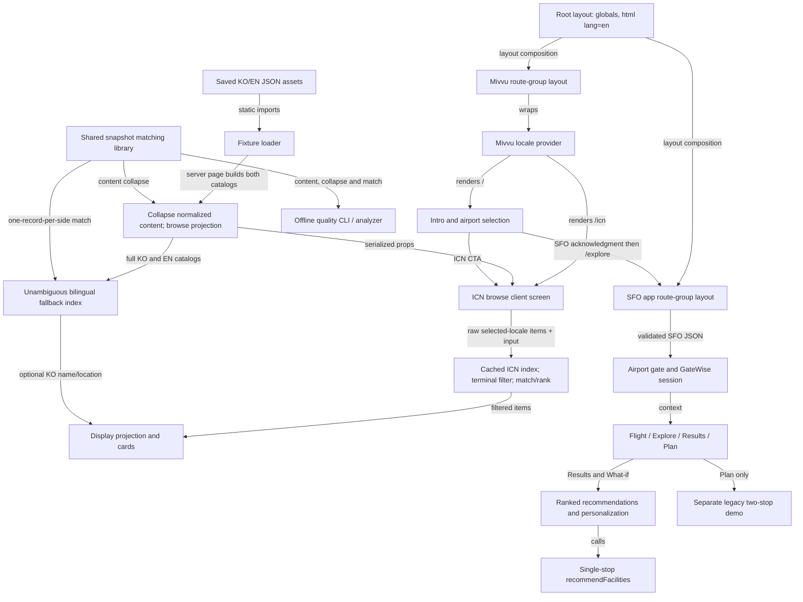

# GW-ICN-010 — Mivvu code map and change-impact analysis

Plan revision: **GW-PLAN-REV-2026-10-26**. Analysis date: **2026-10-28, America/New_York**. Owner: Codex. Report assessment: ChatGPT coordinator. Final acceptance: human owner, **accepted** (direct publication follow-up). Integration/release: **n/a**.

The human owner's direct dispatch of the attached GW-ICN-010 prompt authorizes this local analysis. The task is absent from the implementation table at the mapped revision; that does not block the explicit assignment. The original analysis included no application implementation, comprehensive security audit, or publication. The accepted follow-up authorizes publication of these two documents on a dedicated branch and PR only. Local saved facilities/favorites remains an **unapproved proposal**.

> **Reading and freshness:** This is the maintained Graphify analysis entry point. Analyzed code: [`2e56a28c16ebd71eb202db7aa428db7ba9b50b78`](https://github.com/cucu071212/Mivvu/tree/2e56a28c16ebd71eb202db7aa428db7ba9b50b78); analysis date: **2026-10-28 America/New_York**; Graphify **0.9.97**. The documentation commit is not the analyzed code commit. Compare relevant code changes since that SHA before relying on the map. Update affected sections after relevant structure/dependency changes; rerun Graphify only when justified. This task establishes no automatic regeneration, monitoring, or CI integration. Remote main was rechecked for packaging and still matched the analyzed SHA.
>
> Only this report and its checkpoint are published. `<local-evidence>`, `<analysis-worktree>`, `<original-worktree>` and tool placeholders denote locally retained locations, not GitHub files or working commands. Raw graphs, caches, command outputs and hash manifests remain local. Coordinator document assessment does not imply independent inspection of those raw artifacts. Sections describing initial/final analysis state and commands are historical; current publication state is in the checkpoint.

## 1. Source identity and evidence boundary

| Item | Verified value |
| --- | --- |
| Mapped worktree | `<analysis-worktree>` |
| Branch/base | Detached HEAD, newly created from freshly fetched `origin/main` |
| Full mapped SHA | `2e56a28c16ebd71eb202db7aa428db7ba9b50b78` |
| Coordinator reference | Same full SHA; no source difference |
| Initial mapped state | Clean, no existing GW-ICN-010 report/checkpoint/graph |
| Initial local `main` | `5bd3121f6aac992ac1b5d59e33c1e68d65c40170` |
| Initial cached `origin/main` | `bb4735d07f9b5cb68c6b44944ee76e994df801a8` |
| After permitted fetch | `origin/main` = mapped SHA; local main and original checkout untouched |
| Original workspace | `<original-worktree>`, branch `codex/gw-icn-007-snapshot-quality`, HEAD `5bd3121f6aac992ac1b5d59e33c1e68d65c40170` |
| Original dirty state | Pre-existing 007 application/tests/package/docs edits plus local tool directories and other untracked files; excluded from mapped source |
| Output state | Only the report and checkpoint are new in the analysis worktree; preservation verification is recorded in §8 |

`git worktree list --porcelain` enumerated 17 pre-existing checkouts before creating this one. None was switched, reset, stashed, cleaned, or merged. Complete original status and worktree inventory are saved under `<local-evidence>/initial-status.txt` and `initial-worktrees.txt`. This report's relative source paths and line numbers resolve against the mapped worktree and SHA above.

`git log -4` confirms `2e56a28` is documentation after merge `bb4735d`, which integrates `aac53a3` over `5bd3121`. The current task table records 007/008/009 complete, accepted and released; these implementations and accepted reviews were not repeated. This is source identity, **not fresh production-serving evidence**.

### Canon and historical documents

Read AGENTS, PLAN, implementation plan in both original and chosen source; also read all seven requested adapter/design/quality/008/009/GW-F documents. None is missing. Several historical handoffs retain earlier state:

- [docs/design/mivvu-first-entry-handoff.md:3](https://github.com/cucu071212/Mivvu/blob/2e56a28c16ebd71eb202db7aa428db7ba9b50b78/docs/design/mivvu-first-entry-handoff.md#L3) and [docs/design/mivvu-icn-browse-handoff.md:4](https://github.com/cucu071212/Mivvu/blob/2e56a28c16ebd71eb202db7aa428db7ba9b50b78/docs/design/mivvu-icn-browse-handoff.md#L4) describe feature-branch/pending publication. The mapped implementation table's 007/008/009 release state and direct human dispatch establish the current task context.
- [docs/data/icn-facility-adapter-handoff.md:98](https://github.com/cucu071212/Mivvu/blob/2e56a28c16ebd71eb202db7aa428db7ba9b50b78/docs/data/icn-facility-adapter-handoff.md#L98) describes then-remaining UI work; `MivvuIcnBrowsePage` now wires the static catalogs. Its early row-key advice is refined by shipped content collapse and `browse-{listingIndex}` keys, rather than a raw-source-ID join.
- [docs/data/icn-snapshot-quality-gate.md:3](https://github.com/cucu071212/Mivvu/blob/2e56a28c16ebd71eb202db7aa428db7ba9b50b78/docs/data/icn-snapshot-quality-gate.md#L3), [docs/handoffs/GW-ICN-008-checkpoint.md:7](https://github.com/cucu071212/Mivvu/blob/2e56a28c16ebd71eb202db7aa428db7ba9b50b78/docs/handoffs/GW-ICN-008-checkpoint.md#L7), and [docs/handoffs/GW-ICN-009-integration.md:9](https://github.com/cucu071212/Mivvu/blob/2e56a28c16ebd71eb202db7aa428db7ba9b50b78/docs/handoffs/GW-ICN-009-integration.md#L9) preserve pre-release review/permission statements. They supply implementation history, not new authorization. No historical document was rewritten.
- The browse handoff says a browser language list “starts with ko”; actual `resolveBrowserDefaultMivvuLocale` scans **any** candidate for a `ko` prefix ([src/lib/mivvu-preview-locale.ts:9](https://github.com/cucu071212/Mivvu/blob/2e56a28c16ebd71eb202db7aa428db7ba9b50b78/src/lib/mivvu-preview-locale.ts#L9)). Source behavior is used below.
- `PlanScreen` retains the literal copy “Demo — not in production release” ([src/components/screens/PlanScreen.tsx:10](https://github.com/cucu071212/Mivvu/blob/2e56a28c16ebd71eb202db7aa428db7ba9b50b78/src/components/screens/PlanScreen.tsx#L10)), although `/plan` renders the shipped optional demo. This mapping records route/code behavior; that sentence is not deployment evidence or an instruction to change copy.

## 2. Tool method, scope and limitations

Skills actually read/applied: project Graphify (`.codex/skills/graphify/SKILL.md`) and verification-before-completion (`<installed-skills>/verification-before-completion/SKILL.md`). Ponytail was not executed or inferred from hooks; no coding implementation occurred.

Installed binary: `<graphify-binary>`; distribution `graphifyy` **0.9.97**, verified using `importlib.metadata.version`. Interpreter: `<graphify-python>`. The installed entry point imports `graphify.__main__.main`. The installed extraction, build, cluster, export, CLI dispatch and query logging paths were inspected before use.

The normal semantic/provider and subagent workflow was **skipped by design**. One bounded, code-only extraction used the documented Python library entry points with `GRAPHIFY_BACKEND=none`, explicit file paths, explicit `root`, external `cache_root`, and `parallel=False`. No provider, hook, watcher, model subprocess, install or tool-settings change was invoked. `to_json` was given the verified SHA explicitly, avoiding its optional Git provenance subprocess. Query/path/explain run as inspected local CLI subprocesses; query logging outside task outputs was disabled for those invocations with `GRAPHIFY_QUERY_LOG_DISABLE=1`.

| Scope | Included / excluded |
| --- | --- |
| Explicit inputs | **250** tracked code files; **25,207** lines; **85,890** whitespace-separated words. Below the skill's 500-file / 2-million-word broad-corpus warning threshold |
| Breakdown | 231 under `src`, 9 under `e2e`, 6 maintainer scripts, 4 root code configs; 99 `.test` / `.spec` files |
| Input selection | Tracked `.ts`, `.tsx`, `.js`, `.mjs`, `.cjs` in `src/`, `scripts/`, `e2e/`, plus root code configs; declaration stubs excluded |
| Assets/config read manually | KO/EN snapshot JSON as whole input assets, SFO facilities and other data contracts/imports, package scripts, tsconfig aliases, workflow YAML; no facility-per-row nodes |
| Excluded | All JSON from extraction; documents, styles, binaries/images; dependencies, builds, caches, Git internals, generated reports, credential/environment files, unrelated worktrees |
| Partial coverage | CSS/style behavior, accessibility at runtime, browser/Next lifecycle behavior, dynamic imports, framework serialization, live API/provider accuracy and CI/deployment execution are not established by AST extraction |

Every selected code file has a graph source node. Two additional `source_file` strings (`node:fs`, `@playwright/test`) are external references, not two extra parsed source files. No external source upload occurred.

### Actual graph results and integrity caveat

Raw extraction: **1,156 nodes / 3,342 edges**. Built directed graph: **1,181 nodes / 3,230 edges / 46 communities**. Provider tokens: **0 input / 0 output**. Raw confidence labels: 3,333 EXTRACTED and 9 INFERRED; these describe extractor confidence, not runtime/correctness proof. `contains`, imports and calls coexist and are not interchangeable.

**Graph health warning:** raw diagnostics report **26 dangling-endpoint edges**, **277 external-reference edges**, **107 same-directed-endpoint relationship collapses** (108 if undirected), **0 missing-endpoint edges**, and **0 self-loops**. The directed simple graph can combine multiple import/re-export relations between one node pair. Raw extraction and diagnostic examples are retained; no repair or re-extraction was attempted. Missing graph edges do not establish isolation. The source-confirmed traces below do not depend on graph completeness.

`graphify-out/summary.json` preserves all 46 raw cohesion scores (range **0.051462904911180773–1.0**). Example extraction communities: search community 1 density **0.05555555555555555**, locale community 12 **0.16137566137566137**, snapshot-matching community 23 **0.17786561264822134**. These are structural groupings, not ownership or runtime boundaries. Global structural hubs include `Facility`, `validateFacilities()` and `UserContext`; fixture/test/type references influence these rankings.

### Actual commands and output locations

All Graphify output is external: `<local-evidence>/graphify-out/`. The scope manifest is its parent `scope.json`; original and analysis preservation manifests are also in that parent. Important commands, all actually run:

```text
git status --short; git branch --show-current; git rev-parse HEAD
git show-ref --heads --dereference; git for-each-ref ... refs/remotes/origin/main
git worktree list --porcelain; git log -4 --oneline
git fetch origin main
git worktree add --detach <analysis-worktree> origin/main
```

Commands above are listed separately for readability, not a claim that semicolon-chained commands were executed. The initial sandbox `git ls-remote` failed DNS; the permitted fetch succeeded with escalation. Initial worktree creation failed sandbox `.git` write permission; the authorized escalated retry succeeded. A few inspection `rg` paths did not exist (`qa`, `query.py`, one mistyped package path); actual `e2e`/installed CLI paths were then inspected. These were inspection failures, not application failures.

Actual single extraction/build was an inline Python invocation (no repository script created):

```python
# Environment: GRAPHIFY_BACKEND=none
# GRAPHIFY_OUT=<local-evidence>/graphify-out
scope = json.loads(Path('<local-evidence>/scope.json').read_text())
root = Path(scope['source_root'])
result = extract([root / f for f in scope['files']],
                 cache_root=Path('<local-evidence>'),
                 root=root, parallel=False)
G = build_from_json(result, root=root, directed=True)
communities = cluster(G)
cohesion = score_all(G, communities)
to_json(G, communities, '<local-evidence>/graphify-out/graph.json',
        built_at_commit=scope['source_sha'])
health = diagnose_extraction(result, directed=True, root=str(root))
```

The raw `extraction.json`, `health.json`/`health.txt`, `graph.json`, `summary.json`, vocabulary and full CLI outputs are retained. A later **non-extracting** pass generated `GRAPH_REPORT.md` and `analysis.json` using the installed `generate`, `god_nodes`, `surprising_connections`, `suggest_questions` and deterministic `label_communities_by_hub` APIs. That automatic structural report is supplementary; this source-checked report controls interpretation. No HTML visualization or semantic report labeling was needed.

Queries selected only observed vocabulary: A `[icn, search, index, browse, catalog]`; B `[icn, snapshot, matching, korean, fallback]`; C `[locale, provider, selection, session]`. Actual CLI commands and exact seed IDs/arguments are retained in `query-commands.json`:

| Operation | Actual use / result |
| --- | --- |
| `graphify query "icn search index browse catalog" --seed <filterIcnBrowseItems ID> --budget 1600 --graph <external graph>` | PASS; 83-node BFS context; initially truncated |
| `graphify query "icn snapshot matching korean fallback" --seed <buildKoreanFallbackIndex ID> ...` | PASS; 53-node BFS context; initially truncated |
| `graphify query "locale provider selection session" --seed <MivvuPreviewLocaleProvider ID> ...` | PASS; 74-node BFS context; initially truncated |
| Same three queries at `--budget 3500` | PASS; complete nodes and edges retained in `query-1-complete.txt` through `query-3-complete.txt`. CLI can exceed requested token budget when retaining edges; no graph rebuild |
| `graphify path <filterIcnBrowseItems ID> <searchIcnIndex ID> --directed --graph <external graph>` | PASS; one EXTRACTED `calls` hop, checked against [icn-browse-view-model.ts:231](https://github.com/cucu071212/Mivvu/blob/2e56a28c16ebd71eb202db7aa428db7ba9b50b78/src/lib/icn-facilities/icn-browse-view-model.ts#L231) |
| `graphify explain <collapseDuplicateListings ID> --graph <external graph>` | PASS; imports/calls from catalog builder and quality analyzer, checked at lines 209 and 81 respectively |

## 3. Architecture map

Arrows in this curated map mean the **labeled relationship**, not an assertion that every node runs on each request. Framework layout nesting and React renders are established by file placement/JSX source; they are not inferred as direct function calls from imports.



The shared-library arrows denote imports/use of common rules. The analyzer does not execute as part of `/icn`.

### Route and module ownership map

“Owner” below is the current implementation boundary and suggested future inspection owner, not authorization for changes.

| Route / boundary | Current composition and source | Ownership / propagation |
| --- | --- | --- |
| Root | [src/app/layout.tsx:1](https://github.com/cucu071212/Mivvu/blob/2e56a28c16ebd71eb202db7aa428db7ba9b50b78/src/app/layout.tsx#L1) sets fonts, globals and `html lang="en"` | Shared outer boundary; changes can affect both airport surfaces |
| `/` | [src/app/(mivvu-entry)/page.tsx:1](https://github.com/cucu071212/Mivvu/blob/2e56a28c16ebd71eb202db7aa428db7ba9b50b78/src/app/%28mivvu-entry%29/page.tsx#L1) → `MivvuFirstEntryFlow`; shared shell [src/components/mivvu/MivvuEntryLayoutShell.tsx:13](https://github.com/cucu071212/Mivvu/blob/2e56a28c16ebd71eb202db7aa428db7ba9b50b78/src/components/mivvu/MivvuEntryLayoutShell.tsx#L13) | Mivvu UI/entry, default Cursor integration |
| `/icn` | [src/app/(mivvu-entry)/icn/page.tsx:1](https://github.com/cucu071212/Mivvu/blob/2e56a28c16ebd71eb202db7aa428db7ba9b50b78/src/app/%28mivvu-entry%29/icn/page.tsx#L1) → `MivvuIcnBrowsePage` → client wrapper/screen | Server catalog preparation plus ICN client view; no required flight gate |
| Legacy preview URLs | [src/app/preview/mivvu-entry/page.tsx:1](https://github.com/cucu071212/Mivvu/blob/2e56a28c16ebd71eb202db7aa428db7ba9b50b78/src/app/preview/mivvu-entry/page.tsx#L1) and [src/app/preview/mivvu-entry/icn/page.tsx:1](https://github.com/cucu071212/Mivvu/blob/2e56a28c16ebd71eb202db7aa428db7ba9b50b78/src/app/preview/mivvu-entry/icn/page.tsx#L1) call `redirect` to `/` and `/icn` | Bookmark compatibility; preview layout also uses Mivvu shell |
| SFO route group | [src/app/(app)/layout.tsx:1](https://github.com/cucu071212/Mivvu/blob/2e56a28c16ebd71eb202db7aa428db7ba9b50b78/src/app/%28app%29/layout.tsx#L1) validates `facilities.json` and wraps `GateWiseProviders` | SFO data/session/acknowledgment gate |
| `/flight`, `/explore`, `/recommendations`, `/plan` | Route pages render matching screen components; route labels in [src/lib/app-routes.ts:1](https://github.com/cucu071212/Mivvu/blob/2e56a28c16ebd71eb202db7aa428db7ba9b50b78/src/lib/app-routes.ts#L1) | All use app-group session; ICN locale provider is outside this subtree |
| ICN data rules | [src/types/icn-facility-browse.ts:16](https://github.com/cucu071212/Mivvu/blob/2e56a28c16ebd71eb202db7aa428db7ba9b50b78/src/types/icn-facility-browse.ts#L16), [icn-snapshot-matching.ts:4](https://github.com/cucu071212/Mivvu/blob/2e56a28c16ebd71eb202db7aa428db7ba9b50b78/src/lib/icn-facilities/icn-snapshot-matching.ts#L4), [icn-facility-search.ts:51](https://github.com/cucu071212/Mivvu/blob/2e56a28c16ebd71eb202db7aa428db7ba9b50b78/src/lib/icn-facilities/icn-facility-search.ts#L51) | Airport-specific contracts and algorithms; Codex specialist, Cursor integration on assignment |
| SFO calculation rules | [src/types/airport.ts:225](https://github.com/cucu071212/Mivvu/blob/2e56a28c16ebd71eb202db7aa428db7ba9b50b78/src/types/airport.ts#L225), [recommend.ts:412](https://github.com/cucu071212/Mivvu/blob/2e56a28c16ebd71eb202db7aa428db7ba9b50b78/src/lib/recommend.ts#L412), [plan-two-stop-legacy.ts:363](https://github.com/cucu071212/Mivvu/blob/2e56a28c16ebd71eb202db7aa428db7ba9b50b78/src/lib/plan-two-stop-legacy.ts#L363) | Preserve GW-F, distinct two-stop contract and SFO-only data assumptions |

### ICN/SFO shared boundaries

| Shared item | Actual current relationship | What is separate |
| --- | --- | --- |
| Entry routes / `MIVVU_ENTRY_PATH` | Used by ICN back button, SFO guard and SFO Change airport button ([MivvuIcnFacilitiesBrowseScreen.tsx:121](https://github.com/cucu071212/Mivvu/blob/2e56a28c16ebd71eb202db7aa428db7ba9b50b78/src/components/mivvu/MivvuIcnFacilitiesBrowseScreen.tsx#L121), [AirportSelectionLayout.tsx:20](https://github.com/cucu071212/Mivvu/blob/2e56a28c16ebd71eb202db7aa428db7ba9b50b78/src/components/AirportSelectionLayout.tsx#L20), [AppShell.tsx:39](https://github.com/cucu071212/Mivvu/blob/2e56a28c16ebd71eb202db7aa428db7ba9b50b78/src/components/AppShell.tsx#L39)) | Does not share airport facility models or search indexes |
| Airport catalog/filter | Mivvu passes its own ICN+SFO catalog to `filterAirportSelectionCatalog` ([MivvuAirportSelectionScreen.tsx:86](https://github.com/cucu071212/Mivvu/blob/2e56a28c16ebd71eb202db7aa428db7ba9b50b78/src/components/mivvu/MivvuAirportSelectionScreen.tsx#L86)); catalog type and SFO constant reused | Airport-name search is a separate simple substring filter ([filter-airport-selection-catalog.ts:17](https://github.com/cucu071212/Mivvu/blob/2e56a28c16ebd71eb202db7aa428db7ba9b50b78/src/lib/filter-airport-selection-catalog.ts#L17)), not ICN facility search |
| SFO acknowledgment | Mivvu SFO CTA calls `acknowledgeAirportSelection`, which SFO gate reads | ICN CTA pushes `/icn` without writing SFO acknowledgment ([MivvuAirportSelectionScreen.tsx:99](https://github.com/cucu071212/Mivvu/blob/2e56a28c16ebd71eb202db7aa428db7ba9b50b78/src/components/mivvu/MivvuAirportSelectionScreen.tsx#L99)) |
| Locale | KO/EN context wraps Mivvu entry and ICN browse; persisted independently | SFO screen copy is not a consumer of this locale context; SFO date/time model retains its own contracts |
| Layout/config | Root layout, global CSS, Next/React, package scripts, Vitest/Playwright config | Mivvu route CSS/shell and SFO `AppShell` remain different subtrees |
| Facility identity/data | Entry uses SFO `SUPPORTED_AIRPORT_IATA` as a bridge | ICN browse record is not SFO `Facility`; no ICN-to-SFO-engine conversion is wired |
| Timing | None introduced for ICN browse | SFO travel matrix, `legacy_zone`, countdown, duration overrides, recommendations and two-stop demo stay SFO-specific |

## 4. Representative runtime and maintainer paths

### ICN saved assets → browse

[load-icn-facilities-fixture.ts:7](https://github.com/cucu071212/Mivvu/blob/2e56a28c16ebd71eb202db7aa428db7ba9b50b78/src/lib/icn-facilities/load-icn-facilities-fixture.ts#L7) selects statically imported KO/EN JSON using a type assertion. [MivvuIcnBrowsePage.tsx:8](https://github.com/cucu071212/Mivvu/blob/2e56a28c16ebd71eb202db7aa428db7ba9b50b78/src/components/mivvu/MivvuIcnBrowsePage.tsx#L8) builds **both** catalogs on the server-side page path and passes them through [MivvuIcnBrowsePageClient.tsx:11](https://github.com/cucu071212/Mivvu/blob/2e56a28c16ebd71eb202db7aa428db7ba9b50b78/src/components/mivvu/MivvuIcnBrowsePageClient.tsx#L11). No API client call or offline analyzer invocation is in this source path. A future fixture schema owner must not assume the offline validator runs automatically at runtime.

`buildIcnBrowseCatalog` ([icn-browse-view-model.ts:205](https://github.com/cucu071212/Mivvu/blob/2e56a28c16ebd71eb202db7aa428db7ba9b50b78/src/lib/icn-facilities/icn-browse-view-model.ts#L205)) collapses normalized records first. [icn-snapshot-matching.ts:4](https://github.com/cucu071212/Mivvu/blob/2e56a28c16ebd71eb202db7aa428db7ba9b50b78/src/lib/icn-facilities/icn-snapshot-matching.ts#L4) fingerprints all normalized content, including arrival/departure, duty flag, categories and provenance, excluding only listingIndex. Collapse sorts by listingIndex and keeps the first identical content row (`:29`). Distinct content sharing one sourceId survives. `toListItem` ([icn-browse-view-model.ts:145](https://github.com/cucu071212/Mivvu/blob/2e56a28c16ebd71eb202db7aa428db7ba9b50b78/src/lib/icn-facilities/icn-browse-view-model.ts#L145)) creates React keys `browse-{listingIndex}`, localized terminal labels, joined category text and raw fields. Terminal options derive from all items (`:162`); snapshot copy/date/count derive from metadata (`:179`, `:205`). This is a lossy display projection; do not dedupe its fields again.

The saved JSON itself currently has **1,028 raw rows / 1,011 declared distinct IDs / 17 declared duplicate-ID groups** per language, API reported total **1,175**, `syncIntegrity: api_total_mismatch`. Direct JSON read and SHA-256 confirmed these metadata/row counts. The catalog's expected 1,011 listings is also encoded by existing fixture tests and historical accepted evidence, not newly executed application tests here. Count consistency never proves full airport coverage.

### Maintainer API normalization and snapshot checking

The optional **maintenance** refresh path is [scripts/sync-icn-facilities.mjs:13](https://github.com/cucu071212/Mivvu/blob/2e56a28c16ebd71eb202db7aa428db7ba9b50b78/scripts/sync-icn-facilities.mjs#L13) → opt-in [sync-cli.test.ts:9](https://github.com/cucu071212/Mivvu/blob/2e56a28c16ebd71eb202db7aa428db7ba9b50b78/src/lib/icn-facilities/sync-cli.test.ts#L9) → `syncIcnFacilities` ([sync-icn-facilities.ts:44](https://github.com/cucu071212/Mivvu/blob/2e56a28c16ebd71eb202db7aa428db7ba9b50b78/src/lib/icn-facilities/sync-icn-facilities.ts#L44)) → server-only API client ([icn-facilities-client.ts:6](https://github.com/cucu071212/Mivvu/blob/2e56a28c16ebd71eb202db7aa428db7ba9b50b78/src/lib/icn-facilities/icn-facilities-client.ts#L6), `:81`) → response/item parsers ([parse-api-response.ts:23](https://github.com/cucu071212/Mivvu/blob/2e56a28c16ebd71eb202db7aa428db7ba9b50b78/src/lib/icn-facilities/parse-api-response.ts#L23), [parse-api-items.ts:7](https://github.com/cucu071212/Mivvu/blob/2e56a28c16ebd71eb202db7aa428db7ba9b50b78/src/lib/icn-facilities/parse-api-items.ts#L7)) → `normalizeIcnFacilityRow` ([normalize-icn-facility.ts:30](https://github.com/cucu071212/Mivvu/blob/2e56a28c16ebd71eb202db7aa428db7ba9b50b78/src/lib/icn-facilities/normalize-icn-facility.ts#L30)). Normalization trims missing text to null, preserves unknown taxonomy/terminal strings, rejects missing ID/name, and adds no coordinates/queue/walking values. Sync assigns listingIndex, checks total integrity, and only its writer atomically replaces a fixture ([sync-icn-facilities.ts:108](https://github.com/cucu071212/Mivvu/blob/2e56a28c16ebd71eb202db7aa428db7ba9b50b78/src/lib/icn-facilities/sync-icn-facilities.ts#L108), `:157`; locale path [icn-fixture-paths.ts:4](https://github.com/cucu071212/Mivvu/blob/2e56a28c16ebd71eb202db7aa428db7ba9b50b78/src/lib/icn-facilities/icn-fixture-paths.ts#L4)). No refresh was executed.

The separate **offline** path is package `quality:icn-snapshots` → [scripts/check-icn-snapshots.mjs:15](https://github.com/cucu071212/Mivvu/blob/2e56a28c16ebd71eb202db7aa428db7ba9b50b78/scripts/check-icn-snapshots.mjs#L15) → one installed Vitest harness ([snapshot-quality-cli-runner.test.ts:7](https://github.com/cucu071212/Mivvu/blob/2e56a28c16ebd71eb202db7aa428db7ba9b50b78/src/lib/icn-facilities/snapshot-quality-cli-runner.test.ts#L7)) → `runIcnSnapshotQualityCli` ([icn-snapshot-quality-cli.ts:46](https://github.com/cucu071212/Mivvu/blob/2e56a28c16ebd71eb202db7aa428db7ba9b50b78/src/lib/icn-facilities/icn-snapshot-quality-cli.ts#L46)) → JSON reads → `analyzeIcnSnapshots` ([icn-snapshot-quality.ts:156](https://github.com/cucu071212/Mivvu/blob/2e56a28c16ebd71eb202db7aa428db7ba9b50b78/src/lib/icn-facilities/icn-snapshot-quality.ts#L156)). It validates each input from unknown ([validate-icn-snapshot.ts:34](https://github.com/cucu071212/Mivvu/blob/2e56a28c16ebd71eb202db7aa428db7ba9b50b78/src/lib/icn-facilities/validate-icn-snapshot.ts#L34)), checks schema/metadata before typed use, collapses and groups records, aligns bilingual IDs and compares baseline/candidate content.

The wrapper transfers only its report through a private temporary file and cleans up. It disables live sync/investigation, has no fixture-writer import, and is not an application route. Exit 0 means **valid inputs**, with warnings/differences still possible; `publicationDecision` is `not_assessed` ([icn-snapshot-quality.ts:169](https://github.com/cucu071212/Mivvu/blob/2e56a28c16ebd71eb202db7aa428db7ba9b50b78/src/lib/icn-facilities/icn-snapshot-quality.ts#L169)). The validator accepts blank string names as missing data while the live normalizer rejects them; these are different input boundaries, not evidence of inconsistent runtime execution. The historical `icn-language-coverage` diagnostic includes raw-row cardinality; use the new post-collapse matching contract for runtime pairing.

### SFO browse, session, Results, What-if and two-stop

`prepareProductionFacilities` validates SFO JSON ([browse-integration.ts:12](https://github.com/cucu071212/Mivvu/blob/2e56a28c16ebd71eb202db7aa428db7ba9b50b78/src/lib/browse-integration.ts#L12)); app layout supplies facilities/errors to the provider. `GateWiseSessionProvider` stores manual minutes, buffer, gate landmark, shared filters, demo toggle, overrides, countdown/recovery state and fixed scenario inputs in memory ([gatewise-session.tsx:126](https://github.com/cucu071212/Mivvu/blob/2e56a28c16ebd71eb202db7aa428db7ba9b50b78/src/context/gatewise-session.tsx#L126)). It builds a fixed D-zone flight context ([browse-integration.ts:23](https://github.com/cucu071212/Mivvu/blob/2e56a28c16ebd71eb202db7aa428db7ba9b50b78/src/lib/browse-integration.ts#L23)), validates it, and gates recommendations on valid data/context/personalization/recovery ([gatewise-session.tsx:248](https://github.com/cucu071212/Mivvu/blob/2e56a28c16ebd71eb202db7aa428db7ba9b50b78/src/context/gatewise-session.tsx#L248), `:271`).

Explore applies `filterBrowseDirectory` to browseEligible rows and then shared SFO `filterFacilities` ([ExploreScreen.tsx:24](https://github.com/cucu071212/Mivvu/blob/2e56a28c16ebd71eb202db7aa428db7ba9b50b78/src/components/screens/ExploreScreen.tsx#L24), [filter-browse-directory.ts:5](https://github.com/cucu071212/Mivvu/blob/2e56a28c16ebd71eb202db7aa428db7ba9b50b78/src/lib/filter-browse-directory.ts#L5)). The latter does case-insensitive **name** substring + category/zone/terminal AND filtering and English name sorting ([filter-facilities.ts:4](https://github.com/cucu071212/Mivvu/blob/2e56a28c16ebd71eb202db7aa428db7ba9b50b78/src/lib/filter-facilities.ts#L4)). The schematic is separately rendered and not filtered ([ExploreScreen.tsx:182](https://github.com/cucu071212/Mivvu/blob/2e56a28c16ebd71eb202db7aa428db7ba9b50b78/src/components/screens/ExploreScreen.tsx#L182)). Detail dialog/card/location/media helpers remain SFO presentation paths; their internals were not re-audited.

Results → `buildRankedRecommendations` ([recommendation-page-integration.ts:21](https://github.com/cucu071212/Mivvu/blob/2e56a28c16ebd71eb202db7aa428db7ba9b50b78/src/lib/recommendation-page-integration.ts#L21)) → `filterFacilities` → `recommendFacilitiesWithPersonalization` ([recommend-facilities-with-personalization.ts:24](https://github.com/cucu071212/Mivvu/blob/2e56a28c16ebd71eb202db7aa428db7ba9b50b78/src/lib/recommend-facilities-with-personalization.ts#L24)) → temporary duration-resolved copies → unchanged `recommendFacilities` ([recommend.ts:412](https://github.com/cucu071212/Mivvu/blob/2e56a28c16ebd71eb202db7aa428db7ba9b50b78/src/lib/recommend.ts#L412)). The engine independently resolves directed outbound and return ([recommend.ts:235](https://github.com/cucu071212/Mivvu/blob/2e56a28c16ebd71eb202db7aa428db7ba9b50b78/src/lib/recommend.ts#L235)), preserves missing inputs as unknown (`:289`), adds queue/activity and **one buffer** (`:306`), computes boarding-start margin (`:321`), and applies ≥10 / 0–9 / <0 thresholds (`:79`). No ICN facility is supplied by current route wiring.

[RecommendationsScreen.tsx:128](https://github.com/cucu071212/Mivvu/blob/2e56a28c16ebd71eb202db7aa428db7ba9b50b78/src/components/screens/RecommendationsScreen.tsx#L128) supplies the same session context/filter/overrides to What-if. Both baseline and scenario use `buildRankedRecommendations` ([WhatIfSimulator.tsx:106](https://github.com/cucu071212/Mivvu/blob/2e56a28c16ebd71eb202db7aa428db7ba9b50b78/src/components/WhatIfSimulator.tsx#L106), `:125`), then `compareRecommendationRuns` ([what-if-compare.ts:84](https://github.com/cucu071212/Mivvu/blob/2e56a28c16ebd71eb202db7aa428db7ba9b50b78/src/lib/what-if-compare.ts#L84)). Countdown changes baseline; scenario minutes remain explicit fixed inputs. [AppShell.tsx:73](https://github.com/cucu071212/Mivvu/blob/2e56a28c16ebd71eb202db7aa428db7ba9b50b78/src/components/AppShell.tsx#L73) keeps the countdown host in the shared layout; [BoardingCountdownControls.tsx:143](https://github.com/cucu071212/Mivvu/blob/2e56a28c16ebd71eb202db7aa428db7ba9b50b78/src/components/BoardingCountdownControls.tsx#L143) starts a one-second interval and cleans up. Draft duration controls stay mounted but hidden outside Results ([AppShell.tsx:93](https://github.com/cucu071212/Mivvu/blob/2e56a28c16ebd71eb202db7aa428db7ba9b50b78/src/components/AppShell.tsx#L93)).

[PlanScreen.tsx:25](https://github.com/cucu071212/Mivvu/blob/2e56a28c16ebd71eb202db7aa428db7ba9b50b78/src/components/screens/PlanScreen.tsx#L25) renders a **separate** `TwoStopPlannerDemo`. It consumes shared SFO baseline/resolved duration maps, but owns its selected stops and travel opt-in locally ([TwoStopPlannerDemo.tsx:26](https://github.com/cucu071212/Mivvu/blob/2e56a28c16ebd71eb202db7aa428db7ba9b50b78/src/components/TwoStopPlannerDemo.tsx#L26)). `runTwoStopPlannerEvaluation` ([two-stop-planner-integration.ts:52](https://github.com/cucu071212/Mivvu/blob/2e56a28c16ebd71eb202db7aa428db7ba9b50b78/src/lib/two-stop-planner-integration.ts#L52)) delegates to `evaluateTwoStopPairLegacy` ([plan-two-stop-legacy.ts:363](https://github.com/cucu071212/Mivvu/blob/2e56a28c16ebd71eb202db7aa428db7ba9b50b78/src/lib/plan-two-stop-legacy.ts#L363)), not the single-stop engine. Strict inter-stop travel is unknown; explicit `demo_legacy_d` opt-in uses the labeled D→D synthetic value ([plan-two-stop-legacy.ts:97](https://github.com/cucu071212/Mivvu/blob/2e56a28c16ebd71eb202db7aa428db7ba9b50b78/src/lib/plan-two-stop-legacy.ts#L97)). It totals three leg slots, two queue/activity pairs and **one buffer** (`:304`), evaluates both orders and retains unknowns. Do not generalize the directed single-stop matrix into verified indoor two-stop or ICN routing.

Legacy [GateWiseHome.tsx:120](https://github.com/cucu071212/Mivvu/blob/2e56a28c16ebd71eb202db7aa428db7ba9b50b78/src/components/GateWiseHome.tsx#L120) and `WelcomeAirportScreen` remain in source/tests but are not imported by the current App Router pages. Static graph hubs involving those components do not establish that they are today's entry route.


### Maintainer verification configuration

[vitest.config.ts:5](https://github.com/cucu071212/Mivvu/blob/2e56a28c16ebd71eb202db7aa428db7ba9b50b78/vitest.config.ts#L5) includes library/component tests, with a test-only `server-only` alias; it is not evidence of Next client/server enforcement. [playwright.config.ts:4](https://github.com/cucu071212/Mivvu/blob/2e56a28c16ebd71eb202db7aa428db7ba9b50b78/playwright.config.ts#L4) uses loopback port 3100 and an independently started production server, with desktop/mobile Chromium projects. [.github/workflows/e2e.yml:1](https://github.com/cucu071212/Mivvu/blob/2e56a28c16ebd71eb202db7aa428db7ba9b50b78/.github/workflows/e2e.yml#L1) describes unit/type/lint/build/browser checks on configured PR/push triggers; reading it does not prove the workflow ran. The other inspected script inputs (`capture-mivvu-entry-screens.mjs`, `qa-mivvu-preview.mjs`, `verify-mivvu-intro-timing.mjs`, `icn-facilities-probe.mjs`) are browser evidence/probe entry points, not runtime routes; none was executed. Tests and script wrappers are structurally mapped, but their network/browser side effects were not activated.

## 5. Change-impact A — ICN search behavior

**Entry and data/state flow:** `/icn` → server-built catalogs → `MivvuIcnFacilitiesBrowseScreen` local raw query/terminal state (`:69`) → active locale catalog (`:72`) → `filterIcnBrowseItems` ([icn-browse-view-model.ts:225](https://github.com/cucu071212/Mivvu/blob/2e56a28c16ebd71eb202db7aa428db7ba9b50b78/src/lib/icn-facilities/icn-browse-view-model.ts#L225)) → `getIcnSearchIndex` ([icn-facility-search.ts:155](https://github.com/cucu071212/Mivvu/blob/2e56a28c16ebd71eb202db7aa428db7ba9b50b78/src/lib/icn-facilities/icn-facility-search.ts#L155)) → `searchIcnIndex` (`:141`) → display fallback → cards/count/empty state. A locale toggle changes the catalog/messages without resetting query or terminal because those are separate component states.

| Stage / source | Current rule and affected consumers |
| --- | --- |
| Index fields, [icn-facility-search.ts:51](https://github.com/cucu071212/Mivvu/blob/2e56a28c16ebd71eb202db7aa428db7ba9b50b78/src/lib/icn-facilities/icn-facility-search.ts#L51) | Name, locationDescription, categoryLabel, **full terminalLabel** only. Floor/hours/sourceId are not separate searchable fields; terminalId is used for filtering and exclusion of typo words. Changing projection/terminal wording can alter hits even without changing search code |
| Normalization, `:8`, `:39` | Targeted full-width ASCII fold, NFC, lowercasing, modern leading-jamo to compatibility initials, whitespace collapse. Raw input/display strings are not rewritten; no general NFKC, translation or accent stripping |
| Strong matching, `:78`, `:109` | AND across whitespace tokens, any indexed field; literal substrings remain. Initials consume contiguous positions, preserving punctuation/spaces/full syllables/Latin/digits; no cross-field initial concatenation |
| Terminal and typo fallback, `:141`, `:114` | Filter active terminal **before** deciding zero strong matches. Only then recover one token by one insertion/deletion/substitution against eligible whole Latin name words of ≥5 letters. No transposition or numeric/terminal/location fuzziness; terminal/concourse/label words excluded from name typo candidates (`:65`) |
| Rank, `:99`, `:147` | Exact normalized name; whole mixed/initial name; prefix/all literal name words; other name; other fields. Catalog ordinal breaks ties. Empty query preserves eligible order |
| Cache, `:154` | WeakMap keyed by immutable item-array identity and locale; new arrays rebuild. In-place item mutation would invalidate this assumption; future refresh owner must replace arrays or explicitly redesign invalidation |
| UI, screen `:78`, `:95`, `:141`, `:191` | Filter/useMemo dependencies, raw controlled input, retained terminal/query, focus/IME behavior, result counts/live announcement, empty state and hints. There is no debounce/remote search in this path |
| Display separation, screen `:73`, `:83`; [icn-browse-display.ts:26](https://github.com/cucu071212/Mivvu/blob/2e56a28c16ebd71eb202db7aa428db7ba9b50b78/src/lib/icn-facilities/icn-browse-display.ts#L26) | Full-catalog pairing happens independently; optional Korean fallback is applied **after search**. Making fallback text searchable would change the locale-local contract and require an explicit product decision |

**Direct consumers:** screen filtering and its count/empty/card view; synthetic search/catalog/integration tests. **Indirect consumers:** locale-selected fixture display, terminal labels, category projection, search evidence harness and mobile spec. `icn-language-coverage` imports the catalog builder but does not itself use search output. An import-level graph connection must not be mistaken for a changed search result consumer.

**ICN/SFO boundary:** SFO directory/Results use `filterFacilities`, and airport selection uses `filterAirportSelectionCatalog`; neither delegates to `searchIcnIndex`. A confined ICN algorithm edit has no source-confirmed SFO search consumer. Moving it into a shared utility, changing root/provider boundaries, or reusing SFO facility types broadens that impact and requires inspecting those independent filters.

**Existing evidence to inspect, not rerun here:** [icn-facility-search.test.ts:17](https://github.com/cucu071212/Mivvu/blob/2e56a28c16ebd71eb202db7aa428db7ba9b50b78/src/lib/icn-facilities/icn-facility-search.test.ts#L17) (normalization, literal AND, initials, typo, rank, cache), [icn-search-catalog.test.ts:16](https://github.com/cucu071212/Mivvu/blob/2e56a28c16ebd71eb202db7aa428db7ba9b50b78/src/lib/icn-facilities/icn-search-catalog.test.ts#L16) (saved bytes, empty-query order, former substring membership, terminal isolation), [icn-search-fallback-integration.test.ts:45](https://github.com/cucu071212/Mivvu/blob/2e56a28c16ebd71eb202db7aa428db7ba9b50b78/src/lib/icn-facilities/icn-search-fallback-integration.test.ts#L45) / `:77` / `:96` (full-catalog ambiguity and duplicate order), screen test `:175` / `:203` (raw composition/focus/state and fallback exclusion), [e2e/icn-facility-search.mobile.spec.ts:9](https://github.com/cucu071212/Mivvu/blob/2e56a28c16ebd71eb202db7aa428db7ba9b50b78/e2e/icn-facility-search.mobile.spec.ts#L9) / `:48` (Chromium composition/layout). The opt-in evidence harness at [icn-search-evidence.test.ts:11](https://github.com/cucu071212/Mivvu/blob/2e56a28c16ebd71eb202db7aa428db7ba9b50b78/src/lib/icn-facilities/icn-search-evidence.test.ts#L11) records performance/relevance, not a mobile speed assertion.

**Future owner / verification gaps:** Codex search owner with Cursor UI integration reviewer should inspect all stages above, agree intended membership/rank examples independently, and verify cache replacement, IME/focus/counts and locale/terminal retention. Native OS IME, physical devices, screen-reader speech and non-Chromium browsers remain outside historical cited browser coverage. This analysis establishes no fresh test outcome or performance claim.

## 6. Change-impact B — snapshots and bilingual matching

**Entry points:** saved JSON imports and catalog builder, maintenance sync path, offline analyzer/validator, `buildKoreanFallbackIndex` and `toBrowseDisplayItems`. A content/schema edit may affect all these even if search code is untouched.

1. **Normalize and validate:** a source field addition/change requires inspecting `IcnFacilityBrowseRecordCore` ([src/types/icn-facility-browse.ts:16](https://github.com/cucu071212/Mivvu/blob/2e56a28c16ebd71eb202db7aa428db7ba9b50b78/src/types/icn-facility-browse.ts#L16)), API parser/normalizer, snapshot envelope validator ([validate-icn-snapshot.ts:34](https://github.com/cucu071212/Mivvu/blob/2e56a28c16ebd71eb202db7aa428db7ba9b50b78/src/lib/icn-facilities/validate-icn-snapshot.ts#L34)) and metadata checks (`:99`). Unknown schema fields currently fail validation rather than being silently ignored. Raw API normalization and saved-input validation are distinct paths.
2. **Content identity:** `icnFacilityContent` ([icn-snapshot-matching.ts:4](https://github.com/cucu071212/Mivvu/blob/2e56a28c16ebd71eb202db7aa428db7ba9b50b78/src/lib/icn-facilities/icn-snapshot-matching.ts#L4)) is the shared fingerprint/comparison field inventory. Changing it changes identical collapse, retained listing key/order, conflicting-ID groups, bilingual cardinality and baseline field diffs. Data hidden by `toListItem` can still distinguish rows; duty/arrival changes must not disappear through display-level dedupe.
3. **Full-catalog cardinality:** `matchUnambiguousIcnRecords` (`:49`) joins only when **exactly one collapsed record on each side** has the ID. `buildKoreanFallbackIndex` ([icn-browse-display.ts:18](https://github.com/cucu071212/Mivvu/blob/2e56a28c16ebd71eb202db7aa428db7ba9b50b78/src/lib/icn-facilities/icn-browse-display.ts#L18)) receives complete KO/EN catalogs before terminal/query filtering. Filtering first can hide conflicts and incorrectly enable a join; the integrated regression explicitly demonstrates that trigger ([icn-search-fallback-integration.test.ts:45](https://github.com/cucu071212/Mivvu/blob/2e56a28c16ebd71eb202db7aa428db7ba9b50b78/src/lib/icn-facilities/icn-search-fallback-integration.test.ts#L45)).
4. **Runtime view:** `toBrowseDisplayItems` ([icn-browse-display.ts:26](https://github.com/cucu071212/Mivvu/blob/2e56a28c16ebd71eb202db7aa428db7ba9b50b78/src/lib/icn-facilities/icn-browse-display.ts#L26)) borrows only missing EN **name/location**, keeping raw fields and provenance flags. It does not fill categories/hours or translate. Catalog projection controls keys, terminals, categories, counts, date/source/coverage copy; search indexes those new locale item arrays downstream. Retaining an old terminal selection against a changed catalog is a future refresh/state case to inspect, not a demonstrated defect in the current immutable saved-data flow.
5. **Offline reports:** `analyze` ([icn-snapshot-quality.ts:73](https://github.com/cucu071212/Mivvu/blob/2e56a28c16ebd71eb202db7aa428db7ba9b50b78/src/lib/icn-facilities/icn-snapshot-quality.ts#L73)) validates then collapses/groups; `alignment` (`:108`) shares cardinality; `compare` (`:128`) reports additions/removals/field diffs or ambiguous content sets. ListingIndex/order/duplicate multiplicity are not facility-content changes; metadata and duplicates are reported separately. CLI reader/summary/exit semantics and private harness transport remain consumers of the report shape.
6. **Historical diagnostics and evidence:** [icn-language-coverage.ts:62](https://github.com/cucu071212/Mivvu/blob/2e56a28c16ebd71eb202db7aa428db7ba9b50b78/src/lib/icn-facilities/icn-language-coverage.ts#L62) calculates catalog counts while some other diagnostics count raw rows. Fixture-based search regressions and shipped-output digest depend on saved bytes/content/order. Snapshot refreshes must explain intentional evidence changes, not regenerate expectations solely from output.

**Direct consumers of shared matching:** catalog builder uses collapse; quality analyzer uses collapse/fingerprint/content/group/match; display uses one-to-one match. **Indirect consumers:** all ICN screen cards/counts/terminals, indexes/ranking through changed item data/order, bilingual hints, CLI users, saved regression/evidence fixtures. SFO `Facility`, filters, recommendations and two-stop modules do not consume these matching functions in current source. Shared package/config edits can still affect both test/runtime environments.

**Existing tests to inspect:** [icn-browse-view-model.test.ts:1](https://github.com/cucu071212/Mivvu/blob/2e56a28c16ebd71eb202db7aa428db7ba9b50b78/src/lib/icn-facilities/icn-browse-view-model.test.ts#L1), [icn-browse-display.test.ts:1](https://github.com/cucu071212/Mivvu/blob/2e56a28c16ebd71eb202db7aa428db7ba9b50b78/src/lib/icn-facilities/icn-browse-display.test.ts#L1), [icn-browse-catalog.fixture.test.ts:1](https://github.com/cucu071212/Mivvu/blob/2e56a28c16ebd71eb202db7aa428db7ba9b50b78/src/lib/icn-facilities/icn-browse-catalog.fixture.test.ts#L1), [icn-fixture-duplicate-sn.test.ts:1](https://github.com/cucu071212/Mivvu/blob/2e56a28c16ebd71eb202db7aa428db7ba9b50b78/src/lib/icn-facilities/icn-fixture-duplicate-sn.test.ts#L1), [icn-snapshot-quality.test.ts:1](https://github.com/cucu071212/Mivvu/blob/2e56a28c16ebd71eb202db7aa428db7ba9b50b78/src/lib/icn-facilities/icn-snapshot-quality.test.ts#L1), [icn-snapshot-quality-cli.test.ts:16](https://github.com/cucu071212/Mivvu/blob/2e56a28c16ebd71eb202db7aa428db7ba9b50b78/src/lib/icn-facilities/icn-snapshot-quality-cli.test.ts#L16), [icn-shipped-output.test.ts:8](https://github.com/cucu071212/Mivvu/blob/2e56a28c16ebd71eb202db7aa428db7ba9b50b78/src/lib/icn-facilities/icn-shipped-output.test.ts#L8), normalization/parser/sync tests, and the three integrated fallback/search tests. `icn-shipped-output` excludes timezone-dependent date formatting from its digest, so digest equality does not prove retrieval-date rendering. The existing CLI tests exercise files and wrapper; ordinary runs skip the dedicated harness unless the wrapper supplies its variables.

**Future owner / gaps:** Codex data/matching owner, Cursor integration review, human acceptance. Inspect schema, exact content inventory, both language catalogs before filtering, byte/digest expectations and existing CLI warning semantics. Run offline candidate-vs-baseline review under a separately authorized change; exit 0 alone is not release approval. Runtime loader is a static typed cast and does not invoke `validateIcnSnapshot`; CI currently runs tests, not an independent mandatory arbitrary-candidate publication gate. Provider-side missing 147 rows, ID stability across refreshes, airport completeness and field accuracy remain unknown; no live verification occurred here.

## 7. Change-impact C — shared entry, locale and persistence

| State / owner | Storage and lifetime | Consequence of change |
| --- | --- | --- |
| Mivvu locale provider | React locale resolved after mount; `mivvu.preview.locale.v1` localStorage, stored valid value first, else any `ko` navigator language, else EN ([mivvu-preview-locale.ts:3](https://github.com/cucu071212/Mivvu/blob/2e56a28c16ebd71eb202db7aa428db7ba9b50b78/src/lib/mivvu-preview-locale.ts#L3), `:9`, `:40`) | Boot-shell hydration ([MivvuPreviewLocaleProvider.tsx:30](https://github.com/cucu071212/Mivvu/blob/2e56a28c16ebd71eb202db7aa428db7ba9b50b78/src/components/mivvu/MivvuPreviewLocaleProvider.tsx#L30)), wrapper lang, messages, catalog selection, hints/search rerun; storage failure still allows in-memory toggle |
| Intro | Phase in `MivvuFirstEntryFlow`; `mivvu.entry.introSeen.v1` sessionStorage; reduced-motion skip records seen ([MivvuFirstEntryFlow.tsx:21](https://github.com/cucu071212/Mivvu/blob/2e56a28c16ebd71eb202db7aa428db7ba9b50b78/src/components/mivvu/MivvuFirstEntryFlow.tsx#L21)) | Session/revisit and reduced-motion flow; intro timing constants total 3.2s ([mivvu-entry-intro-timing.ts:1](https://github.com/cucu071212/Mivvu/blob/2e56a28c16ebd71eb202db7aa428db7ba9b50b78/src/lib/mivvu-entry-intro-timing.ts#L1)) |
| Airport screen selection/search | Local query, selectedIata defaults ICN, feedback ([MivvuAirportSelectionScreen.tsx:81](https://github.com/cucu071212/Mivvu/blob/2e56a28c16ebd71eb202db7aa428db7ba9b50b78/src/components/mivvu/MivvuAirportSelectionScreen.tsx#L81)) | Entry remount resets these drafts; no persisted universal selected-airport record is written for ICN |
| ICN query/terminal | Local screen `useState` ([MivvuIcnFacilitiesBrowseScreen.tsx:69](https://github.com/cucu071212/Mivvu/blob/2e56a28c16ebd71eb202db7aa428db7ba9b50b78/src/components/mivvu/MivvuIcnFacilitiesBrowseScreen.tsx#L69)) | Preserved across locale changes while mounted; route unmount/full refresh resets defaults; browser history restoration details need runtime verification |
| ICN index | Module WeakMap with item-array identity + locale ([icn-facility-search.ts:154](https://github.com/cucu071212/Mivvu/blob/2e56a28c16ebd71eb202db7aa428db7ba9b50b78/src/lib/icn-facilities/icn-facility-search.ts#L154)) | Reuses per-locale indexes while arrays reachable; no browser persistence; new serialized catalogs have new identities |
| SFO entry acknowledgment | `gatewise.airport-selection.v1` localStorage + module-memory fallback when storage unavailable ([airport-selection-preference.ts:4](https://github.com/cucu071212/Mivvu/blob/2e56a28c16ebd71eb202db7aa428db7ba9b50b78/src/lib/airport-selection-preference.ts#L4), `:50`) | Gate is about explicit SFO acknowledgment, not a universal airport preference. Date is schema-validated, not expired daily; listeners are in-process, not a storage-event cross-tab sync mechanism |
| SFO flight/session | `GateWiseSessionProvider` in app-group layout ([gatewise-session.tsx:126](https://github.com/cucu071212/Mivvu/blob/2e56a28c16ebd71eb202db7aa428db7ba9b50b78/src/context/gatewise-session.tsx#L126)) | Persists across ordinary client navigation within app-group; full refresh or subtree unmount resets minutes, countdown, filter, scenario and overrides to safe defaults; no countdown/override browser persistence |
| Two-stop selection/opt-in | Page-local `TwoStopPlannerDemo` state (`:26`) | Leaving/unmounting Plan resets these selections; underlying SFO session duration/context remains in its provider |

**Representative navigation trace:** `/` mounts Mivvu shell/provider → locale resolves → intro session gate → airport selection. ICN CTA goes directly to `/icn`. SFO CTA records acknowledgment, then pushes `/explore` ([MivvuAirportSelectionScreen.tsx:99](https://github.com/cucu071212/Mivvu/blob/2e56a28c16ebd71eb202db7aa428db7ba9b50b78/src/components/mivvu/MivvuAirportSelectionScreen.tsx#L99)). SFO app-group wraps AirportSelectionProvider → GateWiseSessionProvider → AirportSelectionLayout ([GateWiseProviders.tsx:21](https://github.com/cucu071212/Mivvu/blob/2e56a28c16ebd71eb202db7aa428db7ba9b50b78/src/components/GateWiseProviders.tsx#L21)). Before hydration it renders a boot shell; unacknowledged visitors are replaced to `/` ([AirportSelectionLayout.tsx:16](https://github.com/cucu071212/Mivvu/blob/2e56a28c16ebd71eb202db7aa428db7ba9b50b78/src/components/AirportSelectionLayout.tsx#L16)). Blocked localStorage is covered by module-memory acknowledgment and listener notification. The Change airport button pushes `/` without clearing the SFO acknowledgment ([AppShell.tsx:39](https://github.com/cucu071212/Mivvu/blob/2e56a28c16ebd71eb202db7aa428db7ba9b50b78/src/components/AppShell.tsx#L39)).

**Direct consumers:** locale toggle, airport and ICN screen; intro flow; SFO gate/boot shell; all callers of route constants and acknowledgment helpers. **Indirect consumers:** SFO Flight, Explore, Results/What-if, Plan and countdown host whenever provider placement or navigation unmounts the session. A locale-only helper edit does not directly localize SFO: its screens are not under the locale provider. Hoisting/merging providers would cross that boundary and could change draft lifetime or localization scope.

**Important lifecycle qualification:** source nesting establishes provider ownership and cleanup paths. Preservation on same-group Next client navigation, reset across groups/full refresh, cache identity and browser back behavior are lifecycle expectations supported by existing tests/framework structure, not newly observed browser execution in this task. Moving the provider above both groups could carry SFO time assumptions into a broader UI; persisting countdown/overrides would additionally contradict the in-memory GW-F contract without a human-approved requirement change.

**Existing tests to inspect:** [mivvu-preview-locale.test.ts:1](https://github.com/cucu071212/Mivvu/blob/2e56a28c16ebd71eb202db7aa428db7ba9b50b78/src/lib/mivvu-preview-locale.test.ts#L1) (resolution/storage), [MivvuPreviewLocaleProvider.test.tsx:22](https://github.com/cucu071212/Mivvu/blob/2e56a28c16ebd71eb202db7aa428db7ba9b50b78/src/components/mivvu/MivvuPreviewLocaleProvider.test.tsx#L22) / `:36` (wrapper lang), [MivvuFirstEntryFlow.test.tsx:62](https://github.com/cucu071212/Mivvu/blob/2e56a28c16ebd71eb202db7aa428db7ba9b50b78/src/components/mivvu/MivvuFirstEntryFlow.test.tsx#L62) / `:69` / `:77` (session/reduced motion/CTA), [MivvuBrandIntroScreen.test.tsx:1](https://github.com/cucu071212/Mivvu/blob/2e56a28c16ebd71eb202db7aa428db7ba9b50b78/src/components/mivvu/MivvuBrandIntroScreen.test.tsx#L1), [airport-selection-preference.test.ts:1](https://github.com/cucu071212/Mivvu/blob/2e56a28c16ebd71eb202db7aa428db7ba9b50b78/src/lib/airport-selection-preference.test.ts#L1), [MivvuSfoEntryGate.integration.test.tsx:84](https://github.com/cucu071212/Mivvu/blob/2e56a28c16ebd71eb202db7aa428db7ba9b50b78/src/components/mivvu/MivvuSfoEntryGate.integration.test.tsx#L84) / `:101` / `:120` / `:128` (storage failures, redirect and retained-provider acknowledgment), [GateWiseMultipage.integration.test.tsx:69](https://github.com/cucu071212/Mivvu/blob/2e56a28c16ebd71eb202db7aa428db7ba9b50b78/src/components/GateWiseMultipage.integration.test.tsx#L69) (countdown host), [mivvu-entry-routes.test.ts:1](https://github.com/cucu071212/Mivvu/blob/2e56a28c16ebd71eb202db7aa428db7ba9b50b78/src/lib/mivvu-entry-routes.test.ts#L1), [app-routes.test.ts:1](https://github.com/cucu071212/Mivvu/blob/2e56a28c16ebd71eb202db7aa428db7ba9b50b78/src/lib/app-routes.test.ts#L1), [e2e/airport-selection.spec.ts:1](https://github.com/cucu071212/Mivvu/blob/2e56a28c16ebd71eb202db7aa428db7ba9b50b78/e2e/airport-selection.spec.ts#L1), [e2e/mivvu-sfo-deep-link-entry.spec.ts:12](https://github.com/cucu071212/Mivvu/blob/2e56a28c16ebd71eb202db7aa428db7ba9b50b78/e2e/mivvu-sfo-deep-link-entry.spec.ts#L12), [e2e/navigation.mobile.spec.ts:1](https://github.com/cucu071212/Mivvu/blob/2e56a28c16ebd71eb202db7aa428db7ba9b50b78/e2e/navigation.mobile.spec.ts#L1), [e2e/countdown.spec.ts:1](https://github.com/cucu071212/Mivvu/blob/2e56a28c16ebd71eb202db7aa428db7ba9b50b78/e2e/countdown.spec.ts#L1). Existing SFO recommendation/What-if/two-stop tests are downstream regression candidates if session ownership changes.

**Future owner / gaps:** Cursor entry/provider integration, Codex review of consequential lifecycle/data contracts, human acceptance. Verify ordinary route transitions, both preview redirects, direct SFO links, blocked storage, refresh/back behavior, KO/EN hydration and accessibility, and timer cleanup/continued baseline with fixed scenario minutes. Current code has no cross-tab locale synchronization listener; cross-tab behavior, native storage policies, physical devices and non-Chromium execution are unverified here. This is an impact boundary, not a newly established bug or a request for broader persistence.

## 8. Verification, facts and closeout

**Source-confirmed facts:** static route composition, import/call targets checked above, state declarations/storage keys, full-catalog matching before filtering, locale-local search before display fallback, shared collapse rules between maintainer analysis and runtime, separate SFO filters/engine/two-stop path, inspected test expectations, saved fixture bytes/metadata.

**Graph inferences:** AST-resolved calls and indirect callbacks, communities/hubs, traversal neighborhoods and density. Important relationships were checked in source; graph `EXTRACTED` is not evidence of invocation on a live page. A query neighborhood containing server/test modules does not imply a client bundle includes them. No bundle was built or inspected in this task.

**Unknowns / excluded evidence:** currently serving production SHA, live API completeness/field accuracy, native IME/assistive technology/physical device behavior, fresh test/build/CI status, dynamic execution not evident in inspected source. This is a bounded map, not a new whole-repository defect or security review. No new defect is asserted.

Verification is document/source verification only. The fresh verification record is `<local-evidence>/verification.json`: report path/line references, local links, selected graph edges versus source, source SHA, new-file whitespace, final Git statuses and preservation hashes. Fresh results: **127** explicit source path/line references resolve; **7** key graph call edges match their actual source lines; **363** original baseline files and **373** mapped tracked files have unchanged SHA-256; original full Git status is identical; analysis worktree contains exactly the two authorized new Markdown files. Local report/checkpoint links and new-file whitespace pass. Application suites, lint, typecheck, builds, benchmarks, quality CLI execution, live API, browser and deployment checks were **NOT RUN** by design. Historical PASS records above are explicitly historical.

The original worktree's complete status and 363 baseline non-secret/non-tool file hashes are compared at closeout; the chosen worktree's tracked file hashes are compared independently. This checks original application/config/test/fixture/script bytes and the mapped tracked source. Initial tool directories were inventoried by Git status, excluded from extraction/hashing and never edited. Expected final mapped Git changes: only `docs/analysis/GW-ICN-010-code-map.md` and `docs/handoffs/GW-ICN-010-checkpoint.md`, both untracked. No commit, push, PR, remote-state mutation, merge or deploy occurred. Local Git metadata changes consist of fetch refs/FETCH_HEAD and the new analysis worktree registration.

### Next work

**No new implementation task is recommended from this map alone.** The current evidence supports coordinator assessment and human acceptance of GW-ICN-010, then using the relevant A/B/C inspection list if a future change is explicitly assigned. Historical handoff status drift is recorded above without reopening accepted 007/008/009 work. Saved facilities/favorites has no new requirement or authorization.

Resumption: [GW-ICN-010 checkpoint](../handoffs/GW-ICN-010-checkpoint.md). Raw outputs remain local in the isolated worktree and task-specific evidence directory; the two Markdown entry points are published by the accepted follow-up; no application code or unrelated work is part of the deliverable.
