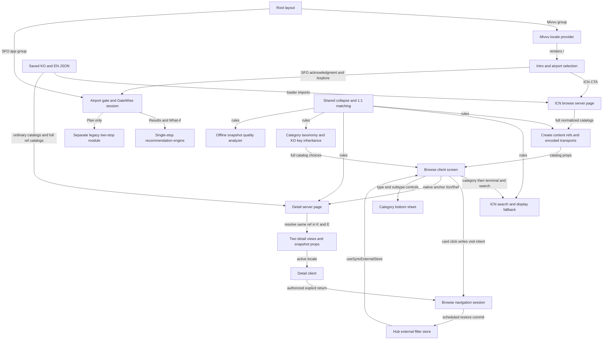

# GW-ICN-010 — Mivvu code map and change-impact analysis

Maintained entry point, refreshed by **GW-ICN-010-R1** through GW-ICN-014. Plan revision: **GW-PLAN-REV-2026-10-29**. Analysis: **2026-10-29, America/New_York**. Owner: Codex. Assessment: ChatGPT coordinator; final acceptance: human owner. **This refresh is pending review/acceptance.** The historical 010 acceptance does not accept this new analysis.

> **Freshness:** All current source links below pin analyzed source [`2be6c13297f0ea0590d69743525de62a47b3920a`](https://github.com/cucu071212/Mivvu/tree/2be6c13297f0ea0590d69743525de62a47b3920a), the published `feat/gw-icn-014-category` HEAD verified before analysis. Graphify: **0.9.97**. The documentation publication commit is a later, documentation-only child of this source; it is not the mapped source SHA. Compare subsequent code changes before relying on this map. This is static analysis, not fresh test, browser, bundle, live API or production evidence. No automatic regeneration is configured.
>
> Raw graph, extraction, diagnostics, manifests and query evidence remain local at `<local-evidence>/`; `<analysis-worktree>` and `<original-worktree>` are generalized placeholders. The private completion report provides actual locations. Only this report and the [R1 checkpoint](../handoffs/GW-ICN-010-R1-checkpoint.md) are published. The [original report](https://github.com/cucu071212/Mivvu/blob/1c3f7215f44e48e8fc89736b0829fd2e5f667aea/docs/analysis/GW-ICN-010-code-map.md) and [historical checkpoint](https://github.com/cucu071212/Mivvu/blob/1c3f7215f44e48e8fc89736b0829fd2e5f667aea/docs/handoffs/GW-ICN-010-checkpoint.md) remain preserved at PR #5's pinned commit.

## 1. Source, authorization and changes since the original map

| Boundary | Verified context |
| --- | --- |
| Analyzed source | `2be6c13297f0ea0590d69743525de62a47b3920a`; clean new worktree on `docs/gw-icn-010-refresh-014`, based directly on 014 |
| Remote verification | `main` = `2e56a28c16ebd71eb202db7aa428db7ba9b50b78`; historical PR [#5](https://github.com/cucu071212/Mivvu/pull/5) open/unmerged at `1c3f7215f44e48e8fc89736b0829fd2e5f667aea` |
| Dependency | 013 = `135712d8561518d36b4f89fc508fdf6981889b94`; PR [#10](https://github.com/cucu071212/Mivvu/pull/10) open/unmerged, head 014 at analyzed SHA, base `feat/gw-icn-013-detail` |
| Direct authorization | Human owner, Codex chat attachment, 2026-10-29 America/New_York: bounded static analysis, documentation, explicit-file commit, normal push and one non-draft PR targeting 014 |
| Exclusions | Application/configuration/test/fixture changes, installs, providers, subagents, merge, deployment and GW-ICN-015 work |
| Canon read | Source-revision AGENTS, PLAN, implementation plan and plan revisions; 012 reference contract; 013/014 checkpoints and category refinement; local Graphify instructions; verification-before-completion |
| Tool inventory | Pinned [inventory at `70f681f`](https://github.com/cucu071212/Mivvu/blob/70f681f914d2ff0409fd559f521768b03053dccc/docs/tooling/agent-tool-inventory.md), read via local Git object; separate PR #9 was not merged |
| Original checkout | Dirty `codex/gw-icn-007-snapshot-quality` at `5bd3121f6aac992ac1b5d59e33c1e68d65c40170`; excluded from extraction |

The original map analyzed `2e56a28` before 012–014. The refresh retrieves that report from `1c3f721`, retains its architecture and A/B/C entry points, and replaces stale relationships:

- **Identity is now wired:** full normalized catalogs feed versioned content references; browse cards have encoded detail transports and `/icn/f/[ref]` resolves the same reference in both locales. `browse-{listingIndex}` remains a rendering association, not persistent identity.
- **Detail has its own server/client path:** it builds ordinary catalogs for metadata/fallback and resolves the selected reference, without generating references for the entire catalog on each detail load.
- **Browse filters are module-owned:** query, terminal and category live in a hub external store. Explicit detail return schedules one-shot session restoration. The old claim that every route unmount resets browse query/terminal is obsolete.
- **Lifecycle ownership is explicit:** pure snapshot reads, commit-driven restoration, guarded storage, document-owned BFCache resume and Strict Mode replay are distinct concerns. Earlier silent-mirror descriptions in the 013 checkpoint are superseded by its final A/B/C corrections.
- **Category discovery is implemented:** eight approved KO keys, medium choices from saved rows, conservative KO/EN pairing, selection continuity and a button-based modal bottom sheet.
- **Product direction advanced:** the six ICN core actions, including local saving, are approved direction in PLAN. This source does not implement the saved-facilities journey or authorize starting it. SFO remains a separate demo path.

Historical checkpoint/task entries contain publication SHAs and earlier proposals; they are evidence of their recorded moment, not current remote state or new execution permission. No implementation-plan edit was necessary: direct authorization and this refresh's separate acceptance state are recorded here and in the R1 checkpoint. PLAN and the historical 010 checkpoint are unchanged.

## 2. Graphify method, coverage and limitations

One deterministic code-only Python-library extraction used `GRAPHIFY_BACKEND=none`, `extract(explicit_paths, root=<analysis-worktree>, cache_root=<local-evidence>, parallel=False)`, `build_from_json(..., directed=True)`, clustering, diagnostics and `to_json(..., built_at_commit=<analyzed SHA>)`. Installed extraction/cache/export/query implementation was inspected. Outputs/cache stay outside source; no semantic extraction, external provider, worker pool, hook, watcher, install or configuration change was used. Query logging was disabled with `GRAPHIFY_QUERY_LOG_DISABLE=1`. Graphify extraction tokens: **0 input / 0 output**; this does not mean the surrounding agent analysis used no tokens.

| Measure | Original 010 | R1 |
| --- | ---: | ---: |
| Tracked code inputs | 250 | **281** |
| Lines / whitespace words | 25,207 / 85,890 | **28,480 / 96,820** |
| Raw node rows / edges | 1,156 / 3,342 | **1,318 / 3,949** |
| Built directed nodes / edges | 1,181 / 3,230 | **1,342 / 3,820** |
| Communities | 46 | **58** |
| Graphify provider tokens | 0 / 0 | **0 / 0** |

Inputs: **260 `src` files, 10 `e2e` files, 7 maintainer scripts, 4 root code configs; 117 test/spec files**. Selection: tracked `.ts/.tsx/.js/.mjs/.cjs` in those directories plus root code configs, excluding `.d.ts` stubs. The explicit corpus is below the 500-file / 2-million-word warning thresholds. No sensitive file was selected. Scope manifest includes selected paths, hashes, line/word counts and excluded tracked paths.

Excluded from graph extraction: documents/prototypes under `docs`, all JSON/data assets, CSS, YAML, binary assets, environment/credential files, dependencies, builds, caches, Git internals, other worktrees and generated outputs. JSON snapshots, package/tsconfig/workflow contracts, relevant CSS and maintainer documents were inspected separately; that is **not parsed graph coverage**. No facility-per-row graph coverage is claimed.

**Graph health warning:** diagnostics on raw extraction report **26 dangling-endpoint edges**, **316 external-reference edges**, **123 directed same-endpoint collapsed relationships** (**125** if undirected), **0 missing-endpoint edges**, **0 self-loops**, **0 exact duplicate edges**. Raw node IDs have three duplicate pairs (`playwright_test`, `productionTravelMatrixMetadata`, `MivvuPreviewMessages`), leaving 1,315 distinct raw IDs; the built graph also materializes endpoint/reference nodes. Do not interpret raw/built count differences as additional parsed code.

The extractor warns that **45 files yielded no symbols**; each selected file still has a source node. `failed_sources` and `skipped_sources` are empty. File representation does not establish complete symbol/callback/test coverage. Additional source strings `@playwright/test` and `node:fs` identify external references, not parsed files. External/unresolved endpoints and AST limitations are retained, not repaired. A missing edge is not proof that modules are isolated.

Raw confidence: **3,936 EXTRACTED / 13 INFERRED**. Relationships include imports, containment, calls, dynamic imports, indirect calls, re-exports and citations. The simple directed graph combines some same-pair relations; inspect raw edges when their distinction matters. Communities/hubs are structural, affected by tests and types, and do not define ownership, client bundles or runtime invocation. Raw cohesion scores for all 58 communities remain in `summary.json` (range **0.055651176133103844–1.0**); examples: matching community 13 **0.11612903225806452**, taxonomy community 29 **0.17647058823529413**, hub-restore community 34 **0.225**.

Targeted CLI evidence uses exact graph IDs and vocabulary-derived tokens:

| Query seed | Expanded vocabulary / result |
| --- | --- |
| `filterIcnBrowseItems` | `browse filter category search`; initial BFS truncated; repeated with `--context call --budget 3500`, retained separately |
| `resolveIcnFacilityRef` | `reference resolve snapshot matching` |
| `commitScheduledHubRestoreIfIdle` | `session restore commit browse` |
| `resumeBrowseOriginAfterBfcache` | `bfcache resume detail session` |
| `buildIcnBrowseCategoryTaxonomy` | `category taxonomy locale matching` |
| `MivvuPreviewLocaleProvider` | `locale provider browse detail` |

All six queries, the focused search retry, two directed paths and matching `explain` completed with exit 0. Several queries explicitly emitted complete answers larger than the requested 3,500-token display budget to preserve edges; those display estimates are not provider usage. Directed paths confirm one-hop `filterIcnBrowseItems → searchIcnIndex` and `MivvuIcnFacilityDetailPage → resolveIcnFacilityRef`. Twelve important raw call relationships were checked at their actual source lines, including category matching, normalized ref creation, ordinary detail catalog loading, silent-clear then publish, and BFCache registration. JSX/layout composition, event ordering and document lifetimes below are **source-confirmed interpretation**, not automatically proven by graph traversal.

## 3. Current architecture and route ownership

Arrows in this curated diagram name source relationships; they do not promise execution frequency or bundle inclusion.

| Route / boundary | Source-confirmed composition | Impact owner on a future assignment |
| --- | --- | --- |
| `/` | [Entry page](https://github.com/cucu071212/Mivvu/blob/2be6c13297f0ea0590d69743525de62a47b3920a/src/app/%28mivvu-entry%29/page.tsx#L1) → [intro/session gate](https://github.com/cucu071212/Mivvu/blob/2be6c13297f0ea0590d69743525de62a47b3920a/src/components/mivvu/MivvuFirstEntryFlow.tsx#L18) → [airport selection](https://github.com/cucu071212/Mivvu/blob/2be6c13297f0ea0590d69743525de62a47b3920a/src/components/mivvu/MivvuAirportSelectionScreen.tsx#L99) | Entry/UI integration; no flight requirement for ICN |
| `/icn` | [browse route](https://github.com/cucu071212/Mivvu/blob/2be6c13297f0ea0590d69743525de62a47b3920a/src/app/%28mivvu-entry%29/icn/page.tsx#L1) → [server catalog assembly](https://github.com/cucu071212/Mivvu/blob/2be6c13297f0ea0590d69743525de62a47b3920a/src/components/mivvu/MivvuIcnBrowsePage.tsx#L11) → client wrapper → browse screen | Server projection, client filters, identity and data contracts |
| `/icn/f/[ref]` | [async route params](https://github.com/cucu071212/Mivvu/blob/2be6c13297f0ea0590d69743525de62a47b3920a/src/app/%28mivvu-entry%29/icn/f/%5Bref%5D/page.tsx#L13) → [server detail](https://github.com/cucu071212/Mivvu/blob/2be6c13297f0ea0590d69743525de62a47b3920a/src/components/mivvu/MivvuIcnFacilityDetailPage.tsx#L20) → [client detail](https://github.com/cucu071212/Mivvu/blob/2be6c13297f0ea0590d69743525de62a47b3920a/src/components/mivvu/MivvuIcnFacilityDetailPageClient.tsx#L50) | Resolution/presentation, locale and navigation lifecycle |
| Mivvu shared shell | [group layout](https://github.com/cucu071212/Mivvu/blob/2be6c13297f0ea0590d69743525de62a47b3920a/src/app/%28mivvu-entry%29/layout.tsx#L1) → [shell](https://github.com/cucu071212/Mivvu/blob/2be6c13297f0ea0590d69743525de62a47b3920a/src/components/mivvu/MivvuEntryLayoutShell.tsx#L13) → locale provider; shared [ICN header](https://github.com/cucu071212/Mivvu/blob/2be6c13297f0ea0590d69743525de62a47b3920a/src/components/mivvu/MivvuIcnHeader.tsx#L20) on browse/detail | Provider placement, header, localized messages and CSS |
| Legacy preview URLs | [entry redirect](https://github.com/cucu071212/Mivvu/blob/2be6c13297f0ea0590d69743525de62a47b3920a/src/app/preview/mivvu-entry/page.tsx#L1) and [browse redirect](https://github.com/cucu071212/Mivvu/blob/2be6c13297f0ea0590d69743525de62a47b3920a/src/app/preview/mivvu-entry/icn/page.tsx#L1) | Bookmark compatibility to `/` and `/icn` |
| SFO app group | [app layout](https://github.com/cucu071212/Mivvu/blob/2be6c13297f0ea0590d69743525de62a47b3920a/src/app/%28app%29/layout.tsx#L1) validates SFO JSON and wraps [GateWiseProviders](https://github.com/cucu071212/Mivvu/blob/2be6c13297f0ea0590d69743525de62a47b3920a/src/components/GateWiseProviders.tsx#L15) | Independent airport acknowledgment/session boundary |
| `/flight`, `/explore`, `/recommendations`, `/plan` | [SFO route definitions](https://github.com/cucu071212/Mivvu/blob/2be6c13297f0ea0590d69743525de62a47b3920a/src/lib/app-routes.ts#L1) and screen components under the SFO group | Preserve shipped engine/demo behavior |

### Server/client loading boundary

[Fixture loading](https://github.com/cucu071212/Mivvu/blob/2be6c13297f0ea0590d69743525de62a47b3920a/src/lib/icn-facilities/load-icn-facilities-fixture.ts#L7) statically imports saved JSON with a typed cast; it does not run the offline validator or call the live API. Browse loads both languages, builds **complete normalized** reference catalogs, and builds both ref-bearing browse catalogs before passing props into the client wrapper. [Ref attachment](https://github.com/cucu071212/Mivvu/blob/2be6c13297f0ea0590d69743525de62a47b3920a/src/lib/icn-facilities/icn-browse-detail-refs.ts#L30) creates references from normalized collapsed rows, then associates transports with `browse-{listingIndex}` at the projection boundary. It never constructs identity from search results or display names.

Detail separately loads both fixtures and uses **ordinary `buildIcnBrowseCatalog`**, not `buildIcnBrowseCatalogWithDetailRefs`, for metadata and fallback. It resolves the transported reference against full normalized catalogs in K and E, builds both views, and passes views/snapshot metadata/ref segment to the client. A found view includes its selected normalized record. The client selects locale and manages origin/back UI. Graph connectivity to loaders/quality tools does not imply those modules are in the client bundle; no build or bundle inspection was performed.

The [013 timing checkpoint](https://github.com/cucu071212/Mivvu/blob/2be6c13297f0ea0590d69743525de62a47b3920a/docs/handoffs/GW-ICN-013-checkpoint.md#L49) records why full ref-bearing detail projections were removed. Its Node timings and earlier build/browser checks are **historical evidence**, not remeasured performance or new browser verification here.

## 4. Change-impact A — search, category discovery and browse presentation

**Start here for query, membership, ranking, category or count changes.** Direct consumers are the browse screen and ICN search helpers; indirect consumers include detail navigation transports and restored category/query/terminal context. Airport-name search and SFO facility filtering remain different algorithms.

1. **Full catalogs first.** [Browse setup](https://github.com/cucu071212/Mivvu/blob/2be6c13297f0ea0590d69743525de62a47b3920a/src/components/mivvu/MivvuIcnFacilitiesBrowseScreen.tsx#L145) builds taxonomy and the name/location fallback index from full KO/EN collapsed catalogs before filtering. EN filtering receives a derived array with conservatively paired KO category keys. Raw EN `categoryLabel`, name, location and hours remain locale-local; KO key inheritance is filter membership, not translation or display borrowing.
2. **Category choices.** [Eight top-level keys](https://github.com/cucu071212/Mivvu/blob/2be6c13297f0ea0590d69743525de62a47b3920a/src/lib/icn-facilities/icn-browse-category-taxonomy.ts#L6) are `식・음료`, `공항즐기기`, `안내・편의시설`, `일반쇼핑`, `면세점쇼핑`, `출입국시설`, `기타시설`, `교통시설`. [Taxonomy construction](https://github.com/cucu071212/Mivvu/blob/2be6c13297f0ea0590d69743525de62a47b3920a/src/lib/icn-facilities/icn-browse-category-taxonomy.ts#L105) takes medium keys from full KO listings under each parent, sorts them in KO order, and derives EN labels from a sample KO row's unambiguous EN counterpart. Missing paired labels show KO with `labelEnFromKoreanFallback` and `icnKoOnlyCategory` disclosure. It does not generate translations or new taxonomy groups. Unpaired locale rows keep their original keys; no category membership is invented.
3. **Composition order.** [filterIcnBrowseItems](https://github.com/cucu071212/Mivvu/blob/2be6c13297f0ea0590d69743525de62a47b3920a/src/lib/icn-facilities/icn-browse-view-model.ts#L238) applies large/medium category filtering, then indexes that scoped array and invokes search with the terminal filter. [searchIcnIndex](https://github.com/cucu071212/Mivvu/blob/2be6c13297f0ea0590d69743525de62a47b3920a/src/lib/icn-facilities/icn-facility-search.ts#L141) limits terminal eligibility, returns eligible source order for empty queries, otherwise uses strong matches and only then conservative typo fallback. Category, terminal and query therefore compose; taxonomy choices are not rebuilt from current hits.
4. **Text behavior.** [Normalization](https://github.com/cucu071212/Mivvu/blob/2be6c13297f0ea0590d69743525de62a47b3920a/src/lib/icn-facilities/icn-facility-search.ts#L8) folds full-width ASCII, normalizes NFC/case/whitespace and Hangul initial forms; it deliberately avoids broad NFKC folding. Search indexes raw locale name, location, category label and terminal label. All query tokens must match across fields; mixed Hangul/initial matching consumes adjacent characters. Name ranking favors exact/whole initial, prefix/whole words, other name hits, then other fields, with ordinal ties. Typo recovery allows one insertion/deletion/substitution in one Latin name token of at least five letters, only if no strong match exists in the eligible set; no transpositions or cross-language name search is added.
5. **Cache qualification.** [WeakMap indexes](https://github.com/cucu071212/Mivvu/blob/2be6c13297f0ea0590d69743525de62a47b3920a/src/lib/icn-facilities/icn-facility-search.ts#L154) are keyed by supplied array identity and locale. Category filtering returns a new array even for `all`; the current wrapper supplies that new scoped array. The old map's broad claim of automatic same-locale index reuse across query changes must therefore not be assumed for this path. This is source-confirmed structure; no runtime speed, memory or defect claim is made and no optimization was attempted.
6. **Display follows membership.** [Display projection](https://github.com/cucu071212/Mivvu/blob/2be6c13297f0ea0590d69743525de62a47b3920a/src/lib/icn-facilities/icn-browse-display.ts#L26) borrows only missing EN name/location from full-catalog 1:1 KO matches, keeping raw fields and separate disclosure flags. Category/hours text is not filled by that helper. Browse count uses filtered length versus snapshot listing count. Equal start/end hours text is treated as unavailable; it does not mean 24-hour opening. React renders source/query text as text.
7. **Bottom-sheet boundary.** [The sheet](https://github.com/cucu071212/Mivvu/blob/2be6c13297f0ea0590d69743525de62a47b3920a/src/components/mivvu/MivvuIcnCategoryBottomSheet.tsx#L32) is a modal dialog with native buttons and `aria-pressed`; selection applies immediately then closes. It captures/restores focus, focuses Close, wraps Tab at boundaries, closes on Escape/backdrop, and restores body overflow on cleanup. The screen alone owns sheet-open mode; filter values live in the hub store. Changing a top-level key clears medium to `all`; optional subtype row appears only with a selected parent and available mediums. [Approved refinement](https://github.com/cucu071212/Mivvu/blob/2be6c13297f0ea0590d69743525de62a47b3920a/docs/handoffs/GW-ICN-019-bottom-sheet-refinement.md#L1) supersedes the earlier prototype's inline category panel. CSS was read separately; source structure is not fresh accessibility/layout validation.

**Future verification candidates (not run):** [search semantics](https://github.com/cucu071212/Mivvu/blob/2be6c13297f0ea0590d69743525de62a47b3920a/src/lib/icn-facilities/icn-facility-search.test.ts#L1), [fixture regression](https://github.com/cucu071212/Mivvu/blob/2be6c13297f0ea0590d69743525de62a47b3920a/src/lib/icn-facilities/icn-search-catalog.test.ts#L1), [full-catalog fallback integration](https://github.com/cucu071212/Mivvu/blob/2be6c13297f0ea0590d69743525de62a47b3920a/src/lib/icn-facilities/icn-search-fallback-integration.test.ts#L1), [taxonomy/composition/disclosure](https://github.com/cucu071212/Mivvu/blob/2be6c13297f0ea0590d69743525de62a47b3920a/src/lib/icn-facilities/icn-browse-category-taxonomy.test.ts#L1), [category restoration](https://github.com/cucu071212/Mivvu/blob/2be6c13297f0ea0590d69743525de62a47b3920a/src/lib/icn-facilities/icn-browse-hub-filters-category.test.ts#L1), [sheet semantics/focus](https://github.com/cucu071212/Mivvu/blob/2be6c13297f0ea0590d69743525de62a47b3920a/src/components/mivvu/MivvuIcnCategoryBottomSheet.test.tsx#L1) and [mobile search E2E](https://github.com/cucu071212/Mivvu/blob/2be6c13297f0ea0590d69743525de62a47b3920a/e2e/icn-facility-search.mobile.spec.ts#L1). Agree membership/rank examples independently; assess KO/EN continuity, empty results, IME, focus/counts, subtype clearing and sheet keyboard behavior for an authorized UI change. The opt-in search-evidence harness is a future performance candidate only.

**Inherited test isolation limitation:** [014's checkpoint](https://github.com/cucu071212/Mivvu/blob/2be6c13297f0ea0590d69743525de62a47b3920a/docs/handoffs/GW-ICN-014-checkpoint.md#L36) records **3 FAIL / 3 PASS** in the combined `MivvuIcnFacilitiesBrowseScreen.test.tsx` file, inherited from `135712d`, caused by module-owned terminal-filter leakage after the EN/terminal case. The EN-without-category, ambiguous-hours and HTML-shaped-text cases each pass alone in that recorded review. Do not describe the full file or historical 71-test campaign as green. This static task neither reruns nor repairs it.

## 5. Change-impact B — snapshots, matching, reference identity and detail

**Start here for saved-data/schema/content changes or facility reference transport/resolution.** The shared [content inventory](https://github.com/cucu071212/Mivvu/blob/2be6c13297f0ea0590d69743525de62a47b3920a/src/lib/icn-facilities/icn-snapshot-matching.ts#L4) now affects more than the original map's collapse/fallback/quality paths: references and category pairing depend on it too.

### Runtime and offline shared contracts

[Identical-row collapse](https://github.com/cucu071212/Mivvu/blob/2be6c13297f0ea0590d69743525de62a47b3920a/src/lib/icn-facilities/icn-snapshot-matching.ts#L29) uses canonical normalized content, excludes only `listingIndex`, and retains the earliest current index for each identical record. Distinct content under one sourceId survives. [Bilingual matching](https://github.com/cucu071212/Mivvu/blob/2be6c13297f0ea0590d69743525de62a47b3920a/src/lib/icn-facilities/icn-snapshot-matching.ts#L49) pairs only one collapsed record per side, on **complete** supplied catalogs, before query/terminal/category filtering. Full catalog means the entire supplied snapshot, not verified airport completeness. Projecting or filtering first can conceal ID conflicts.

The saved JSON still has **1,028 raw rows / 1,011 declared distinct source IDs / 17 duplicate-ID groups per language**, API reported total **1,175**, and `api_total_mismatch`. These are direct file/metadata observations; snapshots were not graph inputs, refreshed or validated against the live airport API. Fixture bytes are unchanged since the original analyzed source. Count consistency is not proof of coverage or field accuracy.

Maintenance remains `sync:icn-facilities` → [sync wrapper](https://github.com/cucu071212/Mivvu/blob/2be6c13297f0ea0590d69743525de62a47b3920a/scripts/sync-icn-facilities.mjs#L1) → opt-in test harness → [sync/parser/normalizer](https://github.com/cucu071212/Mivvu/blob/2be6c13297f0ea0590d69743525de62a47b3920a/src/lib/icn-facilities/sync-icn-facilities.ts#L44) → atomic fixture writer. Offline checking remains `quality:icn-snapshots` → [quality wrapper](https://github.com/cucu071212/Mivvu/blob/2be6c13297f0ea0590d69743525de62a47b3920a/scripts/check-icn-snapshots.mjs#L1) → harness → [CLI](https://github.com/cucu071212/Mivvu/blob/2be6c13297f0ea0590d69743525de62a47b3920a/src/lib/icn-facilities/icn-snapshot-quality-cli.ts#L46) → [unknown-input validator](https://github.com/cucu071212/Mivvu/blob/2be6c13297f0ea0590d69743525de62a47b3920a/src/lib/icn-facilities/validate-icn-snapshot.ts#L34) → [analyzer](https://github.com/cucu071212/Mivvu/blob/2be6c13297f0ea0590d69743525de62a47b3920a/src/lib/icn-facilities/icn-snapshot-quality.ts#L156). The analyzer shares collapse/content/cardinality rules with runtime consumers; it reports content changes separately from metadata/order/duplicate multiplicity. Exit 0 is input validity, with warnings/differences possible and `publicationDecision: not_assessed`. Runtime's typed fixture loader does not invoke this validator. Neither maintenance nor offline commands were run.

### References and locale continuity

The [012 contract](https://github.com/cucu071212/Mivvu/blob/2be6c13297f0ea0590d69743525de62a47b3920a/docs/data/icn-facility-reference-contract.md#L1) remains binding for identity; its statements about *future* route wiring are historical integration handoff text. Actual integration is now in [full-catalog creation](https://github.com/cucu071212/Mivvu/blob/2be6c13297f0ea0590d69743525de62a47b3920a/src/lib/icn-facilities/icn-browse-detail-refs.ts#L14) and the detail page.

`IcnFacilityRef` v1 stores the canonical whole-content JSON fingerprint plus an optional captured opposite-language fingerprint. It is verbose public listing content, not a short persistent business ID, authorization credential or cross-refresh migration mechanism. [Creation](https://github.com/cucu071212/Mivvu/blob/2be6c13297f0ea0590d69743525de62a47b3920a/src/lib/icn-facilities/icn-facility-reference.ts#L95) receives normalized members and full catalogs before lossy projection. Frozen content schema, field order, exact null/blank distinctions and source identity participate; changing shared content inventory requires explicit v1/version review.

[Resolution](https://github.com/cucu071212/Mivvu/blob/2be6c13297f0ea0590d69743525de62a47b3920a/src/lib/icn-facilities/icn-facility-reference.ts#L122) parses first, locates exact origin content, then handles requested language. No failure includes a fallback record:

| Condition | Outcome / propagation |
| --- | --- |
| Exact origin, requested origin language | `found`; reorder/index changes alone are incidental |
| Origin changed or removed | `missing / reference_content_not_found`, even if captured translation survives; changed and removed cannot be distinguished |
| Cross-language sourceId conflicts on either collapsed side | `ambiguous / bilingual_pairing` before uncaptured-locale handling |
| Counterpart not captured at creation | `missing / locale_not_captured`; a later unique match is not adopted |
| Captured counterpart absent or changed | `missing / locale_content_not_found` |
| Exact captured pair and current 1:1 cardinality | `found` in requested language without rewriting the origin reference |
| Malformed reference / future valid version | `invalid_reference` / `unsupported_version` |

The route carries the **same whole ref**, not a new ref constructed on every KO/EN toggle. [Transport](https://github.com/cucu071212/Mivvu/blob/2be6c13297f0ea0590d69743525de62a47b3920a/src/lib/icn-facilities/icn-facility-ref-transport.ts#L8) encodes serialized JSON with `encodeURIComponent`; its decoder conditionally tries one `decodeURIComponent` when percent text remains and catches decode errors before parsing. This describes the implementation, not universal URL-length or arbitrary transport correctness. Inspect special-character and framework-param cases under any future transport change; the graph does not prove them.

[Detail presentation](https://github.com/cucu071212/Mivvu/blob/2be6c13297f0ea0590d69743525de62a47b3920a/src/lib/icn-facilities/icn-facility-detail-present.ts#L50) preserves resolver failure branches and applies name/location display fallback separately on success. It provides terminal/floor, raw category/hours and directory flags; the client distinguishes failure messages, shows source/retrieval/coverage notes, and labels hours as published text rather than live open/closed state. Arrival/duty-free directory labels are not permission to enter a security area. No walks, queue, coordinates or gate suitability are inferred.

**Future verification candidates (not run):** [identity/version/adversarial cases](https://github.com/cucu071212/Mivvu/blob/2be6c13297f0ea0590d69743525de62a47b3920a/src/lib/icn-facilities/icn-facility-reference.test.ts#L1), [projection association](https://github.com/cucu071212/Mivvu/blob/2be6c13297f0ea0590d69743525de62a47b3920a/src/lib/icn-facilities/icn-browse-detail-refs.test.ts#L1), [URL transport](https://github.com/cucu071212/Mivvu/blob/2be6c13297f0ea0590d69743525de62a47b3920a/src/lib/icn-facilities/icn-facility-ref-transport.test.ts#L1), [locale/error presentation](https://github.com/cucu071212/Mivvu/blob/2be6c13297f0ea0590d69743525de62a47b3920a/src/lib/icn-facilities/icn-facility-detail-present.test.ts#L1), [opt-in detail cost probe](https://github.com/cucu071212/Mivvu/blob/2be6c13297f0ea0590d69743525de62a47b3920a/src/lib/icn-facilities/icn-facility-detail-page.perf.test.ts#L1), [detail/mobile/error/storage E2E](https://github.com/cucu071212/Mivvu/blob/2be6c13297f0ea0590d69743525de62a47b3920a/e2e/icn-facility-detail.mobile.spec.ts#L1); also snapshot-quality, CLI, browse-display/catalog, duplicate-ID, shipped-output and integrated fallback tests. Future changes should check full-catalog hidden conflicts, reused ordinals/IDs, changed origin/counterpart, uncaptured translation, version/encoding failures and honest missing copy. Source expectations were inspected; none is a new passing result.

## 6. Change-impact C — entry, locale, hub state and navigation ownership

**Start here for shared provider placement, return navigation, session/storage or BFCache changes.** Source distinguishes three independent ICN responsibilities: live hub filters, browse→detail authorization, and one-shot list restore. Do not collapse them into one persisted flag.

| State | Current owner / lifetime | Change impact |
| --- | --- | --- |
| Mivvu locale | [provider](https://github.com/cucu071212/Mivvu/blob/2be6c13297f0ea0590d69743525de62a47b3920a/src/components/mivvu/MivvuPreviewLocaleProvider.tsx#L30); [localStorage key](https://github.com/cucu071212/Mivvu/blob/2be6c13297f0ea0590d69743525de62a47b3920a/src/lib/mivvu-preview-locale.ts#L3) `mivvu.preview.locale.v1` | Valid stored KO/EN first, otherwise any navigator language with `ko` prefix, else EN. Post-mount boot gate and wrapper `lang`; blocked storage still permits memory toggle. No cross-tab synchronization listener |
| Intro | `MivvuFirstEntryFlow` phase plus `mivvu.entry.introSeen.v1` sessionStorage | Revisit/reduced-motion skip, existing 3.2s timing; not airport preference |
| Airport choice/search | Airport screen local query, selected ICN default, feedback | Draft resets on remount; ICN CTA goes to `/icn`; SFO CTA records acknowledgment then `/explore` |
| ICN query/terminal/large/medium | [module hub store](https://github.com/cucu071212/Mivvu/blob/2be6c13297f0ea0590d69743525de62a47b3920a/src/lib/icn-facilities/icn-browse-hub-filters.ts#L31) via `useSyncExternalStore` | Retained on same-document remount; fresh document starts defaults unless explicit restore commits. Large change clears medium. Airport-back handler explicitly clears session and resets hub |
| Sheet-open mode | Browse component `useState` | UI-local, not persisted with filters |
| Detail context | [session payload](https://github.com/cucu071212/Mivvu/blob/2be6c13297f0ea0590d69743525de62a47b3920a/src/lib/icn-facilities/icn-browse-session.ts#L8) under `mivvu.icn.browseContext.v1` | Query, terminal, category keys, encoded ref, per-visit token and `restoreOnNextHubVisit`; scoped navigation context, not general URL/state preservation |
| Browse origin | One-shot `mivvu.icn.browseOriginIntent.v1`, active `mivvu.icn.activeDetailVisit.v1`, live registration and document-owned token | Storage payload alone cannot establish browse-origin UI or BFCache authorization |
| SFO acknowledgment | [`gatewise.airport-selection.v1`](https://github.com/cucu071212/Mivvu/blob/2be6c13297f0ea0590d69743525de62a47b3920a/src/lib/airport-selection-preference.ts#L4) + memory fallback | Explicit SFO entry, not universal last-airport choice; date validated, no daily expiry |
| SFO flight/countdown/overrides | [GateWiseSessionProvider](https://github.com/cucu071212/Mivvu/blob/2be6c13297f0ea0590d69743525de62a47b3920a/src/context/gatewise-session.tsx#L126) in app group | In-memory GW-F session; separate from ICN hub/session and Mivvu locale |
| SFO two-stop drafts | Page-local `TwoStopPlannerDemo` state | Independent opt-in/selections; no ICN persistence contract |

### Explicit restoration and publication order

[Client snapshot getter](https://github.com/cucu071212/Mivvu/blob/2be6c13297f0ea0590d69743525de62a47b3920a/src/lib/icn-facilities/icn-browse-hub-filters.ts#L123) only reads the current snapshot (server uses a stable frozen default); it does not read storage, attach bridges, mirror a scheduled restore, publish or notify. [Subscription](https://github.com/cucu071212/Mivvu/blob/2be6c13297f0ea0590d69743525de62a47b3920a/src/lib/icn-facilities/icn-browse-hub-filters.ts#L103) attaches the session bridge and may commit an existing restore. An extra subscriber does not reset filters. User setters mark filters dirty before notification, so scheduled restoration cannot overwrite user edits.

[Restore commit](https://github.com/cucu071212/Mivvu/blob/2be6c13297f0ea0590d69743525de62a47b3920a/src/lib/icn-facilities/icn-browse-hub-filters.ts#L60) checks dirty/reentrancy guards and the explicit flag, copies all four filters, **silently clears session context, then publishes the new filter snapshot**. The commit guard blocks recursive bridge reset while subscribers react. It does not call the notifying `consumeHubRestoreFilters` helper. This ordering and pure-read contract supersede earlier silent-mirror checkpoint text; it is directly visible in source and asserted by current-contract/publish-order/commit-guard tests.

### Document-owned detail lifecycle

| Trigger | Source-confirmed behavior |
| --- | --- |
| Browse card activation | `saveIcnBrowseDetailNavigation` writes context, visit token, active token and one-shot intent before native anchor navigation; notification follows successful writes |
| Detail layout effect | [client](https://github.com/cucu071212/Mivvu/blob/2be6c13297f0ea0590d69743525de62a47b3920a/src/components/mivvu/MivvuIcnFacilityDetailPageClient.tsx#L69) consumes matching intent, recording the document-owned token, or reattaches a committed token for Strict Mode replay; registration notifies session subscribers |
| Origin read | [detailOpenedFromBrowse](https://github.com/cucu071212/Mivvu/blob/2be6c13297f0ea0590d69743525de62a47b3920a/src/lib/icn-facilities/icn-browse-session.ts#L217) requires matching ref, non-restore payload, visit token, active token and live registration; it is exposed through `useSyncExternalStore` |
| Explicit list return | Client schedules restore only if `fromBrowse`, then pushes `/icn`; direct entry shows its banner and does not schedule list restoration |
| Persisted `pagehide` | [suspend](https://github.com/cucu071212/Mivvu/blob/2be6c13297f0ea0590d69743525de62a47b3920a/src/lib/icn-facilities/icn-browse-session.ts#L209) retains payload but clears active token/live registration; it does not confer authority to another document |
| Persisted `pageshow` | [resume](https://github.com/cucu071212/Mivvu/blob/2be6c13297f0ea0590d69743525de62a47b3920a/src/lib/icn-facilities/icn-browse-session.ts#L198) additionally requires this document's previously claimed token to equal the session token before restoring active registration |
| Non-persisted departure / last unmount | Pending association is abandoned; microtask cleanup permits immediate Strict Mode reattachment. A scheduled restore is retained for its explicit consumer |
| Storage getter/method failures | [guarded storage helpers](https://github.com/cucu071212/Mivvu/blob/2be6c13297f0ea0590d69743525de62a47b3920a/src/lib/icn-facilities/icn-browse-session.ts#L46) return null/false or ignore removal failure; no successful persistence/restoration guarantee is inferred under denial |

These tokens authorize **navigation context/UI within this document flow**, not access to private facility data. They are not authentication or an airport-access claim. Returning filters is the limited 013/014 one-shot contract; GW-ICN-017's broader exploration-state journey remains separate.

The [013 final ownership corrections](https://github.com/cucu071212/Mivvu/blob/2be6c13297f0ea0590d69743525de62a47b3920a/docs/handoffs/GW-ICN-013-checkpoint.md#L62) and [recorded ABC browser evidence](https://github.com/cucu071212/Mivvu/blob/2be6c13297f0ea0590d69743525de62a47b3920a/docs/handoffs/GW-ICN-013-checkpoint.md#L99) document accepted BFCache direct-entry versus genuine browse-origin, Strict Mode, storage SecurityError and list-return checks. “Production” there describes its recorded browser test mode/context; it is **not fresh serving-production evidence** in this refresh. The 014 checkpoint records reuse of unchanged lifecycle evidence plus category restoration coverage. Resolved review findings are not reopened.

**Future verification candidates (not run):** `icn-browse-session.test.ts`, `icn-browse-hub-filters-{current-contract,commit-guard,publish-order,silent-mirror,cold-snapshot,user-edits,category}.test.ts`, [lifecycle component tests](https://github.com/cucu071212/Mivvu/blob/2be6c13297f0ea0590d69743525de62a47b3920a/src/components/mivvu/icn-browse-lifecycle.test.tsx#L1), locale/provider/intro/entry tests and detail E2E. For a consequential lifecycle change, inspect both fresh direct-entry documents and genuine BFCache resumes, pure repeated snapshots, publish-before-notify, listener attach/unsubscribe, user edits during publish, storage denial, explicit one-time restore and category/locale continuity. Existing recorded evidence does not replace that future validation.

### Preserved SFO and shared entry boundaries

Root layout, shared route constants, airport selection acknowledgment, package/tooling and global styling can affect both surfaces. The [SFO gate](https://github.com/cucu071212/Mivvu/blob/2be6c13297f0ea0590d69743525de62a47b3920a/src/components/AirportSelectionLayout.tsx#L12) waits for hydration and redirects unacknowledged entry to `/`; [AppShell](https://github.com/cucu071212/Mivvu/blob/2be6c13297f0ea0590d69743525de62a47b3920a/src/components/AppShell.tsx#L1) owns shared SFO navigation/countdown hosts. Mivvu locale/header/hub stores do not supply SFO's facility model or session. Moving/merging providers would change state lifetime and require explicit scope/review.

SFO Explore filters browse-eligible rows separately from recommend eligibility. [Single-stop recommendations](https://github.com/cucu071212/Mivvu/blob/2be6c13297f0ea0590d69743525de62a47b3920a/src/lib/recommend.ts#L412) retain directed outbound + directed return + queue + activity + **one safety buffer**, boarding-**start** margin and ≥10 / 0–9 / <0 thresholds; missing essentials remain unknown. [What-if](https://github.com/cucu071212/Mivvu/blob/2be6c13297f0ea0590d69743525de62a47b3920a/src/components/WhatIfSimulator.tsx#L106) invokes the same ranked engine for baseline and scenario. [Two-stop](https://github.com/cucu071212/Mivvu/blob/2be6c13297f0ea0590d69743525de62a47b3920a/src/lib/plan-two-stop-legacy.ts#L363) remains a separate module: applicable directed legs, both queues/activities, one total buffer, honest strict unknowns and explicit synthetic-travel opt-in. SFO `legacy_zone`/D→D assumptions are not wired into ICN. Existing SFO regression suites are downstream candidates if shared entry/provider code changes; no such application edits occurred here.

## 7. Evidence, verification and handoff

**Source-confirmed:** route/JSX nesting, full-catalog creation/resolution, category-before-search composition, raw-locale search before name/location display fallback, stable KO keys/disclosures, exact identity outcomes, pure hub getters and committed restore order, guarded storage and document-token checks, and independent SFO provider/engine paths. Key graph calls were checked in source rather than accepted solely from confidence labels.

**Graph inference/limits:** resolved imports/calls/indirect callbacks, communities/hubs and traversal neighborhoods. React effects, navigation, BFCache, dynamic URL handling, serialization, CSS, accessibility and client bundle behavior require evidence beyond graph connectivity. No newly confirmed defect or security finding is asserted. The scoped-array/cache observation is a structural change-impact note, not a performance investigation.

**Verification performed for R1:** source SHA/ref/PR-state checks; explicit input/hash manifests; graph diagnostics and targeted queries/path/explain; twelve raw call edges versus source lines; SHA-pinned file/line and local Markdown link checks; whitespace, privacy/path review and exact two-document scope; existing worktree/source/historical-artifact preservation checks. Detailed results and publication state are in the [R1 checkpoint](../handoffs/GW-ICN-010-R1-checkpoint.md) and private evidence. Final remote HEAD, PR base/head and exact-HEAD CI observations belong to the private closeout; an empty Actions list is **no matching run**, not a pass.

**Not run:** application tests, lint/typecheck/build, broad suites, browser campaigns, live APIs, snapshot quality CLI, benchmarks, performance investigations or production inspection. Historical 013/014 PASS evidence is labeled and cited above; it is not this task's result. The inherited browse-screen combined-run failures remain explicit.

Publication includes no application/config/test/fixture/script/canonical-plan or workflow edits, no raw graph upload, no PR #5 modification, no dependency merge, no main push, merge, production deploy or next-task work. This refresh is ready for coordinator assessment and human acceptance once its documentation publication is verified; **acceptance remains pending**. No new implementation assignment follows automatically from this map.
