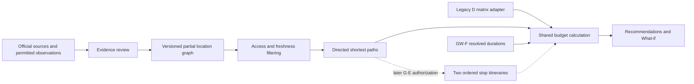

# GW-B-R001 — SFO routing evidence and architecture research

**Research date:** 2026-10-25 (America/New_York). Airport operational times use America/Los_Angeles.
**Audited baseline:** `47c07028e1eccb3515f8bd8bfddd80f1c90fccdd`.
**Task:** GW-B-R001 only; documentation and research, not GW-B-001 policy approval or GW-B-002 implementation.
**Authoring role:** Engineering Support Codex, assigned principal algorithms / airport systems research role.
**Recommendation:** Preserve the D-only illustrative model. Develop an evidence-backed location graph only through separately authorized design and implementation tasks.
**G-B0 readiness: HOLD.** The research supports a design decision, but GW-B-001 and human approval remain outstanding; no acceptable, currently accessible and reuse-approved automated SFO-wide amenity routing source was established.

## 1. Decision and scope

SFO's public information supports a useful **partial topology**: terminal/boarding-area relationships, some named connectors, security distinctions, construction detours, and coarse facility landmarks. It does not establish a complete, current graph of measured, accessible gate-to-facility walks. A partial graph is useful for recording what is known and explaining what is missing; it must not imply complete route coverage.

There is more timing information than the older provenance notes imply. Official terminal maps publish approximate walking-time grid legends. These are evidence for an **officially published approximation**, not measured distances or guaranteed traveler durations. A route derived from those grids would remain a GateWise `demo_estimate` under the present vocabulary, with the derivation and official source identified separately. No new numeric SFO edge is proposed in this report.

The smallest safe next change is a reviewed, per-edge evidence policy and metadata for the existing model. A gate/facility graph is a future architecture, not an implicit expansion of GW-B-002's approved file scope. Broad graph implementation, new gate inputs, and expanded recommendation eligibility need explicit lead assignments and any necessary planning/ownership updates.

This report reads [PLAN.md](../PLAN.md), [IMPLEMENTATION_PLAN.md](./IMPLEMENTATION_PLAN.md), [REMAINING_ROADMAP.md](./REMAINING_ROADMAP.md), [AGENTS.md](../AGENTS.md), and [GW-F-CONTRACT.md](./GW-F-CONTRACT.md). The implementation plan records signed **G-X3**, 26 directory facilities and 12 eligible facilities. Older production SHAs and “Phase X next” summaries elsewhere are historical; the user supplied the newer baseline above. No planning document or approval record is rewritten here.

The following remain fixed:

- Time available ends when **boarding starts**. Required time includes directed travel, queue, activity, and one safety buffer. Margin thresholds remain ≥10 / 0–9 / <0.
- Missing essential inputs produce Unknown with null required time and margin. A verified listing does not prove reachability, operating status, or a walk time.
- What-if and normal recommendations use the same calculation rules. Queue/activity personalization retains GW-F precedence and never mutates official records.
- No auth, database, live flights, multi-airport support, production turn-by-turn navigation, deployment, or eligibility expansion is authorized.
- GW-E still requires **G-Data = G-X3 + G-B1 + G-C0**, plus renewed **G-E** authorization.

## 2. Evidence ledger and feasibility

### 2.1 Method and evidence grades

Sources below were checked during this research on **2026-10-25**. “Direct” means the page or PDF content was retrieved; “indexed” means the search service's indexed first-party text was available but direct retrieval failed. An indexed result is discovery evidence, not proof of present service availability. Source publication/effective dates, retrieval dates, and validity of the described connection are different facts.

The T2, T3, and Moving Around PDFs were downloaded for inspection, rendered locally, and visually read. The International and T1 PDFs were inspected as extracted text. The web screenshot service returned references without viewable images; local rendering supplied the three visual checks. No map assets, API payloads, vendor scripts, or third-party datasets are committed. No vendor account was created, terms accepted, credentials reused, or support message sent.

| ID / source | Evidence actually obtained | What it can support / what it cannot |
| --- | --- | --- |
| S01 — [SFO static map index](https://www.flysfo.com/maps/static-maps), direct | Links to airport overview, International A/G, T1 B/C, T2 D, T3 E/F, Moving Around maps. | Naming and source discovery; not an active-gate inventory or machine-readable route network. |
| S02 — [T2 tabloid map](https://www.flysfo.com/sites/default/files/2025-11/251027_SFO_Tabloid_Face%20A_T2_Web.pdf), p.1, direct + visual | Footer effective **11/2025**; approximate **1 minute per grid square**; labeled D gates, directory grid references and walkway connections. | Coarse placement and a map-specific timing heuristic. No surveyed meters, documented walking-speed population, entrance coordinates, or error bound. Directory cells such as D1 are not gate identifiers. |
| S03 — [T3 tabloid map](https://www.flysfo.com/sites/default/files/2025-11/251027_SFO_Tabloid_Face%20A_T3_Web.pdf), p.1, direct + visual | Effective **11/2025**; approximate **2 minutes per grid square**; E/F areas, construction shading, and connector depiction. | Candidate topology to reconcile with current notices. The T2 calibration cannot be applied to this sheet. A line around construction is not a measured route. |
| S04 — [International tabloid map](https://www.flysfo.com/sites/default/files/2026-09/260701_SFO_Tabloid_Face%20A_INTL_WEB.pdf), p.1, direct text | Effective **7/2026**; approximate **2 minutes per grid square**; distinct A/G checkpoints, gates and terminal walkway labels. | Shows why terminal identity alone cannot identify a routable security region. Exact facility entrances and route weights remain unresolved. |
| S05 — [T1 tabloid map](https://www.flysfo.com/sites/default/files/2025-11/251027_SFO_Tabloid_Face%20A_T1_Web.pdf), p.1, direct text | Gate and concession directory text available. | Further manual topology review candidate; this audit does not assert a visually verified T1 scale or trace individual T1 paths. |
| S06 — [Moving Around SFO](https://www.flysfo.com/sites/default/files/2026-09/260814_SFO_Tabloid_Face%20B_INTL_WEB.pdf), p.1, direct + visual | General walkway average **6 minutes between terminals**; AirTrain average **3 minutes**; a **4-minute** annotation across the International check-in hall. | Orientation averages with coarse endpoints, not an all-pairs gate matrix. The public-hall annotation does not prove a direct post-security A↔G shortcut. The schematic groups D/E near Terminal 2, unlike the terminal index's E/F→T3 classification; do not rewrite canonical boarding-area mappings from that schematic. |
| S07 — [Terminal 3 construction](https://www.flysfo.com/about/construction/terminal-3-construction), direct, Connecting Flights / AirTrain sections | Describes interim post-security connections: vicinity of E2 to rotunda/F area, then onward to the existing International G connector. Reports T3 AirTrain station closure, with combined T2/T3 service. | Stronger operational context than a static drawing, but no segment timings, full endpoints, mobility validation, or precise reopening instant. A stated 2027 reopening expectation is not an executable reopening event. |
| S08 — [International connections](https://www.flysfo.com/passengers/travel-tips/international-travel/connections), direct | Broad post-security connectivity; non-precleared international arrivals must complete inspection, exit, and be screened again. Precleared arrivals are distinguished. | Supports a terminal-level connectivity claim and separate arrivals states. Does not grant an individual passenger clearance or establish every corridor's current availability. |
| S09 — [Check In & Security](https://www.flysfo.com/passengers/flight-info/check-in-security), direct | Published checkpoint access conditions, hours, employee-only checkpoints, and a changing wait-time table. Retrieved table displayed “Oct 24 at 02:32 pm” as last update. | Corrects any blanket claim that SFO publishes no checkpoint waits. Does **not** establish a licensed, tested live API, a maximum future queue, or concession wait times. No displayed wait is ingested. |
| S10 — [Interactive map](https://www.flysfo.com/maps), direct HTML + browser | Public HTML references Jibestream map/navigation scripts. The browser session displayed an overview and printable-map links; no working origin/destination routing flow was verified. | Evidence of map technology, not entitlement to its graph. No hidden endpoint enumeration, client-token reuse, or route-payload extraction. Failure to verify a UI is not proof the service never routes. |
| S11 — [SFO developer portal](https://developers.flysfo.com/), indexed | First-party indexed text says API updates are underway and new developer registration is paused. Direct web retrieval timed out. | Access risk; obtain current confirmation before depending on this service. Not a tested API response or service-level commitment. |
| S12 — [Sandbox API catalog](https://developers-sandbox.flysfo.com/apis), indexed | Gate-To-Gate estimates time/distance; Curb-To-Gate estimates curb/gate time; reference/flight products and an SFO Map entry are listed. Direct retrieval timed out. | Gate-to-gate is a plausible candidate, but its name/description proves neither amenity access nor geometry, security semantics, construction freshness, uncertainty, or licensing fit. |
| S13 — [SFO API terms PDF](https://developers.flysfo.com/files/terms-of-service.pdf), indexed historical revision **10-4-2017**, and [sandbox terms](https://developers-sandbox.flysfo.com/terms) | Indexed PDF text and the earlier repository audit identify export/storage/repurposing restrictions and Airport IP conditions. Direct terms retrieval failed (web 502; sandbox curl certificate expired). | Treat as unresolved restrictions, not an approved current license. Preserve TLS checks. Obtain the operative agreement and written permission for the intended use before ingestion. See §2.4. |
| S14 — [DataSF gate/stand assignment entry](https://data.sfgov.org/Transportation/SFO-Gate-and-Stand-Assignment-Information/chfu-j7tc), catalog discovery | Entry found; page redirected to data.sf.gov and exposed no useful schema in this retrieval. | Gate/stand assignment is not demonstrated corridor geometry. Bounded catalog search did not establish an open indoor routing dataset; this is not a claim none exists. |
| S15 — [OpenStreetMap licensing](https://www.openstreetmap.org/copyright) and [Simple Indoor Tagging](https://wiki.openstreetmap.org/wiki/Simple_Indoor_Tagging), direct | ODbL data with attribution/share-alike obligations; indoor schema distinguishes levels, spaces and corridors. Simple POIs alone do not provide routing. | Potential secondary evidence under reviewed licensing. No complete/current SFO indoor extract, security topology or construction coverage was validated in this task. |
| S16 — [Mappedin MapData API](https://docs.mappedin.com/web/v6/latest/classes/MapData.html), first-party documentation | Distinguishes route directions along walkable paths from straight-line `getDistance`; supports accessible-route options. | Demonstrates a possible vendor capability, not SFO coverage, an Airport contract, allowed export, or real-world accessibility certification. |
| S17 — [Apple IMDF sample](https://developer.apple.com/documentation/MapKit/displaying-an-indoor-map) and [Indoor Maps program](https://developer.apple.com/videos/play/wwdc2019/245/), first-party documentation | Venue-supplied geometry, levels, openings and identifiers can support indoor maps. | Suitable interchange candidate if SFO provides licensed data. A format/sample is not permission to extract Apple Maps' SFO content or an available SFO download. |
| S18 — [Google Routes policies](https://developers.google.com/maps/documentation/routes/policies), [route locations](https://developers.google.com/maps/documentation/routes/specify_location), first-party documentation | Routes have usage/attribution/caching terms and accept route endpoints. | No verified SFO security-aware amenity routing coverage established. General geographic routing or a POI coordinate must not replace indoor entrance topology. No Google data copied. |

### 2.2 Can official maps produce a meaningful graph without invented distances?

**Yes, for a partial, non-metric evidence graph. No, for a verified SFO-wide walking-time system on their own.** The following are separate levels of accomplishment:

1. **Place inventory:** Record a facility's existing identity, terminal/boarding area and source-described vicinity. This does not create any route edge.
2. **Connectivity claim:** Record an official statement about named regions or transfer points. Coarse claims belong in an evidence catalog until endpoints, direction, level and security continuity are sufficiently resolved for an edge.
3. **Traversable topology:** Review a public corridor and its entrance/exit, level changes, security side, current restrictions and each directed traversal. Split at junctions and transfer points. A drawing crossing another line is not necessarily a junction; two floors never join just because their plan coordinates overlap.
4. **Model time:** An independently reviewed path trace plus that sheet's approximate timing grid could yield a *map-derived demo estimate*. Record route definition, normalized grid calibration, rounding, date, assumptions and unresolved error. Do not derive meters from minutes by inventing a walking speed. This report supplies neither traces nor new edge values.
5. **Measured distance / calibrated time:** Requires licensed geometry with documented units and accuracy, or a permitted field survey. Walking speed, luggage, congestion, elevators and wayfinding remain separate model inputs even when distance is measured.

Counting grid cells between labels is insufficient: the walked path can bend, labels can be offset, entries can lie anywhere within a cell, and barriers can separate nearby points. Equal grid cells do not mean equal locations. A straight line through a shop, wall, checkpoint, sterile-arrivals corridor or construction zone is not an edge. The 1-minute and 2-minute legends are sheet-specific approximations; they do not imply a shared geometric scale or publish a confidence interval. Rectangular rendering or resized pixels cannot create survey accuracy.

The general six-minute terminal average is not a suitable fallback for any missing pair. It lacks gate/facility endpoints and direction-specific restrictions. Likewise, a four-minute public-hall crossing cannot stand in for an airside A-to-G connection. A coarse official number can still be the wrong number for the requested journey.

**Pilot recommendation:** Begin with an evidence inventory and a narrowly scoped, explicitly estimated post-security T2 pilot only if separately approved. Keep all 12 legacy D outcomes unchanged while assessing it in shadow mode. Prioritize an authoritative connector/entrance review and an independent survey over a large speculative graph. SFO-wide coverage should be a sequence of accepted subgraphs, never a complete graph generated from terminal adjacency.

### 2.3 Obtainability and gaps

| Needed fact | Research result | Required treatment |
| --- | --- | --- |
| Facility name, terminal/boarding area and coarse security classification | Existing verified-source directory + public SFO content support these at listing granularity. | Keep existing facts; do not upgrade location precision. |
| Actual gate waiting-area origin and facility entrance | Not supplied by current GateWise contracts; map labels are not surveyed access points. | Explicit binding or Unknown. Never snap to the nearest label automatically. |
| Broad post-security terminal connections | Supported by S07/S08/S09, subject to their operational context. | Record as broad claims; no arbitrary gate-to-gate direct edge. |
| Directed edge distances in meters | Not established for the candidate graph. | Null; no pixel-to-meter conversion or geodesic substitute. |
| Walk-duration estimate | Official map grids offer coarse guidance; existing D=3 is a separate illustrative assumption. | Keep methods/source classes distinct; new values require review. |
| Complete accessible route / lift availability | Not established by icon presence or general airport accessibility statements. | Unknown for a step-free request unless every necessary segment is supported. |
| Construction-safe path on the day | Current notices are useful but not a live edge-status feed. | Versioned restrictions, recheck ownership, expiration; no inferred reopenings. |
| Concession queue/activity prediction | All 26 repository rows keep both durations null. | Existing GW-F user/demo resolution only; no new official durations. |
| Security wait data | A public table exists; usable authorized API and bounds were not verified. | No screening shortcuts; current planner stays post-security. |
| Automated amenity-level route source with reuse rights | **None established as acceptable in this audit.** | No API-backed graph build or bulk scrape. |
| Real-time gate changes / flight status | Outside authorization and product scope. | User-supplied gate context; no inferred gate assignment. |

### 2.4 Reuse policy and questions for the lead

Public accessibility, robots allowance, a visible SDK script, and permission to view a map do not establish permission to redistribute a graph derived from it. The earlier [GW-A-R001 API audit](./GW-A-R001-sfo-source-api-audit.md) records SFO terms §3.4(h/i/l) concerns about export, caching and repurposing; the historical indexed agreement also addresses Airport intellectual property and revocable access. The operative agreement could differ. This report makes no legal determination that a particular derivative dataset is permitted or prohibited.

Before adoption, the human lead should obtain written answers covering: amenity versus gate endpoints; access/security attributes; directed paths and distances; construction update cadence; timestamps and error bounds; browser versus server use; caching duration; derived weights/graphs; repository/public redistribution; attribution; retention after termination; pricing and service availability. No contact is sent by this task.

For maps, ask specifically whether manual topology extraction and publishing independently derived estimates are permitted, and whether a current GIS/CAD/IMDF or edge export can be provided under suitable terms. For OSM, review derivative-database and attribution obligations before combining datasets; keep source lineage separable. For commercial vendors, technical export functions do not grant a data license. An external map link remains an orientation option without copying its graph.

## 3. Audit of the actual repository

All paths refer to the audited SHA, not proposed implementations.

| Contract / code | Observed behavior | Multi-terminal risk and recommendation |
| --- | --- | --- |
| [airport.ts](../src/types/airport.ts) | `Zone` spans A–G, but `RecommendScopeZone = 'D'`; `ProductionTravelMatrix` is 1×1. `UserContext` has only `gateZone`, no gate/location ID; passenger area is `'post'`. | Widening `Zone` alone cannot implement routing. Require an explicit location-selection contract; retain old context as a separate legacy mode. |
| [travel-times.ts](../src/data/travel-times.ts) | `productionTravelMinutes.D.D = 3`, global `demo_estimate` metadata. | A graph shortest path D→D is normally zero; substituting it would remove six minutes of travel from a visit. Keep representative zone legs outside the physical graph. |
| [recommend.ts](../src/lib/recommend.ts) | Reads outbound and return independently; production gate/facility zones must be supported and equal; explicit eligibility and security checks; complete totals only when all essential durations exist. | Preserve directed behavior. Its same-zone gate intentionally blocks expansion. It cannot accept per-facility travel values in one D-indexed matrix or carry per-route provenance. |
| Same engine | `recommendEligible ?? true` supports callers omitting the normalized field; internal facility shape does not carry terminal/airport for route validation. | Current production safety relies on normalized inputs plus D gating. A new graph entry point must reject unvalidated/ambiguous input and must not reuse that permissive fallback for new scope. This is an architectural risk, not a reproduced production exploit. |
| [facility-location.ts](../src/lib/facility-location.ts) | Maps B/C→T1, D→T2, E/F→T3, A/G→International. Defaults legacy recommendation eligibility only within D and post/both; validator rejects explicit true outside scope. | These are taxonomy relationships, not edges. International A/G share a terminal without sharing a direct airside passage. New graph eligibility needs an explicit approved policy in addition to reachability. |
| [facilities.json](../src/data/facilities.json) | 26 rows: D18, B2, C1, A1, G1, E1, F2. Twelve legacy rows omit the eligibility flag; 14 explicitly set false, including six D rows. Every queue/activity value is null. | “All D facilities” would expand the approved set from 12 to 18. Preserve facility IDs and the exact eligible set. Routing success must not flip `recommendEligible`. |
| Facility identifiers / landmarks | `GateLandmark` is only D1/D4/D7/D9/D15/D16; other gate prose remains in `locationDescription`. IDs identify business records; no entrance, level or route-port identity exists. | “Near D1” is not the same point as D1. Parse neither names nor slugs into connectivity. Preserve IDs for overrides and What-if joins; add separate reviewed bindings. |
| [validate-facilities.ts](../src/lib/validate-facilities.ts) | Validates supported areas, terminal mapping, eligibility, dates/URLs, confidence/time consistency and duplicates; invalid rows omitted. | Does not validate graph endpoints, security transitions, edge freshness, geometry or duration uncertainty. Add a separate graph validator only when authorized. Some long-form comments in `airport.ts` still describe older D-only dataset rules; executable validator behavior is the audit basis. |
| [validate-context.ts](../src/lib/validate-context.ts), [browse-integration.ts](../src/lib/browse-integration.ts) | Context accepts D only and defaults passenger to post; flight-input builder hardcodes D. | Current default is a scope assumption, not evidence of clearance. New location routing needs explicit source/destination and confirmed post-security context before crossing terminals. |
| [strict-integer.ts](../src/lib/strict-integer.ts) | Model inputs are safe integers; context and individual modeled minutes capped at 1,440; sums checked for integer overflow. | Preserve these guards at the seconds/minutes boundary; do not feed fractional vendor values directly to the engine. |
| [resolve-facility-durations.ts](../src/lib/resolve-facility-durations.ts), [personalization wrapper](../src/lib/recommend-facilities-with-personalization.ts) | Per field: user override → demo → record → unknown; queue adjustment applied later by the engine. | Routing cannot fill unknown activities, merge user estimates into official data, or apply queue adjustment twice. `timeConfidence` on the old recommendation originates from the facility, so it cannot describe a mixed route by itself. |
| [what-if-compare.ts](../src/lib/what-if-compare.ts), [WhatIfSimulator](../src/components/WhatIfSimulator.tsx), [recommendation integration](../src/lib/recommendation-page-integration.ts) | Comparisons join by facility ID; baseline/scenario rely on the same personalization path. Scenario minutes remain fixed while baseline can tick. | Use the same graph/policy/evidence snapshot for both comparisons. A queue-only change must not secretly switch source data or security policy. |
| [boarding-countdown.ts](../src/lib/boarding-countdown.ts) | Injected clock; floors positive remaining milliseconds; clamps elapsed boarding to zero; rejects invalid or >24h future timestamps; pause/resume intentionally shifts the target. | Preserve all behavior. Device time and resumed planning time are not airline truth; neither proves a corridor remains open. Route validity must refresh independently of a paused countdown. |

### 3.1 Behaviors to preserve exactly

The D production fixture with demo queue 8, activity 10 and buffer 10 requires **3 + 3 + 8 + 10 + 10 = 34 minutes**. At available 44, 43, 34 and 33, margins are +10, +9, 0 and −1 respectively. The 42-minute D/E hero example is **synthetic**; it is not evidence for a real SFO D↔E edge. Raw production facility rows without overrides/demo still produce Unknown because queue and activity are missing.

Current classification order is feasible, tight, over-budget, unknown, ineligible, then descending margin for resolved cases, name and ID tie-breaks. Preserve filtering, deterministic membership and order, null breakdowns, signed queue adjustment with zero floor, and ineligibility reasons on the old public API. Existing tests are valuable regression coverage; they do not certify real airport travel accuracy.

## 4. Proposed graph contracts — review material only

### 4.1 Model separation

Use a **directed multigraph**. Nodes are actual modeled access points: gate waiting-area points, facility entrances, corridor junctions, checkpoint sides, or transfer points. A business can have multiple entrances; a region/boarding area is taxonomy, not an interchangeable location. Corridor segments are edges between junction nodes. Parallel edges can represent stairs versus an elevator or different documented corridors. A reverse edge is a separate record with its own cost and access evidence.

Maintain four layers:

1. **Evidence catalog:** field-scoped claims and reuse decisions, including unresolved/conflicting claims.
2. **Graph snapshot:** reviewed nodes, directed edges, precise bindings, and construction/access restrictions.
3. **Travel resolver:** policy-filtered paths, costs, evidence, validity and explicit Unknown reasons.
4. **Budget evaluator:** existing queue/activity/buffer/margin rules, shared with What-if and later GW-E.



A route has multiple confidence dimensions. “Known” means a value/claim is recorded; “verified” states how a specific fact was checked; “estimated” describes a derivation/prediction. None implies present availability or zero uncertainty. Officially measured distance plus assumed speed produces an estimated duration. A stopwatch sample verifies that observation, not all future journeys. Keep the existing `DataConfidence` vocabulary; the new discriminants below describe different dimensions rather than silently adding `'verified'` to it.

### 4.2 Concrete TypeScript proposal

The following is a **declaration-only candidate**, not an approved contract. It reuses the existing terminal, area and confidence types. Strings and numbers need runtime validation; TypeScript alone cannot establish evidence, permissions or safe arithmetic.

```ts
import type { BoardingAreaCode, DataConfidence, TerminalCode } from "@/types/airport";

type NodeId = string;
type EdgeId = string;
type EvidenceId = string;
type Instant = string; // Validated ISO 8601 with Z or explicit offset.
type NonEmpty<T> = readonly [T, ...T[]];

interface EvidenceRecord {
  id: EvidenceId;
  sourceUrl: string;
  publisher: string;
  locator: string; // Section, page, feature ID, or observation record.
  claim: string;   // Narrow fact; no wholesale source-content copy.
  retrievedAt: Instant;
  sourceEffectiveAt: Instant | null; // Null if only month/year or undated.
  sourceDateText: string | null;
  observedAt: Instant | null;
  sourceRevision: string | null;
  contentSha256: string | null;
  retrieval: "direct" | "indexed" | "field_observation";
  confidence: DataConfidence;
  reuse: "approved_for_this_use" | "restricted" | "unreviewed";
  reuseDecisionRef: string | null;
}

interface Validity {
  checkedAt: Instant;
  effectiveFrom: Instant | null;
  effectiveUntil: Instant | null;
  recheckBy: Instant; // Lead-approved freshness policy; never default forever.
}

type Fact<T> =
  | { kind: "supported"; value: T; evidence: NonEmpty<EvidenceId>; validity: Validity }
  | { kind: "unknown"; reason: string; evidence: readonly EvidenceId[] };

type SecuritySide = "pre" | "post" | "sterile_arrivals" | "staff_only";
interface SecurityLocation {
  side: SecuritySide;
  regionId: string; // Same side does not imply a direct or permitted connection.
}

interface RoutingNode {
  id: NodeId;
  airportIata: "SFO";
  kind: "gate" | "facility_entrance" | "corridor_junction" | "transfer" | "checkpoint_side";
  label: string;
  terminalCode: TerminalCode | null;
  boardingAreaCode: BoardingAreaCode | null;
  level: Fact<string>;
  security: Fact<SecurityLocation>;
  placement: Fact<{ endpointDescription: string }>;
  // Coordinates are optional and never sufficient to create a connection.
  geometry: Fact<{ x: number; y: number; crs: string; units: "meters" | "map_grid" }>;
}

type LocationBinding =
  | { kind: "resolved"; entity: "gate" | "facility"; entityId: string;
      entranceNodeIds: NonEmpty<NodeId>; evidence: NonEmpty<EvidenceId>; validity: Validity }
  | { kind: "unresolved"; entity: "gate" | "facility"; entityId: string;
      reason: "coarse_landmark" | "conflicting_location" | "missing_entrance" };

interface SecondsEnvelope {
  lower: number;
  nominal: number;
  upper: number;
  interpretation: "model_envelope_not_guarantee";
  rationale: string; // Not an invented percentile or statistical confidence bound.
}

type EdgeDuration =
  | { kind: "known"; seconds: number;
      basis: "published_value" | "measured_observation";
      evidence: NonEmpty<EvidenceId>; validity: Validity;
      planningEnvelope: SecondsEnvelope | null }
  | { kind: "estimated"; confidence: "demo_estimate";
      method: "map_grid" | "distance_speed_model" | "calibrated_walk_model";
      evidence: NonEmpty<EvidenceId>; validity: Validity;
      assumptions: NonEmpty<string>; envelope: SecondsEnvelope }
  | { kind: "unknown"; reason: string };

type TraversalAccess =
  | { kind: "allowed"; evidence: NonEmpty<EvidenceId>; validity: Validity }
  | { kind: "inaccessible"; reason: "closed" | "staff_only" | "prohibited_direction";
      evidence: NonEmpty<EvidenceId>; validity: Validity }
  | { kind: "unknown"; reason: string };

interface RoutingEdge {
  id: EdgeId;
  from: NodeId;
  to: NodeId;
  mode: "walk" | "stairs" | "escalator" | "elevator" | "airtrain";
  connectivity: Fact<{ endpointPairVerified: true }>;
  access: TraversalAccess;
  transition: Fact<"same_security_region" | "post_connector" | "exit_security" |
    "screening" | "immigration" | "staff_access">;
  stepFree: Fact<boolean>;
  distanceMeters: Fact<number>;
  duration: EdgeDuration;
  restrictionIds: readonly string[];
}

interface RouteRestriction {
  id: string;
  appliesTo: { nodeIds: readonly NodeId[]; edgeIds: readonly EdgeId[] };
  effect: "closed" | "access_unknown" | "revalidation_required";
  reason: string;
  evidence: NonEmpty<EvidenceId>;
  validity: Validity;
  expectedReopenText: string | null; // Informational; never turns an edge on.
  supersedes: readonly string[]; // Explicit reviewed relationship, not latest-wins.
}

interface RoutingGraphSnapshot {
  id: string;
  schemaVersion: 1;
  airportIata: "SFO";
  createdAt: Instant;
  coverage: "partial";
  nodes: readonly RoutingNode[];
  edges: readonly RoutingEdge[];
  bindings: readonly LocationBinding[];
  evidence: readonly EvidenceRecord[];
  restrictions: readonly RouteRestriction[];
}

interface RoutingPolicy {
  id: string;
  approvedScopeId: string; // Independent of facility browse/recommend flags.
  allowedModes: readonly ("walk" | "stairs" | "escalator" | "elevator")[];
  allowEstimatedDurations: boolean;
  requirePlanningEnvelope: true;
  security: "remain_post_security";
}

interface RouteQuery {
  from: NodeId;
  to: NodeId;
  asOf: Instant; // Injected clock; resolver does not call Date.now().
  horizon: { from: Instant; through: Instant }; // Entire itinerary planning window.
  passengerSecurity: "confirmed_post" | "unknown";
  mobility: "standard_walk" | "step_free_required";
  policy: RoutingPolicy;
}

type RouteUnknownReason = "unresolved_endpoint" | "no_evidenced_path" |
  "unknown_duration" | "access_unknown" | "stale_evidence" |
  "conflicting_evidence" | "missing_planning_envelope" | "invalid_graph" |
  "invalid_clock" | "numeric_out_of_range";

type RouteResolution =
  | { kind: "resolved"; graphId: string; policyId: string;
      from: NodeId; to: NodeId; edgeIds: readonly EdgeId[];
      budgetSeconds: number; modelEnvelope: SecondsEnvelope;
      durationClass: "known" | "estimated" | "mixed" | "identity";
      evidence: readonly EvidenceId[]; recheckBy: Instant;
      optimality: "within_admissible_snapshot" }
  | { kind: "unknown"; graphId: string; reasons: NonEmpty<RouteUnknownReason>;
      budgetSeconds: null; evidence: readonly EvidenceId[] }
  | { kind: "ineligible"; graphId: string;
      reason: "outside_approved_scope" | "security_policy" | "endpoint_closed";
      budgetSeconds: null; evidence: readonly EvidenceId[] };

interface ResolvedVisitTravel {
  facilityId: string; // Existing dataset ID, unchanged.
  outbound: RouteResolution;
  returnTrip: RouteResolution;
}

type TravelContext =
  | { kind: "legacy_zone"; gateZone: "D"; modelId: "legacy-d-demo-v1" }
  | { kind: "location_graph"; originNodeId: NodeId; boardingGateNodeId: NodeId;
      graphId: string; policyId: string };
```

### 4.3 Contract requirements beyond the declarations

- Node/edge/evidence/restriction IDs must be unique and references valid. Use map lookups, not prototype-sensitive plain-object membership. Unknown airport/region/level cannot be inferred from a nearby point. Geometry with `map_grid` units must never enter a meter-based speed model.
- Each usable physical movement edge must have supported endpoint-pair connectivity, an allowed current access record, compatible security transition, and approved evidence reuse. Its endpoints require supported placement, level and security facts. Supported topology requires reviewed authoritative documentation or an accepted permitted observation; synthetic evidence is insufficient. A `demo_estimate` duration cannot authorize speculative connectivity. Indexed snippets alone do not qualify a pilot edge for traversal.
- A step-free query requires supported `stepFree: true` on every necessary movement and transfer, including entrance links. Standard walking makes no claim that the route is accessible. Unknown vertical-transport state prevents a step-free route from being declared resolved.
- All duration/envelope fields are finite safe integers in seconds; `0 <= lower <= nominal <= upper`. Distinct physical points require positive movement time. Measured/published point values without an approved planning envelope remain visible facts but cannot satisfy the proposed conservative new-route policy. Do not manufacture an envelope to bypass that requirement.
- `known` describes a sourced observation/value, not certainty about future travel. The UI must still expose basis and uncertainty. Aggregate confidence never exceeds the weakest essential input; neither facility `locationConfidence` nor an official source domain upgrades derived timing.
- No graph node has `security: both`. A both-side business has separate entrances with separately sourced access; the business identity does not create an edge between them. Likewise, arriving passengers in a sterile corridor cannot be mapped directly into a departure gate's post-security node.
- `confirmed_post` means an explicit traveler/context assertion for modeling, not authentication, a boarding-pass check, or certification of security clearance. Do not collect or infer credentials to populate it.
- Identity travel is zero only after validating the **same exact node**, scope, security and endpoint availability. Distinct facilities are not equal because they share a boarding area or landmark. If a business has several entrances, incoming and outgoing legs must use a consistent entrance or an evidenced internal transfer; independently minimizing over different entrances would teleport the traveler.
- `originNodeId` and `boardingGateNodeId` allow a later explicit start-away-from-gate feature, but the first graph integration should require them to be equal. Different origins require separate UI/context approval and tests; no indoor positioning is implied.
- Restrictions apply to nodes as well as edges. A newer generic map must not automatically override an explicit closure. Resolve conflicts by claim specificity, effective period and reviewed supersession. An overdue closure becomes unresolved/revalidation-required, never automatically open.
- Validate date ordering and reject future `checkedAt` values relative to the evaluation clock. Use half-open effective intervals `[effectiveFrom, effectiveUntil)` where those endpoints are known; the complete query horizon must fit inside accepted coverage and before recheck deadlines. Null effective dates mean the source omitted them, not permanent permission. GW-B-001 must define how a reviewed as-of claim supplies limited planning coverage without inventing source dates.
- Missing data is not an `inaccessible` record. Inaccessible is an affirmative, scoped restriction on an edge or endpoint. A partial graph with no admissible route returns `unknown/no_evidenced_path`, not “SFO has no path.” `ineligible` is reserved for a known endpoint restriction or explicit product/security policy.
- Keep the approved legacy D matrix entirely outside this graph: no three-minute D self-loop, no fake gate coordinates, and no default D-to-new-terminal edge. Legacy mode has its own existing disclaimer and arithmetic.

## 5. Routing algorithm and complexity

### 5.1 Recommended first algorithm

Use adjacency lists and **Dijkstra with an indexed binary min-heap**, after validation and policy filtering. Edge weights are nonnegative budget seconds. Keep predecessor edge IDs for explanation and audit, not just a scalar distance. Dijkstra's nonnegative-weight precondition and heap implementation are documented by [Princeton's reference implementation](https://algs4.cs.princeton.edu/44sp/DijkstraSP.java.html); the policy around it is GateWise's proposed design.

For V nodes and E edges, filtering/validation is O(V+E) plus evidence/restriction-index processing. A search is O((V+E) log V), with O(V) search state and O(V+E) graph storage. Path reconstruction is O(path length). An implementation using lazy duplicate heap entries instead should disclose O(E) heap space and O((V+E) log E) general multigraph behavior. Do not claim an indexed-heap bound for a different implementation.

For one boarding gate and many facilities, run one forward search from the gate and one search on the **transpose of the same filtered directed graph**. The latter computes distances *to* the gate while preserving the original direction's weight, evidence and access. Reversing the query is not mirroring physical edges. This optimization applies only to a static shared horizon/profile; timed transitions cannot blindly reuse it. Add ranking O(F log F) for F evaluated facilities and path-output costs.

Filtering first matters more than algorithm choice: a two-second edge through a checkpoint or unresolved construction area must never compete against a longer evidenced airside route. Do not impose a small penalty on prohibited edges. Do not convert unknown edges to zero, infinity in persisted JSON, or a terminal average. Omit them from numerical search and preserve diagnostic reasons separately.

### 5.2 What “shortest” means

The resolver minimizes the sum of **approved planning upper-envelope seconds**, within one admissible snapshot and policy. It does not claim the globally fastest real airport route. Prefer this clear objective over an arbitrary confidence penalty. If the product later chooses “verified evidence first, then time,” implement explicit staged searches or a reviewed lexicographic objective and disclose that a slower route may win. Never silently blend minutes with ordinal confidence scores.

If an evidenced route exists alongside an unknown possible shortcut, the evidenced route can still be returned, with optimality limited to the admitted graph. The unknown alternative cannot make it faster or poison all known alternatives. If no fully costed admissible route exists but supported topology reaches the destination through uncosted segments, return `unknown_duration`; if reachability itself is unestablished, return `no_evidenced_path`. A second diagnostic traversal over supported topology can distinguish these cases in O(V+E), without granting access to excluded edges.

Use stable node/edge-ID ordering and a documented queue tie-break so input array order cannot alter equal-cost outputs. Relax on strict cost improvement; do not repeatedly change predecessors on equal-cost zero cycles. Exact-node identity is handled separately. Validate graph-wide corruption rather than allowing malformed edges to disappear and make a result look more trustworthy.

### 5.3 Alternatives

| Method | Cost / fit | Decision |
| --- | --- | --- |
| BFS | O(V+E), valid for equal edge costs or unweighted reachability. | Use for diagnostics only; fewer hops is not less walking time. |
| Dijkstra | O((V+E) log V), nonnegative static weights. | Best first resolver; no geometric assumptions required. |
| A* | Same correctness needs a valid lower-bound heuristic; performance depends on geometry/heuristic. | Defer. Map-grid and straight-line cues are not proven time lower bounds. `h=0` safely reduces to Dijkstra. A future metric heuristic needs a proven maximum speed bound and valid geometry across levels. |
| Floyd–Warshall | O(V³) time, O(V²) space. | Useful as an independent small synthetic-graph oracle; unnecessary as the default runtime resolver. Null and forbidden states must be excluded before numeric operations. |
| Bellman–Ford | O(VE), supports negative edges. | No need: negative travel is invalid input. Its availability is not a reason to accept bad durations. |
| All-pairs Dijkstra | O(V(V+E) log V), O(V²) if retaining scalar distances. | Defer until demand warrants it; snapshots/access profiles create invalidation work. |
| Time-dependent search | State/cost depends on entry time; standard label-setting needs FIFO arrival functions. | Defer scheduled openings, queue feeds and transit. A later departure cannot yield an earlier arrival under FIFO; arbitrary opening/closing/wait rules can violate naive assumptions. Require a separately specified time model. |
| Multiobjective / resource-constrained search | Can require many nondominated labels; general resource-constrained variants are much harder than scalar shortest path. | Avoid for initial scope. Filter security/mobility as hard constraints, then optimize one documented time objective. |

### 5.4 Time validity, uncertainty and arithmetic

Initial graph mode should admit only connections whose evidence/access policy covers the **entire itinerary planning horizon**, including stops and the return, and whose freshness deadline has not elapsed. This deliberately conservative static policy avoids computing a return leg using departure-time access after a connector closes. It may reject a journey that a more advanced time-dependent solver could fit; report Unknown rather than silently inventing waiting or schedule logic.

The horizon is an explicit evaluation window, **not automatically the boarding deadline**. It must cover the complete modeled itinerary even when that itinerary is over budget; otherwise a numeric over-budget result could depend on access beyond the checked interval. Validate the final itinerary against that window. If it does not fit, re-evaluate both runs with an approved wider common window or return Unknown. Keep this window independent of the available-minute slider when testing margin monotonicity. For What-if, use one window covering both runs' modeled stops and travel; never compare paths filtered under silently different windows. The first pilot can require a single resolved entrance per facility to keep this validation tractable.

Use an injected absolute `asOf`; normalize source operational times from America/Los_Angeles with explicit offsets. Do not convert undated notices or month-only map dates into exact validity instants. A manually entered minute budget defines a hypothetical planning horizon; a paused/resumed GW-F countdown does not freeze construction validity. Invalid clocks or unresolved time windows prevent resolved graph routes. A plausible but wrong device clock cannot be detected from these inputs; keep the local-clock limitation visible and do not invent a clock-error bound.

Sum envelopes componentwise along the **selected same path**. Independently finding the shortest lower-bound path and shortest upper-bound path does not produce the uncertainty range of one itinerary. Summing model envelopes does not create a statistical confidence interval; correlated congestion must not be treated as independent random noise. Repeated segment use counts on each traversal. A measured distance alone cannot bound crowd or elevator delay.

Convert seconds to integer minutes by rounding **up once per complete travel leg**, then reuse integer budget arithmetic. Rounding each tiny edge separately makes results depend on graph segmentation. Flooring each edge undercounts. Legacy D=3 stays exactly 3 per directed leg. Preserve known zero queue/activity values, current range checks and safe-integer sums; never clamp an oversized route to 1,440 or a valid-looking finite value. A sum outside the adapter's supported numeric domain yields Unknown with a diagnostic.

For a new-route uncertainty display, show the selected model envelope separately from the scalar budget and the existing safety buffer. Using an upper model envelope is a proposed G-B0 decision, not a change to today's formula. A robust margin range could be `available − [requiredUpper, requiredLower]`; lack of a valid envelope prevents claiming a conservative margin. No route envelope, safety buffer or feasible-in-model label guarantees boarding.

## 6. Security and Unknown policy

| Condition | Routing outcome | Recommendation treatment |
| --- | --- | --- |
| Exact authorized endpoints, supported same-side route, current allowed access, usable duration envelope | Resolved path, with evidence and model labels. | Budget only if queue/activity are also resolved. |
| Facility listed post-security but entrance/path unresolved | Unknown endpoint/path. | No numeric required time or margin. |
| Known path but any required duration missing | Unknown duration. | Known individual legs may be shown; total and margin null. |
| Different terminal, broad connectivity statement only | Unknown until path endpoints and directed edge chain are supported. | No terminal-average fallback. |
| Traveler security unknown / pre-security / sterile-arrivals for initial policy | Ineligible under post-only policy. | Never infer admission from a boarding-area label. |
| Route exits security, uses a screening shortcut, staff corridor, or unsupported transit | Excluded from search. | Existing airside alternative may be evaluated; otherwise no evidenced route. |
| One edge closed | That directed edge unavailable; search valid alternatives. | Do not declare the whole terminal unreachable. |
| Endpoint affirmatively closed | Ineligible endpoint, with source and effective scope. | Exclude visit; preserve explanatory evidence. |
| Closure's expected end passed without reopening evidence | Unknown/revalidation required. | Never auto-reopen. |
| Official sources conflict about the same access fact | Unknown affected segment until reviewed. | Newer generic source alone cannot erase a specific closure. |
| Known outbound, absent/prohibited return | Return Unknown or policy failure. | No one-way visit feasibility. |
| Graph is partial and search fails | Unknown/no evidenced path. | Not proof of physical disconnection. |
| Existing browse-only facility becomes graph-reachable | Still outside approved recommendation eligibility. | Remains browse-only until a dedicated authorization. |

AirTrain belongs to a potential future multimodal model with station access, waiting and any necessary screening represented. It is excluded from the proposed first walking policy. Terminal 3's station closure also makes old all-terminal transit assumptions unsafe. Security screening and immigration are not walking edges with a small constant weight. A current checkpoint table cannot establish the right to use a checkpoint or bound a future screening delay.

Confidence and availability must be explained independently: “officially sourced location,” “map-derived demo walk estimate,” “user queue estimate,” and “access not established” can coexist. A single green official badge must not describe the entire itinerary.

## 7. Shared budget logic and future GW-E

Do not squeeze graph nodes into `Zone`, fabricate per-facility D matrices, or call the old engine with fake facility zones. A D-indexed matrix cannot simultaneously represent different gate-to-shop and shop-to-gate times. Preserve `recommendFacilities(context, facilities, travelTimes)` and the personalization wrapper's existing callable contracts, per D-F4.

If later authorized, the lead can extract a private **resolved-leg budget evaluator** and existing classifier/sort helpers, while keeping the old API as an adapter that resolves matrix legs and delegates to that same core. A new explicitly named graph entry point would resolve actual locations and call the same core. This is a future lead-owned refactor needing approval; it is not included in a documentation-only task or automatically covered by matrix-metadata work.

Common flow: validate context/scope → resolve each stop's durations using GW-F → apply queue delta once per stop → resolve directed travel → sum all required travel and stop durations → add **one** buffer → subtract from minutes until boarding starts → apply the existing thresholds. Preserve legacy error/reason ordering at the old API boundary; keep richer route diagnostics in a sidecar or new result contract instead of silently changing existing unions.

For one stop, the ordered legs are gate→A and A→gate. For GW-E's two distinct facilities, evaluate gate→A→B→gate and gate→B→A→gate independently. Sum each stop's queue/activity once. Do **not** add two one-stop required totals: that duplicates buffers, returns to gate between stops and omits A↔B travel. A physically shortest leg may pass another facility without visiting it; only an explicit stop adds activity or queue.

Keep each stop's entry/exit consistent. If there are multiple usable entrances, evaluate coherent entrance choices or model the internal connection, not independently chosen leg minima. For a fixed three-node itinerary and fixed static graph/profile, at most three single-source searches provide all needed directed leg costs. With one resolved entrance for each of n candidate facilities, searches from the gate and each candidate cost O((n+1)(V+E) log V); enumerating both orders costs O(n²), excluding reconstructed output paths. With multiple entrances, replace n with the total admitted entrance count p for search and pair-enumeration bounds, and retain business identity when selecting distinct stops. Start with user-selected pairs; do not build an airport-wide pair recommender as an implied Phase B task.

If one order is fully resolved and the other is Unknown, display the resolved order as **an evaluable order**, not the proven fastest of both. If both are resolved, compare the same documented objective and report both breakdowns. Reject duplicate facility IDs as two distinct stops. Staying at exactly the same location costs zero additional movement; two distinct facilities in the same legacy zone still use the representative matrix leg, preserving PLAN §3. Deduplication of business identity must not collapse separate real entrances or outlets.

Normal and What-if runs must share graph ID, policy ID, access profile and evaluation snapshot. Current fixed scenario minutes remain fixed; changing queue estimates affects duration budgets, not evidence truth. If a later approved time-dependent model makes queue changes affect return access, both runs must use that same solver and explain that additional effect. This report recommends the simpler shared-horizon static policy first.

## 8. Independent adversarial test specification

These are **proposed tests**, not tests implemented in GW-B-R001. All graph costs below are synthetic and unrelated to SFO. Expected values are hand-derived. Add tests only in a separately assigned implementation task; use TDD for pure routing/budget logic.

| ID | Synthetic setup / attack | Independent expected result |
| --- | --- | --- |
| T01 | g→a=120 sec; a→g=300 sec. Queue 8, activity 10, buffer 10; available 45 min. | Outbound 2, return 5; required 35, margin 10, feasible. Never substitute outbound for return. |
| T02 | g→a known, no a→g edge. | Return Unknown; required/margin null. |
| T03 | g→x→a costs 60+120; a separate g→a has unknown cost. | Resolved admitted path costs 180 sec; no claim of global fastest path. Unknown shortcut does not become zero. |
| T04 | Only g→x is known; x→a connectivity unverified. | No evidenced path, not a 60-second route. |
| T05 | Supported g→x→a topology, x→a duration unknown. | Unknown duration, no partial total. |
| T06 | Two disconnected components in a partial graph. | Unknown/no evidenced path; do not state physically inaccessible airport. |
| T07 | Direct g→a=60; g→x→a=10+10. | Choose 20 sec; hop-count BFS would be wrong. |
| T08 | Direct g→a=2 seconds crosses security; valid airside chain totals 600. | Choose 600; security is a hard constraint, not a time penalty. |
| T09 | Same terminal label on A/G-side nodes; no supported edge. | Unknown; terminal identity creates no shortcut. |
| T10 | “Near gate X” facility binding; nearest gate and shop share coordinates. | Unresolved endpoint; no implicit zero-distance snap. |
| T11 | Two floors have identical x/y; elevator link missing. | No inter-floor edge. |
| T12 | A corridor crosses another on a schematic with no junction evidence. | No invented connection. |
| T13 | Facility has pre/post entrances and `securityZone: both`; no internal passage evidence. | No pre↔post transfer through the business. |
| T14 | Sterile-arrivals node adjacent to departure gate; traveler not confirmed post. | Ineligible under initial security policy. |
| T15 | Staff-only shortcut, or numeric security wait shown as zero. | Neither establishes passenger permission; never enter numeric search. |
| T16 | Step-free request, shortest path uses stairs; alternative elevator access unknown. | Unknown; standard-walk result must not be labeled step-free. |
| T17 | One direction's escalator allowed, reverse prohibited. | Reverse requires an independently valid alternative; no automatic reverse edge. |
| T18 | Edge closed now; proposed reopening date passes; no new evidence. | Remains excluded/unknown pending revalidation. |
| T19 | Map says corridor exists; specific closure says closed; generic map retrieved later. | Closure cannot be silently erased by retrieval ordering. |
| T20 | Connector open at departure but closure falls inside whole itinerary horizon. | Excluded under conservative static policy, including return. |
| T21 | Closure applies to an intermediate node, not just an edge. | Every path through that node is excluded. |
| T22 | Graph/evidence recheck deadline crossed while countdown paused. | Invalidate route result; paused budget cannot freeze access facts. |
| T23 | Equal instants written in Z and Pacific offsets; clock crosses midnight/DST. | Same validity outcome; offset-less ambiguous restriction timestamps rejected. Preserve existing countdown tests. |
| T24 | Invalid `asOf`, unsupported horizon, or >24h boarding input. | Explicit invalid/Unknown path; no current-time fallback. |
| T25 | Edge weights negative, NaN, Infinity, unsafe integer, or wrong units. | Reject invalid graph/data; no negative-edge algorithm, coercion or truncation. |
| T26 | Safe individual values overflow when summed; route exceeds adapter range. | Unknown numeric result, never wrapped/clamped feasible. |
| T27 | One edge of 90 sec versus three edges of 30 sec on same path. | Both produce 2 minutes for that leg; segmentation cannot change rounded cost. |
| T28 | Two 1-second movement edges. | Leg ceil(2/60)=1 minute; never 0 from per-edge flooring. |
| T29 | Path A envelope 60/120/600 sec; path B 180/240/300. | Upper-envelope objective selects B (300), not nominally faster A. Returned range belongs to B. |
| T30 | Official distance, assumed speed; or one stopwatch sample without planning envelope. | Derived duration stays estimated; point-only observation cannot satisfy envelope-required policy. |
| T31 | Evidence conflict / missing reuse approval / expired validity. | Affected edge excluded with reason; source URL alone cannot make it usable. |
| T32 | Duplicate IDs, dangling endpoints, prototype-like IDs, malformed restriction reference. | Validator rejects corruption; no accidental object-property route. |
| T33 | Permute edge/node arrays; equal-cost parallel paths; permitted zero identity. | Stable output; no predecessor cycle or unbounded relaxation. |
| T34 | Unknown unused edge added elsewhere. | Existing resolved path/cost unchanged. |
| T35 | Increase an admitted edge weight, with graph/policy unchanged. | Minimum budget cannot decrease. Removing an edge cannot reduce the minimum. Route may become Unknown. |
| T36 | Add a physically plausible but unverified shorter edge. | Admitted result unchanged; plausibility is not evidence. |
| T37 | Independent transposed search versus individual node→gate searches. | Equal directed costs and original edge evidence; no swapped-direction restrictions. |
| T38 | Two entrances e1/e2 of the same shop: cheap inbound to e1, cheap outbound from e2, internal transfer absent. | Do not combine the minima; use coherent entrance pair or Unknown. |
| T39 | New route reaches one of six browse-only D reserves, or a T3 facility. | Existing recommendation eligibility remains false. |
| T40 | D legacy demo fixture at 44/43/34/33 available minutes. | Required 34; statuses feasible/tight/tight/over-budget; same 12 IDs. |
| T41 | D raw dataset, no overrides/demo; then partial override. | Missing queue/activity stay null; partial override resolves only its field. |
| T42 | D demo queue +7; then negative adjustment below zero. | Required +7 / margin −7 while above floor; at floor queue=0, never negative. |
| T43 | Synthetic hero: 7+7+8+10+10=42; available 50/35/52. | Margins +8/−7/+10; tight/over-budget/feasible; no production D/E edge created. |
| T44 | Legacy `D→D=3` converted to graph identity. | Test must fail that migration: distinct gate/facility still cost 3 each direction in legacy mode. |
| T45 | g→a=2, a→b=3, b→g=4 minutes; g→b=7, b→a=1, a→g=5. Stop totals a=10, b=7; buffer=10; available=46. | AB travel=9, required=36, margin=10 feasible. BA travel=13, required=40, margin=6 tight. One buffer each. |
| T46 | Above graph, a→b unknown; reverse order still fully known. | AB Unknown; BA evaluable at 40. Do not label BA proven fastest across both. |
| T47 | Duplicate facility ID requested twice, or two distinct facilities share D zone. | Reject duplicate stop; distinct stops incur their leg, not zero. |
| T48 | Route g→a passes b without visiting b. | No b queue/activity charged; no automatic extra stop. |
| T49 | What-if queue +7, identical graph/evidence snapshot and route constraints. | Same resolver and budget core; margin delta exactly −7 above floor. No source/version change hidden in scenario. |
| T50 | What-if fixed scenario minutes while baseline countdown ticks. | Existing D-F3 behavior preserved; countdown never drives scenario minutes. |
| T51 | Graph snapshot/restriction/policy/profile changes while cached result exists. | Cache miss or invalidation; old feasible route cannot survive under the new key. |
| T52 | Exact from==to node closed or outside approved scope. | Apply eligibility/access before returning identity zero. |
| T53 | Boarding in 10 minutes, modeled itinerary needs 20; access checked only for next 10. | Do not produce a validated 20-minute trip from that check. Widen the shared evaluation window and re-resolve, or return Unknown. With supported access for 20+, classify over-budget normally. |

Additional verification layers: table-driven unit tests; small exhaustive simple-path enumeration or independently written Floyd–Warshall oracle for nonnegative synthetic graphs; property tests for weight monotonicity and input-order invariance; frozen-input mutation checks; exact legacy API regression; UI tests for route-versus-facility confidence. Do not calculate expected output by calling the implementation under test or bless snapshots generated from it.

Field validation is a separate acceptance layer. Before any reliability claim, define repeatable endpoint-to-endpoint walks, direction, luggage/mobility profile, route version, date/time, sample count, raw observations, detours and exclusions. Compare held-out observations against modeled envelopes and report underestimation rates, not only average error. The lead must set coverage and error acceptance criteria before collecting/calibrating data; this report invents neither survey measurements nor achieved accuracy.

## 9. Smallest safe migration and approval boundaries

| Stage | Research/design prerequisite | Separately authorized coding / owner | Acceptance / rollback |
| --- | --- | --- | --- |
| R — This report | G-X3 and explicit GW-B-R001 assignment. | Documentation only. | Report review; production and eligible IDs unchanged. |
| P — GW-B-001 | Decide evidence vocabulary, reuse, validity, rounding, uncertainty, scope and compatibility. | Lead-owned **design**, not runtime implementation. | Human signs policy and G-B0. Research approval alone does not sign G-B0. |
| M — Small GW-B-002 | Approved per-edge labeling rules. | Lead's existing matrix/metadata file and assigned tests within current task scope. | D=3 remains demo; no new numeric edges without evidence. Revert the matrix/metadata commit if needed. |
| G — Optional graph foundation | Explicit new task/files/ownership; approved declarations, exact bindings and evidence prerequisites. | Pure graph validation/resolution utilities; no automatic UI or eligibility change. | Synthetic adversarial tests and shadow mode; disabling resolver restores legacy path. This larger work is not silently bundled into M. |
| Pilot integration | Accepted evidence for each directed leg and facility entrance, approved estimate policy, measured validation plan, lead handoff. | Lead-owned shared budget extraction, new graph entry point and explicit location UI; separately assigned tests. | Old API output identical. Legacy context remains legacy. No graph failure falls back to invented time. |
| Eligibility release | Dedicated scope authorization, source/reuse/freshness sign-off, preview regression and route-specific limitations. | Lead owns integration/release; teammate data changes only if assigned. | Exact approved facility/gate list; broader graph coverage does not auto-enable rows. Disable graph mode / revert dedicated release to roll back. |
| GW-E | G-B1, G-C0, G-X3 and renewed G-E; accepted common budget core. | Support pure itinerary module and lead UI under separate assignments. | Both orders, one buffer, Unknown propagation and no duplicated recommendation logic. |

No legacy facility ID changes, and no normalization from a free-form location string to a graph node without a reviewed binding table. Persist graph/schema/policy versions separately from facility data. Keep route evidence alongside derived results; a scalar all-pairs matrix alone loses path, restrictions and provenance.

Caching is optional, in-memory initially, and subject to source licenses. Key by graph revision, restriction revision (or graph ID incorporating it), policy, endpoints, security/mobility profile, horizon and freshness validity. Invalidate at the earliest relevant recheck/effective boundary. An unrestricted cache keyed only by gate and facility is unsafe. Keep user overrides ephemeral per GW-F.

Migration must be **mode-explicit**. Legacy D mode continues to use exactly the old model and copy. A future graph request with an unresolved precise gate must show Unknown; it cannot quietly use D=3 or an average nearby gate. Disabling graph mode restores the intact legacy API, not a partial graph disguised as a matrix.

## 10. Recommended GW-B-001 decisions and G-B0 checklist

| Decision | Recommended choice | Human decision / evidence still needed |
| --- | --- | --- |
| D1 — First release scope | Metadata/evidence policy for legacy matrix; graph work remains separately assigned. | Approve exact GW-B-002 file scope and owners. |
| D2 — Confidence vocabulary | Reuse `DataConfidence`; separate fact support, access and predictive timing. | Approve mapping of roadmap `verified` shorthand to field-specific evidence. |
| D3 — Official map-derived time | Remains `demo_estimate`, method `map_grid`, with source calibration and limits. | Reuse permission, reviewed path endpoints, derivation, envelope and pilot validation. |
| D4 — Eligibility | Preserve the current 12-ID set; require explicit new scope authorization. | No broadening at G-B0 by implication. |
| D5 — Graph identity | Distinct gate points / facility entrances / junctions / transfers, directed multiedges. | Resolve actual pilot bindings and level/security evidence; do not infer coordinates. |
| D6 — Security | First policy remains post-security walking; forbid screening, immigration, staff routes and AirTrain. | Explicit post context for any new location mode; approve transition rules. |
| D7 — Unknown | No cost for unsupported path; no route through uncertain access; missing essential input nulls total/margin. | Approve richer diagnostic mapping without breaking old public reasons. |
| D8 — Weight objective | Upper model-envelope seconds; Dijkstra after filtering. | Approve envelope construction, acceptance criteria and presentation; no invented statistical confidence. |
| D9 — Freshness | Explicit `recheckBy`, review owner, whole-horizon access validity; no automatic reopening. | Set actual recheck intervals and a maintenance process, especially for construction. No defaults chosen by this research. |
| D10 — Compatibility | Legacy adapter outside physical graph; unchanged old API; future common budget extraction by lead. | Approve any new exported API/owned-file changes as separate work. |
| D11 — Automated source | No current dependency. Request operative terms/sample schemas only through lead-authorized contact. | Current access, licensed reuse, amenity coverage, update cadence and validated responses. |
| D12 — GW-E | Reuse resolver + budget evaluator; two orders, one buffer; no implementation yet. | G-Data and renewed G-E remain required. |

**G-B0: HOLD for implementation.** Reasons:

1. The gate explicitly requires **GW-B-R001 plus GW-B-001 policy approval**; GW-B-001 has not been executed by this task.
2. No accepted, versioned directed SFO edge list with exact gate/facility bindings, access evidence and usable duration policy exists. Public maps can seed research, not supply that missing acceptance.
3. Automated-source access and reuse remain unresolved. Public catalog descriptions and historic terms are insufficient for a production data dependency.
4. Estimate envelopes, freshness intervals, update ownership and validation acceptance criteria need lead decisions; a reliable SFO-wide claim is not supported today.
5. A graph integration needs explicit scope/API/ownership authorization beyond the currently described matrix update task.

**Research is ready for human review.** Lack of verified SFO-wide times does not prevent the lead from approving a narrowly scoped **legacy metadata-only** GW-B-001 policy and subsequently signing G-B0 for that limited implementation. Broader graph/eligibility readiness must remain on hold unless its evidence prerequisites are met. These are different approval scopes; this report grants neither.

**Recommended next task (proposal only): GW-B-001**, lead-owned design review of D1–D12, beginning with the legacy metadata-only boundary and an evidence acquisition plan for a small future pilot. Stop after the lead's decision; do not start graph coding or GW-E from this report.

## 11. Research verification and reproducibility

The fresh existing suite ran in the isolated research worktree using the checkout's already-installed dependencies: **`npm test` → 37 files / 631 tests passed**. The temporary dependency symlink was removed after the run. The runner emitted an existing Vite configuration compatibility warning; no tests failed. No new routing algorithm or adversarial tests were implemented. A full production build and deployed smoke test are not necessary evidence for this documentation change and are not claimed.

The JSON audit found 26 rows with all queue/activity values null, 14 explicit `recommendEligible: false`, and 12 legacy rows using normalization. Existing regression tests verify that normalization preserves the 12 eligible facilities.

The original checkout was on `main` at the supplied SHA and reported no tracked changes. Although the dispatch asked to preserve uncommitted AGENTS.md, Git reported it unchanged at inspection; it was never edited, staged or restored. Its initial SHA-256 was `38a1a968ba108a39f93eded34fa1ce156ab33d6348a9d23870e5464b0b894c01`. Existing worktrees at `/private/tmp/GateWise-gw-f2-logic` and `/Users/wonjonghun/Desktop/GateWise-logic` were left in place. Research branch: `codex/gw-b-r001-routing-research`, based directly on the audited SHA.

PDF content hashes below identify what was examined, not a promise those URLs will remain unchanged:

| Source | SHA-256 of retrieved bytes |
| --- | --- |
| S02 T2 | `6f8356d9b34e7dede08c66ec688d0ecc1c0ecdeae1650a72dd0e84638b6b0aec` |
| S03 T3 | `e7379bd595a2b88f00f3559a19d55d5559206d293cbd5863b252e109ab768c3f` |
| S06 Moving Around | `f1f91e4e38cbed6e5c28fd5f5990d49222f5db7b7a07ea8ea9e3265d4e0201c8` |

Retrieval limitations are part of the result: developer-portal timeout/502 responses; an expired sandbox certificate; no authenticated API responses; no verified interactive routing flow; a DataSF entry with no retrieved schema; no on-site survey; and no validated third-party SFO graph. Local PDF rendering initially encountered a font-cache environment problem and succeeded after permitted cache access; the three rendered maps were actually inspected. These limitations do not justify inferred edges, permissions or durations.

### Final document checks

| Check actually performed | Result |
| --- | --- |
| `npm test` in the research worktree | PASS — 631 tests / 37 files. |
| Extract the single TypeScript block into a temporary file; `tsc -p /private/tmp/gw-b-r001-doc-check/tsconfig.json` with strict/noEmit and aliases to baseline types | PASS — candidate declarations type-check against current shared types. This validates declaration consistency, not a routing implementation. |
| Python document structure/link audit | PASS — balanced fences, 21 repository-relative links resolve, 53 adversarial cases, explicit HOLD/approval boundary. |
| JSON inventory audit | PASS — counts and null-duration findings above. |
| Original AGENTS.md SHA-256 recheck and existing worktree inventory | PASS — original hash and existing worktree HEADs preserved. |
| Application `tsc`, lint, production build, deployed smoke | NOT RUN for this documentation-only task. |

The staged whitespace/scope checks, final commit and remote push verification are recorded in GATEWISE STATUS. This report is the only intended tracked change. It does not claim G-B0 approval, measured routing accuracy, a production release, or implementation completion for any later task.
